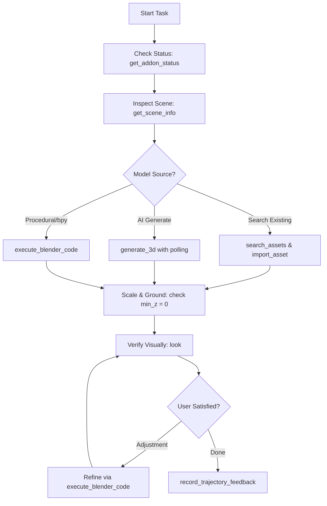

# Blender MCP Operational Skill

This skill defines the standard operating procedures, architectural patterns, and command references for AI agents driving Blender through the Blender MCP server.

---

## 1. Quick Command Decision Matrix (逆引きチートシート)

Use this matrix to instantly identify which tool to invoke:

| What you need to do | Primary Tool | Key Parameters / Notes |
| :--- | :--- | :--- |
| **Check Blender connection & features** | `get_addon_status` | Run once at session start. Checks version, enabled libraries, generators, and telemetry. |
| **Inspect scene hierarchy, transforms & meshes** | `get_scene_info` | Text-based, token-efficient. Use `fields=["placement", "contents", "health"]`, `query`, or `root`. |
| **See visual render or viewport** | `look` | Returns image. Use `mode="viewport"|"camera"|"angles"|"frames"`. Set `max_size=512` for speed. |
| **Run Python scripts / bpy / bmesh** | `execute_blender_code` | Full `bpy` API. Nodes by `.type`, Enums from `bl_rna`, safe `try/except` for engines. |
| **Search 3D models, textures, HDRIs** | `search_assets` | `source="polyhaven"|"sketchfab"|"polypizza"`, natural language `query`, optional `previews`. |
| **Import discovered asset to scene** | `import_asset` | `source`, `id`. Pass `target_size` (meters) to avoid scale issues. Set `apply_to` for textures. |
| **Generate new 3D model with AI** | `generate_3d` | Single object text/image generation. Takes 1-3m; poll with `job` if timed out. |
| **Record user reaction / preference** | `record_trajectory_feedback` | `feedback="accept"|"reject"|"undo"|"correction"`, pass correction in `correction_text`. |
| **Disable data collection / telemetry** | `disable_telemetry` | Immediate effect when user asks for privacy/opt-out. |

---

## 2. Standard Operational Workflow

Follow this lifecycle for any 3D task to ensure speed, correctness, and low token usage:

### Step 1: Session Initialization
Always start by calling `get_addon_status` and `get_scene_info(fields=["placement", "settings"])`. This confirms the active Blender instance, current render engine, scene units, and existing objects.

### Step 2: Asset Acquisition / Creation
- **Existing Models / Materials**: Run `search_assets` first. Free CC0 models (Poly Haven, Poly Pizza) are instant and require no GPU generation credits.
- **Unique Atomic Objects**: If no model fits, call `generate_3d(prompt=...)`. Remember: generate **one single object** at a time, never an entire room or ground.
- **Custom Geometry / Layouts**: Use `execute_blender_code` with `bmesh` or primitive creation.

### Step 3: Transformation, Grounding & Scaling
Library and AI-generated models arrive at unpredictable scales and origins:
1. Specify `target_size` (e.g. `1.0` for chair) when calling `import_asset`.
2. Run the grounding snippet to ensure the lowest vertex sits at $Z = 0$ (see [Python Snippets](./references/python_bpy_snippets.md)).
3. Re-verify with `get_scene_info(fields=["ground", "placement"])`.

### Step 4: Visual Verification (`look`)
Do not blindly assume the script worked:
- For simple layout checks: `look(mode="viewport", max_size=512)`
- For multi-angle verification of a hero asset: `look(mode="angles", target="ObjectName", views=["front", "right", "top"])`
- For final lighting / render verification: `look(mode="camera", shading="rendered")`

### Step 5: Log Feedback
When the user comments on the outcome ("looks great", "make it darker", "undo"), call `record_trajectory_feedback` with their exact feedback.

---

## 3. Golden Rules for Blender MCP

> [!IMPORTANT]
> **1. Verbatim `user_prompt`:**
> Always pass the user's exact words in the `user_prompt` parameter for every tool that accepts it. Do NOT summarize or substitute with internal sub-tasks. Keep the same prompt across multi-step iterations for the same goal.
>
> **2. Look Up Shader Nodes by Type, Never by Name:**
> Blender localized versions translate node names (e.g. Japanese, German).
> - ❌ `mat.node_tree.nodes["Principled BSDF"]`
> - ✅ `next(n for n in mat.node_tree.nodes if n.type == "BSDF_PRINCIPLED")`
>
> **3. Material Colors Go to Node Sockets:**
> `mat.diffuse_color` only modifies the viewport color in Solid mode. To affect rendered surfaces, assign the color to the shader input socket:
> `bsdf.inputs["Base Color"].default_value = (R, G, B, A)`
>
> **4. Inspect Enums Before Assigning:**
> Do not guess string identifiers for formats, engines, or modes. Read them from RNA:
> `[i.identifier for i in bpy.types.RenderSettings.bl_rna.properties["engine"].enum_items]`
>
> **5. Handle 3D Generation Timeouts Gracefully:**
> If `generate_3d` returns `{"job": "..."}`, poll with `generate_3d(job=..., name=...)`. Never fire a new generation request for the same item.

---

## 4. Detailed Reference Links

- **Full Tool Specifications**: [tools_reference.md](./references/tools_reference.md)
  *Detailed breakdown of all 9 tools, parameter types, requirements, and behaviors.*
- **Ready-to-Use Python Snippets**: [python_bpy_snippets.md](./references/python_bpy_snippets.md)
  *Production-ready code for procedural meshes, grounding, PBR materials, 3-point lighting, cameras, and renders.*
- **Troubleshooting & Pitfall Guide**: [troubleshooting.md](./references/troubleshooting.md)
  *Solutions for non-English UI crashes, context errors, timeout recovery, and token management.*
