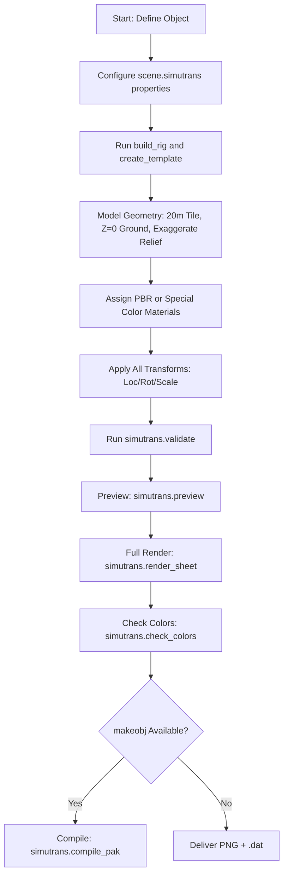

# Simutrans Blender Kit Operational Skill

This skill defines the development standards, API specifications, and automation procedures for creating Simutrans assets using the `simutrans_blender_kit` Blender addon.

---

## 1. Quick Operator & Workflow Decision Matrix

| Task | Operator / Action | Key Script / Notes |
| :--- | :--- | :--- |
| **Configure pakset & object type** | `bpy.context.scene.simutrans` | Set `pakset="pak128"`, `obj_type="building"|"vehicle"|...`, `out_dir=os.path.abspath(...)`. |
| **Setup orthographic camera & sun** | `bpy.ops.simutrans.build_rig()` | Sets up isometric ortho camera and screen-locked sunlight ($60^\circ$ elevation from South). |
| **Generate required collections** | `bpy.ops.simutrans.create_template()` | Creates collections and boundary guides. Safe/idempotent: does not touch user meshes. |
| **Apply all object transforms** | `bpy.ops.object.transform_apply(...)` | **Mandatory before render**: apply location, rotation, and scale to all mesh objects. |
| **Pre-flight scene validation** | `bpy.ops.simutrans.validate()` | Verifies bounding boxes, origin grounding, and missing collections. |
| **Fast preview (1 heading)** | `bpy.ops.simutrans.preview()` | Quick test render of one heading through the final camera/shading pipeline. |
| **8-heading contact preview** | `bpy.ops.simutrans.preview_sheet()` | Renders all 8 headings onto a single labeled contact sheet. |
| **Full render & .dat generation** | `bpy.ops.simutrans.render_sheet()` | Renders all headings, slices and packs sprite sheet PNG, emits companion `.dat`. |
| **Scan for reserved color leaks** | `bpy.ops.simutrans.check_colors()` | Scans output sheet for accidental occurrences of Player Colors 1 & 2, `#E7FFFF`, or night colors. |
| **Night light preview** | `bpy.ops.simutrans.night_preview()` | Simulates in-game night lighting and window illumination. |
| **Update .dat without re-render** | `bpy.ops.simutrans.write_dat()` | Rewrites `.dat` parameters from scene properties instantly. |
| **Compile .pak package** | `bpy.ops.simutrans.compile_pak()` | Runs `makeobj` to compile `.dat` + PNG into game-ready `.pak`. |
| **Insert reusable prop** | `bpy.ops.simutrans.insert_component(...)` | Appends/links a prop from `components/` (AC units, wells, trees, etc.). |

---

## 2. Standard Production Pipeline

---

## 3. Golden Modeling & Rendering Rules

> [!IMPORTANT]
> **1. Scale & Grounding**:
> - $1 \text{ tile} = 20\text{m} \times 20\text{m}$.
> - The origin $(0, 0, 0)$ is the tile center at ground level.
> - The contact surface **must sit flat at $Z = 0.0$**.
> - Standard $1\times 1$ building footprint should stay within **$16\text{m} \times 16\text{m}$ to $18\text{m} \times 18\text{m}$** (except row houses/machiya which can span 20m).
>
> **2. Exaggerated Isometric Relief**:
> - Due to 2:1 dimetric projection (a 20m tile spans **64px horizontally** and 32px vertically in `pak128`), **$1\text{px} \approx 31.25\text{cm}$**.
> - Realistic reliefs under $30\text{cm}$ fall into sub-pixel blur. You must exaggerate shapes to at least $1\text{--}1.5\text{px}$ ($30\text{--}50\text{cm}$):
> - **Window reveals/frames**: Recess panes by $30\text{--}45\text{cm}$; make frames $30\text{--}40\text{cm}$ wide.
> - **Roof eaves & parapets**: Make overhangs and curbs $35\text{--}50\text{cm}$ thick.
> - **Props & equipment**: Air conditioners and tanks should be scaled $1.5\times\text{--}2.0\times$ real size ($1.2\text{--}1.5\text{m}$) for readable silhouettes.
>
> **3. Always Apply Transforms Before Render**:
> Unapplied rotation or scale produces corrupted bounding box calculations and distorted orthographic projections:
> `bpy.ops.object.transform_apply(location=True, rotation=True, scale=True)`
>
> **4. Reserved Colors & Emission Bypass**:
> - Never use transparency key `RGB(231, 255, 255)` (`#E7FFFF`) in textures.
> - Player colors (Blue ramp, Gold ramp) and night window lights must be rendered with unlit **Emission** shaders (or `rig.make_special_color_material`) so Tone Mapping does not shift their exact 15-bit RGB values.
> - Always run `bpy.ops.simutrans.check_colors()` after rendering.
>
> **5. Always Use Absolute Output Paths**:
> Relative paths (`//...`) can fail or resolve outside the project if the `.blend` file has not been saved yet. Always pass `os.path.abspath("output/...")`.
>
> **6. 32x32 Menu Button Icons**:
> For infrastructure and ways (`way`, `way_obj`, `tunnel`, `bridge`, `stop`, `depot`, `signal`), generate a 32x32 menu icon with solid `#fafafa` background, bottom 7px transport color bar, 1px multiply `#8a8a8a` border, and N-S oriented artwork with 1-2px margin.
>
> **7. 128x128 Cursor**
> For infrastructure and ways (`way`, `way_obj`, `tunnel`, `bridge`, `stop`, `depot`, `signal`), use a N-S oriented artwork as a cursor image.

---

## 4. Detailed Reference Links

- **Addon API & Properties Reference**: [addon_api_reference.md](./references/addon_api_reference.md)
  *All properties for buildings, vehicles, ways, bridges, tunnels, signals, and all operators.*
- **Modeling Standards & Isometric Exaggeration**: [modeling_rules.md](./references/modeling_rules.md)
  *Dimensional rules, footprint margins, waterline conventions, and cleanup standards.*
- **Stops, Stations & Platforms (OTRP Diagonal & Slope Standards)**: [stops_and_stations_rules.md](./references/stops_and_stations_rules.md)
  *Single/End/Intermediate geometry, OTRP diagonal 45-deg rotation & 1/sqrt(2) scaling, slope offsets (+48/+64/+80/+96), dims 48/80/112.*
- **Menu Button Icon Specifications (32x32)**: [menu_icon_rules.md](./references/menu_icon_rules.md)
  *Canvas layers, way color bars, blend modes, positioning rules, and PIL/Pillow generation script.*
- **Special Colors, Night Lights & Materials**: [special_colors_and_materials.md](./references/special_colors_and_materials.md)
  *Palette tables, player colors, night lights, emission shader bypass, and color validation.*
- **Workflow Automation Recipes**: [workflow_automation.md](./references/workflow_automation.md)
  *Ready-to-run Python scripts for buildings, vehicles, components, and makeobj compilation.*
