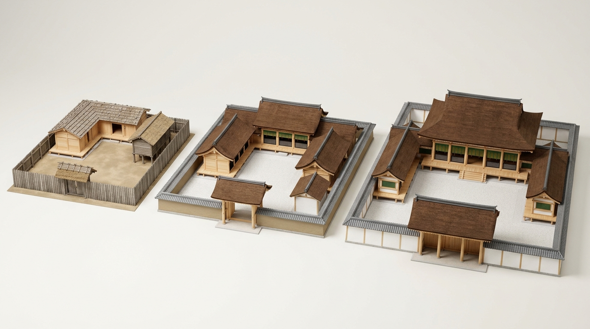
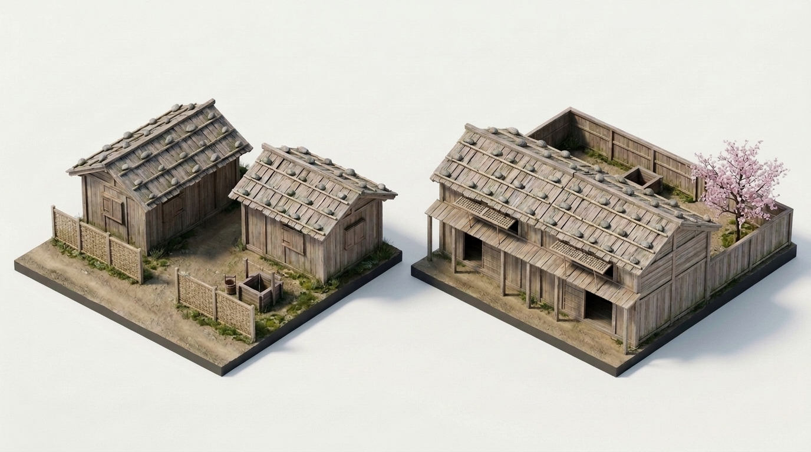
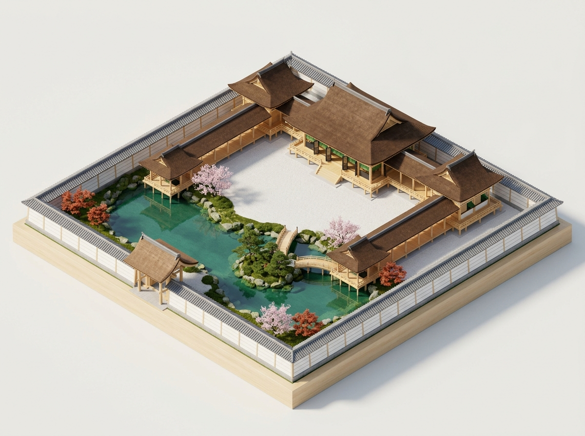
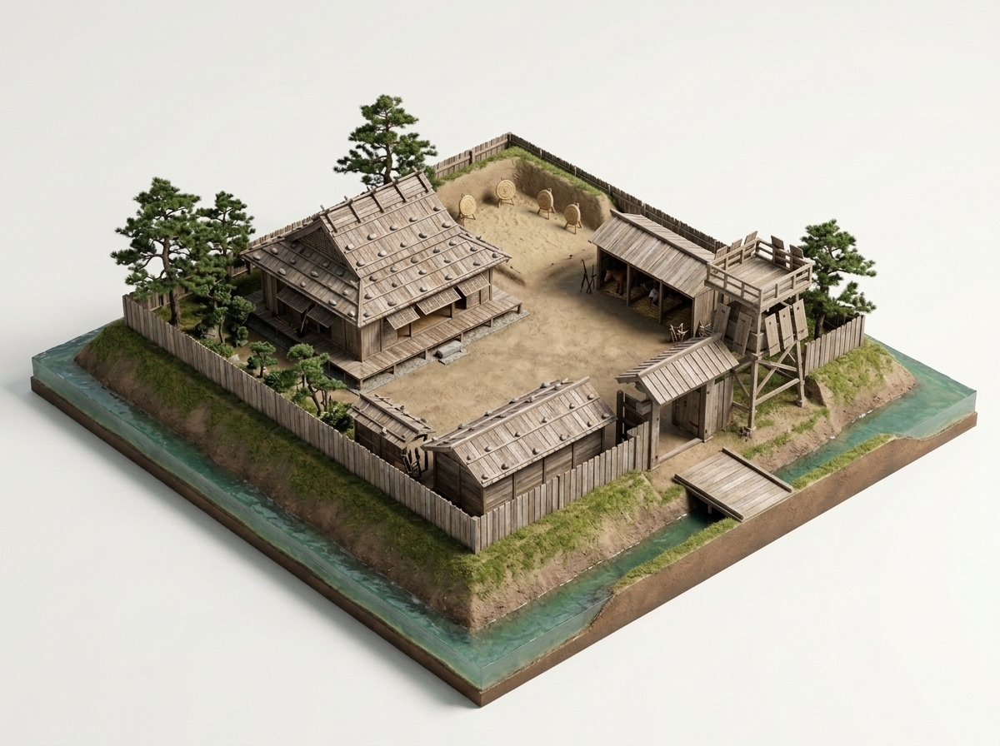
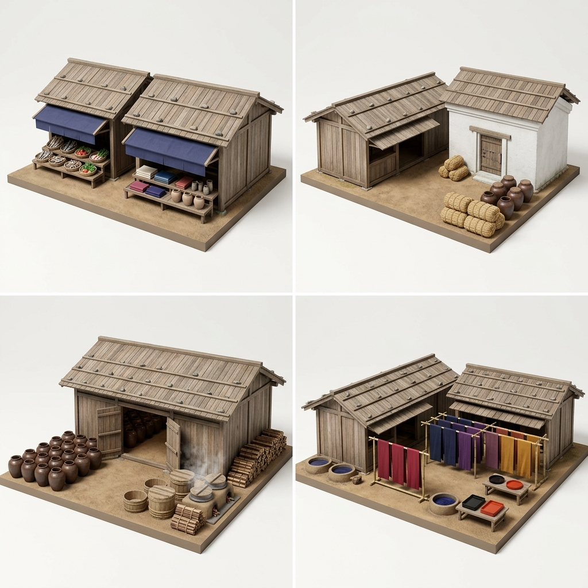

# 平安時代（794–1185年）建築様式調査 ＆ Simutrans「Phase A」設計提案

> [!NOTE]
> 本資料は、既存の奈良時代 Phase A アセット（`1050〜1185年` に順次引退する「青丹よし」の瓦舎赤白建築・郡衙/国庁：[nara_architecture_research.md](./nara_architecture_research.md)）から、遣唐使廃止後の国風文化（檜皮葺・素木・蔀戸・御簾・寝殿造・初期町家）および末期の武士の館へ滑らかに接続するため、絵巻物・発掘成果に基づき整理した **平安 Phase A（16棟）** の建築考証と実装設計書です。

---

## 1. 総論：唐風「青丹よし」から国風文化「檜皮・素木・寝殿造・初期町家」へ

794年の平安京遷都に続く9世紀末（894年の遣唐使廃止）以降、日本建築は大陸直輸入の唐風様式を消化し、日本の気候・風土と貴族・庶民の生活感に根ざした **国風文化（和様建築）** を開花させました。さらに律令制の変質に伴い地方では **荘園公領制（国衙領と荘園）** が成立し、京の市中では条坊区画が緩んで街路に店を構える **初期町家・見世棚** が発達、11〜12世紀末期には地方・都周辺に堀と土塁を構えた **初期武士の館** が登場します。

絵巻物（『年中行事絵巻』『伴大納言絵詞』『信貴山縁起絵巻』『扇面法華経冊子』）および平安京・鎌倉発掘成果にみられる建築コードの変化は以下のとおりです。

### 奈良時代（Phase A） vs 平安時代（Phase A） 造形比較

| 比較項目 | 奈良時代（〜1185年引退）※実装済 | 平安時代（Phase A 実装ターゲット：`820〜1350年`） |
| :--- | :--- | :--- |
| **基本色彩・建具** | 「青丹よし」（**丹塗柱＋白漆喰壁＋緑の連子窓＋本瓦葺**） | **茶褐色の檜皮葺＋無塗装の素木（檜・杉）柱＋黒枠格子「蔀戸（しとみど）」＋深緑の「御簾（みす）」** |
| **政庁・役場 (`tow`)** | 律令制の2段階：`Nara_Gunga`（郡衙・正倉付）＋ `Nara_Kokucho`（国庁） | 荘園公領制＋院政期を反映する **3段階**：**荘園政所・郡司館** → **国府庁・受領政庁** → **平安京・院庁/検非違使庁** |
| **貴族邸宅 (`res`)** | 築地塀・瓦葺主殿＋檜皮葺脇殿・曲水庭園（長屋王邸風） | **寝殿造**（檜皮葺の寝殿＋東西対屋＋透渡殿＋中門廊＋**池上の釣殿と反り木橋・中島付池泉舟遊庭園**） |
| **庶民・町並み (`res`)** | 条坊制1/16町宅地（宅地内に板葺小屋が点在） | 小路裏手の **網代垣・石置き板葺小宅** と、大路沿いの **初期町家（切妻平入・板庇・半蔀・平屋板葺）** |
| **末期地方武家 (`res`)** | 地方豪族・郡司居宅（板塀＋L字掘立柱＋正倉） | **11世紀以降の武士の館**：**水堀＋草葺土塁＋縦板塀＋冠木門・物見櫓**、内に板葺主殿・遠侍・厩・弓場（的） |
| **商業・工芸 (`com`/`ind`)** | 公設の東西市「肆」・官営の造営/写経工房 | 市井の常設 **見世棚店舗**（無地藍の日除け幕・食料/布帛）・**問丸と白壁「塗籠」蔵**・**酒蔵（大甕群）**・**蒔絵漆芸/綾錦染織工房** |

> ※ 江戸時代に普及する「二階建て黒瓦町家」「白漆喰海鼠壁の大型蔵」「文字入り暖簾」「石垣天守」は平安時代にはまだ存在しないため厳密に排除し、すべて **平屋板葺・檜皮葺・素木・初期塗籠** で統一します。

---

## 2. ① 3段階の役場・政庁階層 (`tow` / すべて `2×2`)

ユーザー要望の「郡（荘園）レベル・国（受領）レベル・平安京（朝廷/院庁）レベル」の3階層を、既存の `Nara_Gunga` / `Nara_Kokucho` と同じ **`2×2` サイズ** で統一設計します。これにより都市成長に応じた自動建替え・外観アップデートがスムーズに機能します。

| ID | 日本語名 / 英語名 | サイズ | 期間 | `lv` | `build_time` | 建築構成・歴史的位置づけ |
| :--- | :--- | :---: | :---: | :---: | :---: | :--- |
| `Heian_Shoen_Mandokoro` | 平安の荘園政所・郡司館 (2x2) `Heian Manor Office & Granary (Mandokoro 2x2)` | `2×2` | `850..1350` | `18` | `0` | **郡・荘園レベル**。木柵・縦板塀と素木茅葺冠木門、土間前庭にL字型・石置き板葺の政所舎、年貢稲を納める高床板倉（`Itakura`）を備える。 |
| `Heian_Kokufu_Cho` | 平安の国府庁・受領政庁 (2x2) `Heian Provincial Governor Office (Kokufu 2x2)` | `2×2` | `850..1350` | `24` | `1200` | **国（受領）レベル**（`Nara_Gunga` の後継）。瓦載せ築地塀・四脚門の内に、檜皮葺・素木・黒蔀戸＋深緑御簾の国司正庁と東西脇庁がコの字に並び、白壁の初期塗籠年貢蔵を併設。 |
| `Heian_Incho_Seicho` | 平安京・院庁／検非違使庁 (2x2) `Heian-kyo Imperial Regency Court (Incho 2x2)` | `2×2` | `950..1350` | `32` | `3000` | **平安京・都城最高峰**（`Nara_Kokucho` の後継）。白壁瓦載せ築地塀・八脚門・白砂南庭の正面に、大規模寝殿造様式の檜皮葺正殿と渡廊で結ばれた東西対屋が並ぶ威容。 |

---

## 3. ② 庶民小宅・初期町家（京町家の源流）

平安中期以降、都の左京三条〜七条付近では従来の宅地塀を破って路面に軒先（**板庇**）を張り出し、上下に開閉する**蔀戸・半蔀**を備えた町家が誕生しました（『年中行事絵巻』『病草紙』等）。

| ID | 名称 | 種別 | サイズ | 期間 | `lv` | `chance` | 建築特徴 |
| :--- | :--- | :---: | :---: | :---: | :---: | :---: | :--- |
| `Heian_01_Koya_Nagaya` | 平安京の小宅・板葺長屋 `Heian Commoner Back-Alley Houses` | `res` | `1×1` | `820..1280` | `2` | `100` | `Nara_01` 後継。小路沿いの粗い網代垣・竹柴垣の内に、石置き板葺きの平屋小家屋2棟・土間小路・木枠の共同井戸。 |
| `Heian_02_Early_Machiya` | 平安の初期町家（板葺平入） `Heian Early Machiya Rowhouse` | `res` | `1×1` | `880..1350` | `3` | `95` | 通りに直接面する切妻平入・石置き板葺の平屋町家。前面の板庇下に半蔀（はじとみ）と板戸、背後に板塀で囲った坪庭・井戸・桜一株。 |

---

## 4. ③ 貴族邸宅と寝殿造の完成（受領屋敷〜摂関家大寝殿造）

貴族層には奈良瓦舎から **檜皮葺＋素木＋黒蔀戸＋深緑御簾＋簀子縁** への和様洗練を反映し、最高位の **`2×2`** では平安貴族文化の頂点である池泉舟遊庭園を備えた **大寝殿造** を表現します。

| ID | 名称 | 種別 | サイズ | 期間 | `lv` | `chance` | 建築特徴 |
| :--- | :--- | :---: | :---: | :---: | :---: | :---: | :--- |
| `Heian_03_Zuryo_Yashiki` | 平安の中級貴族・受領屋敷 `Heian Mid-Rank Noble Residence` | `res` | `1×1` | `850..1300` | `5` | `90` | 簡素な築地塀/板塀＋檜皮門の内に、茶褐色檜皮葺・素木簀子縁のL字屋敷と遣水小庭・桜橘。 |
| `Heian_04_Shinden_Teitaku` | 平安の寝殿造小邸宅 `Heian Compact Shinden Residence` | `res` | `1×1` | `900..1300` | `6` | `85` | 瓦載せ築地塀と四脚門を備えた `1×1` 上級住宅。檜皮葺主殿に黒枠蔀戸・緑御簾、白砂前庭と紅葉・松。 |
| `Heian_06_Shinden_2x1` | 平安の上級貴族・寝殿造邸宅 (2x1) `Heian Senior Aristocrat Shinden (2x1)` | `res` | `2×1` | `900..1320` | `8` | `75` | 築地塀・檜皮四脚門の内に、檜皮葺寝殿＋東対屋＋渡殿、白砂南庭と遣水・小池泉・松/桜を横長2タイルに展開。 |
| `Heian_07_Dai_Shinden_2x2` | 摂関家・大寝殿造邸宅 (2x2) `Heian Regent Grand Shinden Estate (2x2)` | `res` | `2×2` | `920..1320` | `10` | `65` | **東三条殿・土御門殿モデル**。築地塀内に寝殿＋東西対屋＋透渡殿＋白砂南庭を構え、南下する中門廊先端に池上の **釣殿**、前面の **池泉舟遊庭園** に松島と素木反り木橋・桜紅葉を配置。 |

---

## 5. ④ 平安末期の初期武士の館（鎌倉武家屋敷への橋渡し）

11世紀半ば以降、在地領主層・武士団の居館は方形区画の周囲に **水堀と土塁・板塀** を巡らし、入り口に楯を並べた **冠木門と木造物見櫓**、館内に厩と弓射の的場（`矢場`）を設ける防御的性格を強めます。

| ID | 名称 | 種別 | サイズ | 期間 | `lv` | `chance` | 建築特徴 |
| :--- | :--- | :---: | :---: | :---: | :---: | :---: | :--- |
| `Heian_05_Bushi_Yakata_2x1` | 平安末期の武士の館 (2x1) `Late Heian Warrior Manor (Bushi Yakata 2x1)` | `res` | `2×1` | `1020..1350` | `6` | `70` | 水堀＋芝付土塁＋縦板塀・木橋・冠木門＋楯付物見櫓、館内に板葺主殿・遠侍・馬屋・砂地の弓場（藁的3基）と松木立（鎌倉初期まで自然存続）。 |

---

## 6. ⑤ 都市商業・酒蔵・国風工芸工房（見世棚・問丸・酒蔵・漆芸・染織）

東西市の衰退後に京の三条・四条・七条通りへ展開した常設店舗「**見世棚**」に加え、ご要望のとおり **食料品系小売店舗**、規模の大きい **`2×1` マルチタイル問丸蔵屋敷・造酒蔵（酒蔵）・綾錦染織工房** を組み込みました（計6棟：`com` 3種＋`ind` 3種）。

| ID | 名称 | 種別 | サイズ | 期間 | `lv` | `chance` | 建築・情景の特色 |
| :--- | :--- | :---: | :---: | :---: | :---: | :---: | :--- |
| `Heian_08_Shokuryo_Misedana` | 平安の食料・魚青物見世棚 `Heian Food & Produce Misedana Shop` | `com` | `1×1` | `880..1350` | `4` | `95` | 街路向きの平屋板葺町家。傾斜した木製**見世棚**に干魚・青菜・米籠・曲物を並べ、無地藍布の短い日除け幕を張る食料小売店。 |
| `Heian_09_Gofuku_Misedana` | 平安の布帛・器物見世棚 `Heian Cloth & Ware Misedana Shop` | `com` | `1×1` | `900..1350` | `5` | `85` | 見世棚に折り畳んだ絹麻の反物（藍・紅・生成）と陶器壺・漆椀を並べる雑貨・呉服原型店舗（裏に小板倉）。 |
| `Heian_10_Toimaru_Kura_2x1` | 平安の問丸・塗籠蔵屋敷 (2x1) `Heian Toimaru Merchant & Nurigome (2x1)` | `com` | `2×1` | `950..1350` | `8` | `65` | 年貢物・唐物・諸国物産を集散する大商家の卸売複合施設。板葺帳場屋敷、積まれた稲俵と大壺のある荷捌き土間、厚い白壁の初期耐火蔵「**塗籠（ぬりごめ）**」2棟。 |
| `Heian_11_Sakagura_2x1` | 平安の酒蔵・造酒工房 (2x1) `Heian Sake Brewery Complex (Sakagura 2x1)` | `ind` | `2×1` | `900..1400` | `7` | `70` | 平安中〜末期に急速に発展した都市・寺院系の造酒工房（13世紀の「造酒司・洛中酒麹役」の原型）。広大な板葺発酵・麹室棟、庭に並ぶ**大量の暗褐色大甕（おおがめ）群**、木製大桶、かまど蒸し釜と薪束山。 |
| `Heian_12_Urushi_Kobo` | 平安の蒔絵・漆芸工房 `Heian Maki-e Lacquerware Workshop` | `ind` | `1×1` | `880..1350` | `5` | `90` | 平安国風工芸の粋「蒔絵・漆器」工房。板葺/檜皮葺細工棟＋庭の木製乾燥台に並ぶ黒漆/朱漆の椀・文箱（将来の Phase D 漆器チェーンと連携）。 |
| `Heian_13_Someori_Kobo_2x1` | 平安の綾錦・染織工房 (2x1) `Heian Silk Weaving & Dyeing Workshop (2x1)` | `ind` | `2×1` | `880..1350` | `6` | `75` | 織部司・大舎人町（西陣の源流）型の大規模工房。機織り棟2棟＋日向の庭に林立する**赤・深藍・紫・山吹色の反物干し枠**と埋め込み式**藍甕（あいがめ）群**。 |

---

## 7. ⑥ Simutrans「平安 Phase A（16棟）」設計まとめ ＆ 実装前確認事項

### 全16棟パラメータ・格納フォルダ計画一覧

| # | フォルダ (`buildings/`) | ID | 種別 | サイズ | 導入..引退 | `lv` | `ch` | `bt` | 後継対象（奈良 Phase A 等） |
| :-: | :--- | :--- | :---: | :---: | :---: | :---: | :---: | :---: | :--- |
| 1 | `tow/heian_shoen_mandokoro` | `Heian_Shoen_Mandokoro` | `tow` | `2×2` | `850..1350` | `18` | `100` | `0` | 地方荘園・郡レベル基盤 |
| 2 | `tow/heian_kokufu_cho` | `Heian_Kokufu_Cho` | `tow` | `2×2` | `850..1350` | `24` | `100` | `1200` | `Nara_Gunga (lv=16, 1050引退)` 後継 |
| 3 | `tow/heian_incho_seicho` | `Heian_Incho_Seicho` | `tow` | `2×2` | `950..1350` | `32` | `100` | `3000` | `Nara_Kokucho (lv=24, 1185引退)` 後継 |
| 4 | `city_buildings/44_heian_koya_nagaya` | `Heian_01_Koya_Nagaya` | `res` | `1×1` | `820..1280` | `2` | `100` | — | `Nara_01_Heijo_Nagaya (1100引退)` 後継 |
| 5 | `city_buildings/45_heian_early_machiya` | `Heian_02_Early_Machiya` | `res` | `1×1` | `880..1350` | `3` | `95` | — | 通り沿い町家新規帯 |
| 6 | `city_buildings/46_heian_zuryo_yashiki` | `Heian_03_Zuryo_Yashiki` | `res` | `1×1` | `850..1300` | `5` | `90` | — | `Nara_02/03 (1050/1150引退)` 後継 |
| 7 | `city_buildings/47_heian_shinden_teitaku` | `Heian_04_Shinden_Teitaku` | `res` | `1×1` | `900..1300` | `6` | `85` | — | `Nara_04 (1185引退)` 後継 |
| 8 | `city_buildings/48_heian_bushi_yakata_2x1` | `Heian_05_Bushi_Yakata_2x1` | `res` | `2×1` | `1020..1350` | `6` | `70` | — | 平安末〜鎌倉武家屋敷橋渡し |
| 9 | `city_buildings/49_heian_shinden_2x1` | `Heian_06_Shinden_2x1` | `res` | `2×1` | `900..1320` | `8` | `75` | — | `Nara_05_Kizoku_Teitaku_2x1` 後継 |
| 10 | `city_buildings/50_heian_dai_shinden_2x2` | `Heian_07_Dai_Shinden_2x2` | `res` | `2×2` | `920..1320` | `10` | `65` | — | `Nara_06_Kizoku_Shuden_2x2` 後継 |
| 11 | `city_buildings/51_heian_shokuryo_misedana` | `Heian_08_Shokuryo_Misedana` | `com` | `1×1` | `880..1350` | `4` | `95` | — | 食料小売店舗・新規 |
| 12 | `city_buildings/52_heian_gofuku_misedana` | `Heian_09_Gofuku_Misedana` | `com` | `1×1` | `900..1350` | `5` | `85` | — | `Nara_07_Tozai_Ichi (1100引退)` 後継 |
| 13 | `city_buildings/53_heian_toimaru_kura_2x1` | `Heian_10_Toimaru_Kura_2x1` | `com` | `2×1` | `950..1350` | `8` | `65` | — | `Nara_08_Ichinotsukasa (1050引退)` 上位後継 |
| 14 | `city_buildings/54_heian_sakagura_2x1` | `Heian_11_Sakagura_2x1` | `ind` | `2×1` | `900..1400` | `7` | `70` | — | 都市・洛中酒蔵新規 |
| 15 | `city_buildings/55_heian_urushi_kobo` | `Heian_12_Urushi_Kobo` | `ind` | `1×1` | `880..1350` | `5` | `90` | — | `Nara_09_Zoei_Kobo (1100引退)` 後継 |
| 16 | `city_buildings/56_heian_someori_kobo_2x1` | `Heian_13_Someori_Kobo_2x1` | `ind` | `2×1` | `880..1350` | `6` | `75` | — | `Nara_10_Shakyo_Kobo (1100引退)` 上位後継 |

### 技術仕様（Blender 5.2 制作方針）
- 全16棟とも **5季節（冬/春/夏/秋/雪）・4向き（`dims=X,Y,4`）・`needs_ground=1`・予約色ゼロ（`reserved={}`）**、`tree_lib` の桜・紅葉・松・杉により季節変化を表現します。
- 共通モジュール（奈良用 `nara_arch_common.py` をベースに、**黒枠蔀戸・深緑御簾・白壁塗籠・無地藍布幕・反物染め色・大甕群** を備えた `heian_arch_common.py`）でシームレス外周と精度高いマルチタイル分割を実現します。

### 実装（Blender モデリング）着手前の確認事項
1. **役場3階層 (`tow`) のレベルと `build_time`**: 荘園政所 (`lv=18, bt=0`) / 国府庁 (`lv=24, bt=1200`) / 院庁・検非違使庁 (`lv=32, bt=3000`) の出現段階差で問題ないでしょうか？
2. **マルチタイル展開（全16棟中 7棟が `2×1` / `2×2`）**: 上記の `Heian_10_Toimaru_Kura_2x1`（問丸・塗籠蔵）、`Heian_11_Sakagura_2x1`（酒蔵）、`Heian_13_Someori_Kobo_2x1`（綾錦染織工房）、および `Heian_08_Shokuryo_Misedana`（食料見世棚）の構成・サイズ感に修正点はありますか？
3. 問題なければこのまま **Blender モデリング実装・レンダリング検証・ビルド統合** へ進みます！

---

## 8. 実装結果（Phase A 完了メモ）

- **事前チェックポイント**: Phase A 実装開始前にここまでの進捗（古墳 Phase 1–3・奈良 Phase A–D・`tree_lib.py`・平安事前調査）をコミット `55f349a`（515 files changed）として `origin/main` へプッシュ済み。
- **造形・レンダリング実績（Blender 5.2.2 LTS）**:
  - 共通モジュール `heian_arch_common.py`（`nara_arch_common.py` ＋ `nara_phaseC_helpers.py` 継承拡張）により、全16棟を **5季節（冬/春/夏/秋/雪）・4向き・`needs_ground=1`・予約色ゼロ (`reserved={}`)** で出力（計 **740スプライト**：`2×2` ×4棟×100 ＋ `2×1` ×5棟×40 ＋ `1×1` ×7棟×20）。
  - プレビュー目視検証で抽出した5点（檜皮葺入母屋隅棟の連続曲線仕上げ、`Heian_01_Koya_Nagaya` の2棟分離・庇干渉解消、`Heian_03_Zuryo_Yashiki` の階段・遣水干渉解消、`Heian_07_Dai_Shinden_2x2` の西中門亭追加、`Heian_08/09/10` 見世棚の藍布日除け位置補正＆問丸の塗籠蔵2棟とも正面扉化）を修正・再レンダリング済み。
- **Excel 登録 ＆ フルビルド検証**:
  - [parameters.xlsx](../buildings/parameters.xlsx) の `R102..R117` へ全16棟を登録し、`ruby scripts/make.rb makedat makeobj merge tab` を正常終了（exit `0`）。
  - 個別ステージング `.pak` 16種すべてが `makeobj LIST` 通過、`.dat` パラメータ（`type`/`dims`/`level`/`chance`/`intro_year`/`retire_year`/`build_time`）16/16 一致、`build/JP_Historical_all.pak`（`94,418,687` bytes）および `build/text/ja.historical.tab`（`18,719` bytes）・`build/text/en.tab`（`18,173` bytes）への全16 ID 収録を確認。
