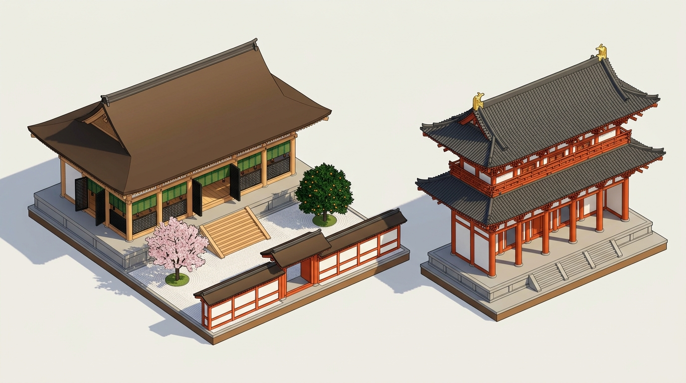
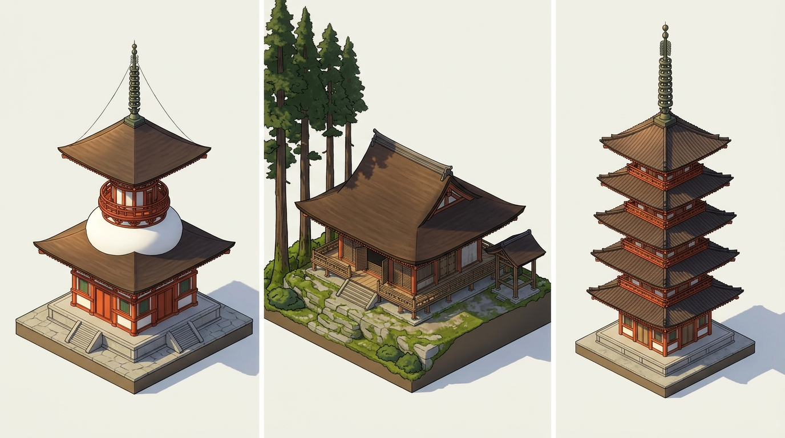
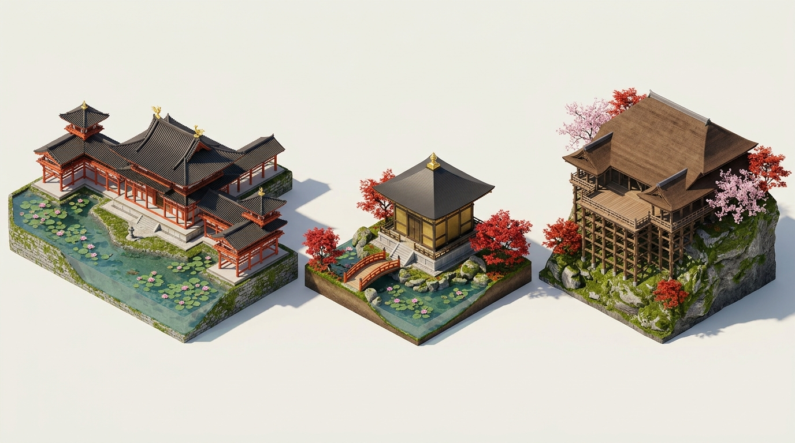
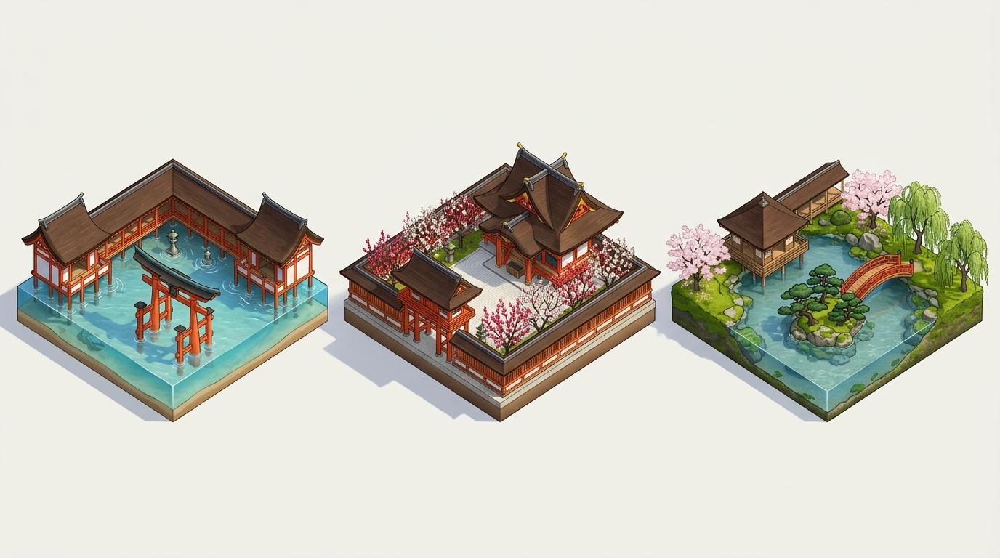

# 平安時代（794–1185年）宮都・密教・浄土教・神社庭園ランドマーク調査 ＆ Simutrans「Phase C」実装結果

> [!NOTE]
> 本資料は、既存の奈良時代 Phase C（[nara_cur_phaseC_research.md](./nara_cur_phaseC_research.md)）に続く **平安 Phase C** の調査・設計・最終実装仕様です。レビュー・実機確認結果を反映し、**全12アセット（`buildings/cur/` 9種 ＋ `stations/` 道路通過・接続型ゲート／回廊 `stop` 3種）**、**自己完結 1×1 道路 `stop` 版・羅城門**、および **奈良 Phase A 市内建築・国庁・郡衙を含む全建築物の妻面（濃茶木連格子＋破風板・懸魚）刷新** を実装・ビルド検証済みです。

---

## 1. レビュー・改修確定方針と実装スコープ

| 分類 | 確定内容 | 備考 |
| :--- | :--- | :--- |
| **内裏（紫宸殿・清涼殿）** | **宮殿モジュール 2種（`49..50_*`, `cur`）** | 紫宸殿（3×2）・清涼殿/後宮殿舎（2×1）。紫宸殿に額縁・渡殿接続端を備え、周辺の道路回廊・門と組み合わせて宮城を構成可能。 |
| **内裏門・内裏回廊** | **飛鳥寺院型の道路 `way` `stop` 2種** | `Heian_Dairi_Mon_Stop`（`dims=1,1,16` 2パス Holdout 道路門）および `Heian_Dairi_Kairo_Stop`（`dims=1,1,112` 20形状・直線/角/T字/十字/坂道対応の連続回廊）。 |
| **羅城門** | **自己完結 `1×1` 道路通過型 `stop` へ再構築** | `1×3` 穴開き構成から両翼棟（`54_heian_rajomon_wing`）を廃止・削除し、単体完結型の `Heian_Rajomon_Center_Stop`（`type=stop`, `waytype=road`, `dims=1,1,16` 重層入母屋）として再構築。単一 `z=0`・2パス Holdout により道路上へ直接建設・車両通過可能。 |
| **密教・浄土寺院・神社庭園** | **7種を実装（`55..61_*`, `cur`）** | 多宝塔・山岳本堂・醍醐寺五重塔・平等院鳳凰堂（4×2）・金色堂阿弥陀堂・天満宮神社・池泉庭園別業（釣殿付）。 |
| **屋根妻面（`妻面`）の刷新** | **奈良 Phase A〜D・平安 全対象建築へ適用** | 瓦葺屋根（`kawara`）の妻面も白壁から濃茶の `木連格子`（`tsuma_kirengoshi.png`＋`wood_dark` 破風・軒裏・3D縦格子）へ変更し、未更新だった奈良 Phase A 全15種（郡衙・国庁・平城京町屋/貴族邸宅/主殿/市/工房・神社）も一括再レンダリング。 |
| **懸造り・海上社殿** | **見送り（対象外）** | 清水寺（地形制約）および厳島神社（海上立地制約）は Phase C スコープから除外。 |
| **室津・賀茂神社** | **調査・コンセプト図版のみ（未実装）** | [murotsu_kamo_shrine_research.md](./murotsu_kamo_shrine_research.md) に独立ドキュメントとして整理。 |

---

## 2. コンセプト図版 ＆ 実装アセット一覧（全12種）

### ① 宮都モジュール：内裏殿舎 2種（`cur`）＋ 道路通過型ゲート・連続回廊 3種（`stop`）

| ID | 種別 | ディレクトリ | サイズ / 方位 | 期間 | 主要パラメータ | 建築仕様・特徴 |
| :--- | :---: | :--- | :---: | :---: | :---: | :--- |
| `Heian_Dairi_Shishinden` | `cur` | `buildings/cur/49_heian_dairi_shishinden` | `3×2` | `794..1500` | `lv=26`, `bt=30000`, `ch=5` | 檜皮葺入母屋（木連格子妻面・破風板・懸魚・破風金具）・額縁付・素木檜柱・跳ね上げ蔀戸と緑御簾・南庭白砂＋左近の桜/右近の橘。 |
| `Heian_Dairi_Seiryoden` | `cur` | `buildings/cur/50_heian_dairi_seiryoden` | `2×1` | `794..1500` | `lv=18`, `bt=30000`, `ch=5` | 内裏殿舎モジュール。両側に渡殿接続端と坪庭の桜を備えた `2×1` 殿舎。 |
| `Heian_Dairi_Mon_Stop` | `stop` (`road`) | `stations/heian_dairi_mon_stop` | `1×1` (`dims=1,1,16`) | `794..1500` | `lv=6`, `cap=48`, `cost=7500`, `m=28`, `enables_pax=1` | 飛鳥・中門と同方式の道路通過型内裏門。`BackImage` + `FrontImage` 2パス Holdout 描画。 |
| `Heian_Dairi_Kairo_Stop` | `stop` (`road`) | `stations/heian_dairi_kairo_stop` | `1×1` (`dims=1,1,112`) | `794..1500` | `lv=4`, `cap=32`, `cost=2500`, `m=18`, `enables_pax=1` | 飛鳥・回廊（`asuka_corridor_stop`）と同方式の道路上連続回廊（20形状：直線/角/T字/十字/坂道・降雪対応・112スロット割当）。 |
| `Heian_Rajomon_Center_Stop` | `stop` (`road`) | `stations/heian_rajomon_center_stop` | `1×1` (`dims=1,1,16`) | `794..1050` | `lv=8`, `cap=80`, `cost=18000`, `m=55`, `enables_pax=1, post=1, ware=1` | 自己完結 1×1 重層入母屋・道路通過型羅城門（`BackImage` + `FrontImage` 2パス Holdout、16方位）。木連格子妻面・連子窓・扁額・上層高欄・鴟尾を完備。 |

---

### ② 密教寺院・浄土教寺院・神社庭園（7種：`buildings/cur/55..61_*`）

| ID | ディレクトリ | サイズ | 期間 | `lv` | `bt` / `chance` | 建築構成・造形仕様 |
| :--- | :--- | :---: | :---: | :---: | :---: | :--- |
| `Heian_Tahoto_Pagoda` | `buildings/cur/55_heian_tahoto_pagoda` | `1×1` | `820..1800` | `12` | `2500` / `35` | 方形1重目＋檜皮裳階、白い半球「亀腹」漆喰ドーム、円形上層と宝形屋根＋相輪。 |
| `Heian_Mikkyo_Hondo` | `buildings/cur/56_heian_mikkyo_hondo` | `3×2` | `810..1700` | `16` | `3500` / `30` | 苔境内に建つ懸架縁・向拝付の巨大檜皮葺入母屋本堂＋鐘楼＋杉木立（高木）。 |
| `Heian_Daigoji_Gojunoto` | `buildings/cur/57_heian_daigoji_gojunoto` | `1×1` | `951..1800` | `14` | `12000` / `15` | 緩やかな檜皮葺5重屋根と長大な金銅相輪を備えた醍醐寺様式五重塔（縦2タイル分割）。 |
| `Heian_Byodoin_Hoodo` | `buildings/cur/58_heian_byodoin_hoodo` | `4×2` | `1053..1800` | `28` | `30000` / `5` | 阿字池＋太鼓橋の奥に二重中堂（金鳳凰）・左右翼廊＆隅楼閣・尾廊を配した鳳凰堂伽藍。 |
| `Heian_Konjikido_Amidadou` | `buildings/cur/59_heian_konjikido_amidadou` | `2×2` | `1100..1700` | `16` | `4500` / `25` | 金箔張り柱壁と黒漆扉・宝珠戴く宝形屋根を石壇と杉・紅葉の境内に構えた阿弥陀堂。 |
| `Heian_Tenmangu_Shrine` | `buildings/cur/60_heian_tenmangu_shrine` | `2×2` | `947..1800` | `10` | `1800` / `45` | 朱塗明神鳥居・四脚門・築地塀の内に拝殿・石の間・流造本殿（千木/鰹木）と桜梅林を配置。 |
| `Heian_Shinden_Garden_Villa` | `buildings/cur/61_heian_shinden_garden_villa` | `2×2` | `980..1500` | `12` | `2200` / `40` | 檜皮葺寝殿と中門廊、池面上の釣殿、中島の松と反り橋を備えた貴族池泉舟遊庭園別業。 |

---

## 3. 屋根妻面（`妻面`）テクスチャ・3D構造の全面改修（奈良・平安全建築）

実例写真に基づき、共通建築ビルダー（`nara_arch_common.py` / `heian_arch_common.py`）の屋根・妻面生成処理を更新したうえで、未反映だった **奈良 Phase A 全15種（郡衙・国庁・市内建築・神社）** を含む対象全建築を再レンダリングした。

- **新規妻面テクスチャ（`512×256`, `Texture/` 配下）**:
  - [tsuma_kirengoshi.png](../Texture/tsuma_kirengoshi.png): 濃茶木連格子（縦格子＋上部入母屋陰影）。檜皮葺（`hiwada`）および本瓦葺（`kawara`）の双方に使用。
  - [tsuma_plaster_beam.png](../Texture/tsuma_plaster_beam.png): 漆喰妻壁＋妻梁/虹梁・蟇股。
  - [tsuma_plank.png](../Texture/tsuma_plank.png): 縦板張り＋貫板妻面（`itabuki`・`thatch` 屋根等に使用）。
- **3D造形・陰影強化**:
  - 妻面ポリゴンの内込み配置、濃茶木部の軒裏（ソフィット）、曲線状の破風板（`Hafu`）、妻梁/虹梁、立体懸魚（`Gegyo`）、破風金具（`Hafu-kanagu`）、中型以上妻面（`t_span >= 0.48, z_span >= 0.16`）への 3D 木連格子縦桟・貫を追加。

---

## 4. ビルド・検証結果

- 旧 `cur` 4種（`buildings/cur/51_heian_dairi_mon`, `52_heian_dairi_kairo_straight`, `53_heian_dairi_kairo_corner`, `54_heian_rajomon_wing` および対応 `.pak`）を削除し、[buildings/parameters.xlsx](../buildings/parameters.xlsx)（Phase C `cur` 9種：行126–134）および [stations/parameters.xlsx](../stations/parameters.xlsx)（Phase C 道路 `stop` 3種：行36–38）を更新。
- `build_nara_phaseA.py`（15種）を含め、対象となる奈良・平安全建築について `reserved={}`（Simutrans 予約色漏れゼロ）、道路ゲート `stop`（`Heian_Rajomon_Center_Stop` の `TOP_Y=31px` 上端余白確認、`Heian_Dairi_Mon_Stop`, `Nara_Rajomon_Stop`, `Nara_Bomon_Stop`）の 2パス Holdout を確認済み。
- `ruby scripts/make.rb makedat makeobj merge tab` を実行し、新規警告・エラーゼロ（既知の `Ancient_Tsu_*` / `Yayoi_*` の `waytype` 警告6件のみ）でビルド完了。
- 統合パックス: `build/JP_Historical_all.pak`（`120,103,987 bytes`）、ステージング `.pak` 数 `279`、`verify_heian_pC.rb`・`verify_heian_pD.rb` とも `0 errors` で通過。
