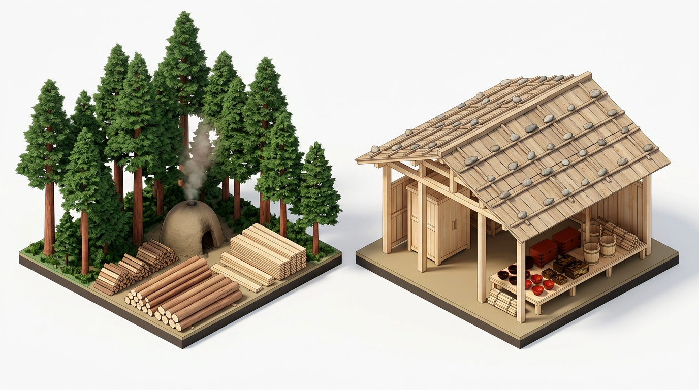
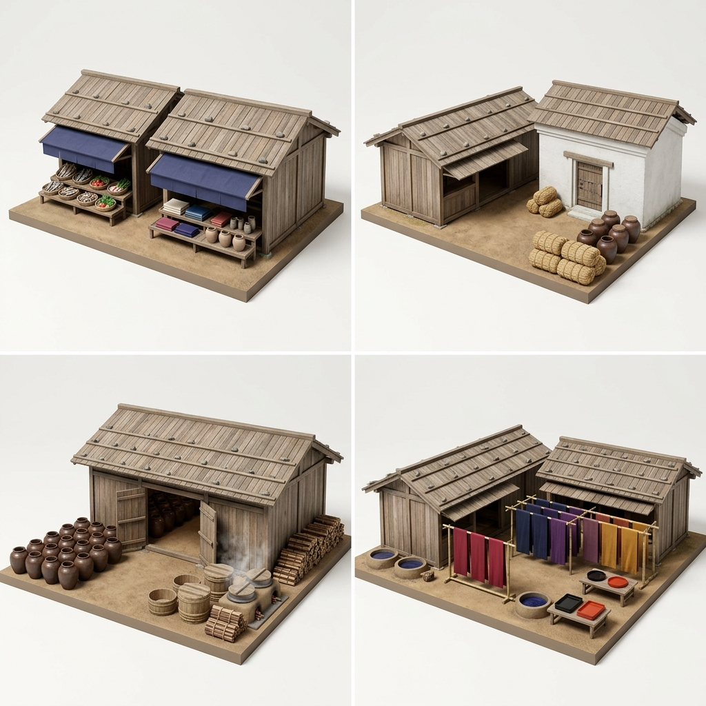
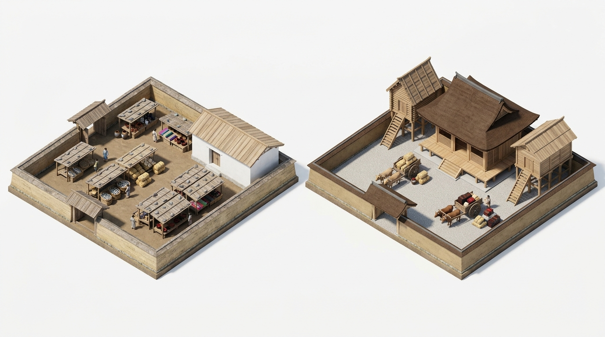
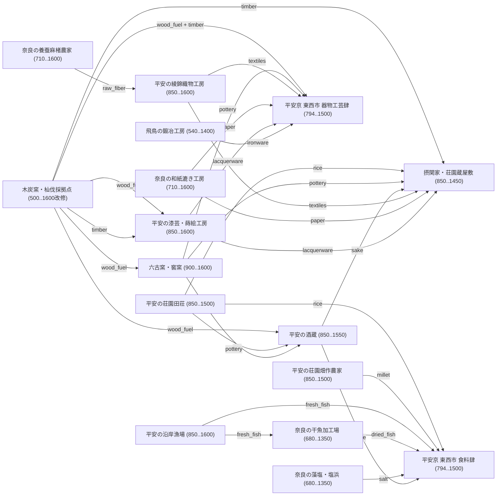

# 平安時代（794–1185年）産業・流通・フィールド刷新調査 ＆ Simutrans「Phase D」設計計画

> [!NOTE]
> 本資料は、完了済みの **Phase A（[平安時代建築様式調査](./heian_architecture_research.md)）**・**Phase B（[平安時代交通・車両・橋梁調査](./heian_transport_phaseB_research.md)）** に続き、平安時代の生産・加工・消費チェーンおよび **植林地・水田・畑ビルボードフィールド** を構築する **Phase D（産業・貨物）** の事前時代考証・技術検証・Simutrans 実装仕様案です。  
> *(専用図版のうち「荘園田荘・六古窯」図版1点のみ画像生成サーバー容量エラー `HTTP 503` のため保留とし、既存の [`heian_05_commerce_crafts.png`](./images/heian_05_commerce_crafts.png) も併せて参照しています。)*

---

## 1. 時代考証：平安経済への移行と 1185〜1200年引退ギャップ

### 1-1. 律令経済から荘園公領制・国風工芸への転換

奈良時代（平城京・律令国家）の中央集権的な「調・庸・官営東西市」体制は、平安時代（794–1185年）を通じて以下のように再編されました。

1. **荘園公領制と年貢・公事の蔵屋敷流通**:
   - 墾田永年私財法以降に拡大した初期荘園は、10〜11世紀の寄進地系荘園の成立によって貴族（摂関家）・大寺社を本所・領家とする広域経済網へと発展しました。
   - 荘園の現地拠点である **田荘（たどころ）・荘園政所** で徴収された **年貢（米・雑穀）・公事（布帛・和紙・漆器・陶器・材木・清酒）** は、水上交通（淀川・琵琶湖・瀬戸内海）や駄馬（馬借）・車借を経て都へ運ばれ、貴族邸宅付属や津の **蔵屋敷（倉敷）・倉代** に集積されました。
2. **国風工芸（漆芸・窯業・綾錦・酒蔵）の成熟**:
   - 唐風模倣を脱し、**蒔絵（平蒔絵・研出蒔絵）・螺鈿** といった和様漆工芸が貴族調度・寺社荘厳具として頂点に達しました（正倉院の唐風漆器から『延喜式』内匠寮・中世漆器産地への橋渡し）。
   - 窯業では従来の須恵器（還元炎灰釉陶）から、常滑・瀬戸・信楽・越前・丹波・備前へと連なる **六古窯・中世山茶碗窯**（無釉・自然灰釉の大型窖窯による甕・壺・鉢の大量生産）が平安後期（10〜12世紀）に勃興しました。
   - 酒造は『延喜式』造酒司に見られる澄酒・濁酒・麹室技術を経て、平安中後期には寺社・京都柳酒屋の源流となる土間大甕＋麹室を備えた **酒蔵** へ拡大しました。
3. **肉食禁忌（殺生禁断令）の定着**:
   - 天武朝以来の殺生禁断令や『延喜式』の触穢観、浄土信仰・仏教倫理の浸透により、平安貴族・都市社会では獣肉（特に四足動物）の公的な市場流通と食用加工が忌避・縮小しました。これに伴い、古代の干し肉加工所（`Ancient_Meat_Curing_Workshop`）は **1200年で後継施設を設けず自然引退** とするのが歴史的に妥当です。
4. **建築様式の平安基準（時代考証ガードレール）**:
   - Phase D すべての施設において、**檜皮葺（貴族蔵屋敷・政所）・石置き板葺（町家市・工房・田荘・酒蔵）・素木檜造・築地塀・土塁板塀・初期白漆喰の塗籠（ぬりごめ）** を徹底します。
   - 江戸期以降の要素（**海鼠壁・二階建て黒瓦葺町家・文字入り大暖簾・切石積み高石垣**）や明治以降の近代造語は一切使用しません。

### 1-2. 現行パックにおける 1185〜1200年引退ギャップ棚卸し

[Industries/parameters.xlsx](../Industries/parameters.xlsx) および [産業チェーンまとめ.md](../産業チェーンまとめ.md) を監査した結果、奈良〜飛鳥・弥生系の主要産業が一斉に **1185年または1200年で引退** するため、以下の通り平安後継施設へ世代交代・機能統合を行います。

| 既存施設 (`name`) | 現行期間 | 出力 / 役割 | 引退・承継上の課題 | Phase D での対応方針 |
| :--- | :---: | :--- | :--- | :--- |
| `Asuka_Suiden_Factory` | `600..1200` | `rice`（水田） | **1200年で米供給が停止** | **`Heian_Shoen_Rice_Manor`**（`850..1500`）＋ビルボード型新水田フィールド（8クラス）へ世代交代 |
| `Kofun_Asuka_Dryfield_Farm` | `400..1200` | `millet`（雑穀） | **1200年で雑穀供給が停止** | **`Heian_Shoen_Dryfield_Farm`**（`850..1500`）＋ビルボード型新畑フィールド（8クラス）へ世代交代 |
| `Asuka_Sake_Brewery` | `600..1200` | `sake`（酒） | **1200年で酒供給が停止** | **`Heian_Sakagura_Brewery`**（`850..1550`, `2x2` 大甕酒蔵・麹室）へ世代交代 |
| `Yayoi_Fishing_Ground` | `1..1200` | `fresh_fish` | **1200年で海産供給が完全停止** | **`Heian_Coastal_Fishery`**（`850..1600`, `water`, `2x2` 定置網・漁船群）へ世代交代 |
| `Nara_Tozai_Market_Food` | `710..1185` | `city`（食料消費） | **1185年**（飛鳥食料市も `1200` 引退） | **`Heian_Tozai_Market_Food`**（`794..1500`, `city`, `2x2`, `cured_meat` 除外）へ世代交代 |
| `Nara_Tozai_Market_Craft` | `710..1185` | `city`（工芸消費） | **1185年**（飛鳥道具市も `1200` 引退） | **`Heian_Tozai_Market_Craft`**（`794..1500`, `city`, `2x2`, `timber`・`lacquerware` 追加）へ世代交代 |
| *(新規系統)* | — | `city`（年貢集積） | 貴族邸・荘園からの年貢/公事受入 | **`Heian_Kuge_Kurayashiki`**（`850..1450`, `city`, `2x2` 摂関家・荘園蔵屋敷）を新設 |
| `Ancient_Meat_Curing_Workshop` | `1..1200` | `cured_meat` | 肉食禁忌に伴う歴史的縮小 | **後継なし・1200年で自然引退**（狩猟場 `1..1400` は自然消滅、`cured_meat` を平安市場から除外） |
| `Ancient_Charcoal_Kiln` | `500..1600` | `wood_fuel` | 木炭生産継続＋林業材木需要増 | **`2x1`（炭焼き窯＋檜丸太土場）へ改修し `wood_fuel`＋`timber` 2品目同時出力** ＋ **杉・檜植林地フィールド** 接続 |
| `Nara_Sueki_Kiln` | `650..1350` | `pottery` | 平安中後期の大型壺・甕需要へ橋渡し | **`Heian_Rokukoyo_Kiln`**（`900..1600`, `2x2` 中世六古窯型窖窯・灰釉壺）を追加し中近世へ接続 |
| `Nara_Textiles_Workshop` | `710..1600` | `textiles` | 平安王朝風の高級綾錦生産 | **`Heian_Ayanishiki_Weaving`**（`850..1600`, `2x1` 高機・綾錦織物工房）を追加し並存・高級化 |

> [!TIP]
> 既存の `Nara_Saltworks`・`Nara_Dried_Fish_Factory`（`680..1350`）・`Nara_Washi_Workshop`・`Nara_Fiber_Farm`・`Nara_Textiles_Workshop`（`710..1600`）・たたら製鉄群（`540..1600`）・`Asuka_Blacksmith_Factory`（`540..1400`）は平安〜鎌倉・室町期まで引き続き稼働するため、今回の新設・改修群と隙間なく噛み合います。

---

## 2. 新規貨物 2種（`goods/heian_goods.dat`）＆ 車両荷姿拡張

[goods/yayoi_goods.dat](../goods/yayoi_goods.dat)・[ancient_goods.dat](../goods/ancient_goods.dat)・[nara_goods.dat](../goods/nara_goods.dat) の全18貨物（すべて `catg=1` 混載貨物、`metric=t`, `weight_per_unit=100`）に続き、**平安〜現代まで通用する基礎・工芸貨物2種** を `goods/heian_goods.dat`（新規作成）として追加し、**全20貨物体制** を構築します。

| ID | 日本語名 (`ja.tab`) | 英語名 (`en.tab`) | `catg` | `value` | `speed_bonus` | `weight` | `mapcolor` | 生産施設 → 消費・加工先 |
| :--- | :--- | :--- | :---: | :---: | :---: | :---: | :---: | :--- |
| `timber` | 木材・檜材 | Timber & Lumber | `1` | `190` | `4` | `100` | `106` | `Ancient_Charcoal_Kiln`（改修） → 漆芸工房 / 器物肆 / 蔵屋敷 |
| `lacquerware` | 漆器・蒔絵 | Lacquerware & Maki-e | `1` | `520` | `12` | `100` | `142` | `Heian_Urushi_Workshop` → 東西市（器物・工芸肆） / 蔵屋敷 |

- **マップ色 (`mapcolor`) 重複チェック**: 既存18貨物の使用色 `56, 68, 76, 94, 114, 119, 124, 128, 135, 148, 164, 174, 182, 199, 210, 213, 214, 215` に対し、`106`（木肌系）および `142`（朱漆系）はいずれも未使用です。
- **既存貨物車両への荷姿追加（実装フェーズ時）**:
  - すべて `catg=1` のため既存の全貨物車両・貨物船で自動積載可能ですが、荷台ビジュアル対応（`freightimagetype[18]=timber`, `freightimagetype[19]=lacquerware`）として以下の **奈良・平安期の汎用貨物車両9種** に檜丸太束および朱黒漆唐櫃・蒔絵箱の荷姿を追記・設定します：
    - 陸上荷車・駄馬：`Nara_Rikisha_Cargo`, `Nara_Oxcart_Trailer_Cargo`, `Heian_Shashaku_Cart_Trailer`, `Heian_Bashaku_Packhorse_4_Cargo`, `Heian_Bashaku_Packhorse_8_Cargo`
    - 河川・海上輸送：`Nara_Hiratabune_Cargo`, `Nara_Hiratabune_Large_Cargo`, `Heian_Wasen_Cargo`, `Heian_Nisso_Trade_Ship_Cargo`

---

## 3. 炭焼き・林業統合改修 ＆ 全時代汎用「20〜30m 杉・檜植林地」ビルボードフィールド

### 3-1. `Ancient_Charcoal_Kiln` の改修（`wood_fuel` ＋ `timber` 2品目同時出力）

- **現行仕様（[ancient_charcoal_kiln.datt](../Industries/ancient_charcoal_kiln/ancient_charcoal_kiln.datt)）**:
  - `dims=1,1,4`, `location=Land`, `500..1600`, `Lv=3`, `Prod=42`, `Range=26`, `outputgood[0]=wood_fuel (cap=260, factor=100)`。
- **Phase D 改修案（炭焼き＋木材伐採拠点）**:
  - サイズを **`dims=2,1,4`（2×1）** へ拡張（または 1×1 の丸太積場併設案も可だが、2×1 とすることで「石積み炭窯・薪小屋」と「皮剥ぎ檜丸太土場・鋸挽き木挽台」を余裕をもって並置可能）。
  - **2品目同時出力（Simutrans `outputgood[0..1]`）**:
    - `outputgood[0]=wood_fuel` (`outputcapacity[0]=240`, `outputfactor[0]=100`)
    - `outputgood[1]=timber` (`outputcapacity[1]=220`, `outputfactor[1]=100`)
  - 燃料消費拠点（たたら・鍛冶・須恵器・六古窯・和紙・製塩・酒蔵・漆芸）と新規木材需要（漆芸・市場・蔵屋敷）の双方を支えるため、`Productivity=48`, `Range=28` とし、周囲に **杉・檜植林地フィールド（`fields[0..7]`）** を自動生成させます（`min_fields=4, start_fields=8, max_fields=18, probability_to_spawn=4500`, `production_per_field=14`, `storage_capacity=40`）。

### 3-2. 全時代汎用「20〜30m 杉・檜植林地」ビルボードフィールド (`Sugi_Hinoki_Forest_Field`)

古代から現代の林業・製材工場まで切れ目なく使える **全時代汎用フィールド** として **`Sugi_Hinoki_Forest_Field`**（`intro_year=1`, `retire_year=2999`, `2バリアント × 4回転 = 8クラス`, 5季節・積雪対応）を新設します。

- **単一タイル（`obj=field`・`128×128 px`）における高さ上限と 20〜30m 樹木スケール検証**:
  - Simutrans `obj=field` はマルチZ（`[z]` 方向積上げ）非対応であり、各季節1枚（`Image[0..4]`）の **`128×128 px` セル内** に樹木全体が収まる必要があります。
  - 本パックの pak128 基準カメラ（[scripts/tree_lib.py](../scripts/tree_lib.py) および都市建物基準）において、アイソメトリック投影では **`1.0 BU ≈ 39.2 px`**、地面タイル中心 `(0, 0, 0)` は出力画像の **`y_px = 96`**、奥角 `(-1, -1, 0)` は **`y_px = 64`** に投影されます。
  - これより、上端 `y_px = 0` を超えずクリップしない最大樹高は以下の通り算出されます：
    - タイル奥寄り（`x + y ≈ -0.7`）：最大高さ **`~1.80 BU`**（約 70 px）
    - タイル中央〜手前（`x + y ≈ 0.0 .. +0.5`）：最大高さ **`~2.25 BU`**（約 88 px）
  - 一方、本パックの平屋住居（軒〜棟高 約 4.5〜5.5m）が `0.45–0.55 BU` でモデリングされているため、**実世界 20〜30m の杉・檜成木は `1.55–2.10 BU`** に相当します。
  - [scripts/tree_lib.py](../scripts/tree_lib.py) の `_build_cedar_geometry`（樹高 `0.50 * scale` + 上端葉房 `0.56 * scale`）を用いる場合、**`scale = 2.7〜3.6`（実効全高 `1.51〜2.02 BU` ≒ 実スケール 18〜26m）** を中央〜奥寄りに配置すれば、**上端切れゼロで圧倒的な 20〜30m 級の杉檜植林景観** を単一フィールド画像内に描写できます。
- **2バリアント × 5季節構成（人工物ゼロの純自然林仕様）**:
  - **Variant 1 (`Sugi_Hinoki_Forest_1_R0..R3`)**: 苔むした針葉樹林床に直立する 20〜30m 杉・檜の密植成木林（6本の樹高差・接地シャドウパッド・シダ下草ビルボード）。
  - **Variant 2 (`Sugi_Hinoki_Forest_2_R0..R3`)**: 大木と中〜若齢木（`scale = 2.15..3.25`）が混交する自然林と、より豊かなシダ・野草の下草クラスター（切り株・伐倒丸太・柵などの人工物は配置しない）。
  - **5季節変化**:
    - 夏 (`s=0`) / 春 (`s=3`)：深緑・新芽交じりの常緑杉檜（春はわずかに明るい若葉ティント）。
    - 秋 (`s=1`)：わずかに黄褐色を帯びた秋杉＋林床の落葉パッチ。
    - 冬 (`s=2`)：暗色冬杉（常緑維持）＋枯れシダ下草。
    - 雪 (`s=4`)：各樹冠の雪冠＋林床全面の積雪。

---

## 4. ビルボード型「水田・畑」フィールド刷新の技術設計

### 4-1. 刷新方針：幾何学ソリッド塊から「アルファカットアウト交差ビルボード」へ

従来の水田・畑フィールド（`yayoi_suiden` / `kofun_suiden` / `asuka_suiden` / `yayoi_millet_farm` / `kofun_asuka_dryfield`）では、イネや麦・雑穀の穂を単純な直方体・角錐メッシュで表現していましたが、本パックの木本類（[scripts/tree_lib.py](../scripts/tree_lib.py) および `Texture/foliage_*_cluster.png`）と同様に **高解像度 RGBA アルファカットアウト＋交差ビルボードカード＋ボリューム統一法線** へ刷新します。

- **密度感のベンチマーク**: 現行の **`yayoi_suiden_1.png`**（[yayoi_suiden_1.png](../Industries/yayoi_suiden/yayoi_suiden_1.png)）における **「1タイル4小区画・密に条植えされた稲束」のシルエット密度** を基準としつつ、1本1本の葉先が透けて揺らぐ有機的な水田・畑質感を実現します。
- **新規プロシージャル葉群テクスチャ 2種（256×256 RGBA）**:
  - 既存樹木の葉群テクスチャ（`Texture/foliage_pine_cluster.png` 等）と同じく、アルファ境界での黒フリンジを防ぐ **4パス RGB エッジ拡張（Edge Dilation）** および **`DITHERED` 二値カットアウト** を適用して生成します。
  1. `Texture/foliage_rice_crop.png`: 根元から放射状・弓なりに広がる細長い稲葉束＋上部に垂れ下がる粒状稲穂クラスター（1枚のカード内に 5〜7株分の密集葉群）。
  2. `Texture/foliage_dryfield_crop.png`: 大麦・小麦・粟・稗の直立した茎葉＋芒（のぎ）のある麦穂／房状の粟穂シルエット。
- **メッシュ・シェーダ構造**:
  - **2枚交差（または3枚スター配置）ビルボードカード** を条植え列（1タイル 4区画×各区画 4〜6列、計 60〜90 クラスター）で高密度配置。
  - **頂点カラー `Col` 制御**：`R` = 根元ほど暗い株間 AO (`0.55..1.05`)、`G` = 株ごとの色味ゆらぎ (`0.88..1.12`)、`B` = 穂先ハイト (`0.0..1.0`：これにより **秋・夏シェーダ側で葉元は緑、穂先だけを黄金色〜黄褐色へグラデーション変色** させることが可能)。
  - **カスタム法線**：タイル上向き（`Z+` バイアス `0.55`）に緩やかに揃えたボリューム統一法線を与え、128px 縮小時も不自然な裏面黒潰れが発生しません。

### 4-2. 平安「水田・畑」フィールド 5季節サイクル設計（2種×4回転 = 16クラス）

| 季節 (`Image[s]`) | `Heian_Shoen_Paddy_1..2`（荘園水田ビルボード・全面1区画・台形畔） | `Heian_Shoen_Dryfield_Field_1..2`（荘園麦・雑穀畑ビルボード） |
| :--- | :--- | :--- |
| **夏 (`s=0`)** | 台形断面外周畔（泥＋草Zブレンド＋バンプ）＋張水（`water.png`）全面に、専用フルカラーテクスチャ `foliage_rice_summer.png` ビルボード（両面表面化＋`+Z`法線・全4回転輝度差 `< 1%`） | 黒褐色耕作畝の上に、青緑〜黄緑の雑穀・夏作茎葉ビルボード |
| **秋 (`s=1`)** | **2デザイン**：Variant 1 は全面に黄金色に垂れた稲穂 `foliage_rice_autumn.png` ビルボード、Variant 2 は刈り取り後の土面＋低背刈り株 `foliage_rice_stubble.png`＋`茅葺き_縦_512.png` 質感を貼った **3連稲架（はざ）掛け** | 実った黄金〜赤褐色の粟・蕎麦・秋麦穂ビルボード＋収穫籠・藁束（Variant 2） |
| **冬 (`s=2`)** | 刈り取り後の乾いた土面に **`foliage_rice_stubble.png` のごく低い控えめな刈り株**（見えるか見えないか程度の表現） | 冬の休耕畝＋乾燥した低背刈り株／霜枯れ雑草カード |
| **春 (`s=3`)** | 田植え前の **張水（`water.png`）のみ** ＋ 若草〜土グラデーションの台形外周畔 | 新緑の麦・早生雑穀の若葉ビルボード（鮮やかな萌黄色） |
| **雪 (`s=4`)** | 雑物のない清潔な真っ白雪原＋**バンプ付き台形断面雪畔（`aze`）で境界を判別可能** | 雪を被った畝・雪面に埋もれた冬刈り株カード |

> [!IMPORTANT]
> **事前確認事項（適用範囲）**: この「ビルボード型水田・畑」設計は、今回新設する **平安時代の水田・畑フィールド（16クラス）** に標準採用しますが、**既存の弥生・古墳・飛鳥時代の水田・畑フィールド（計44クラス）にも同じビルボード刷新を一括適用して世代間ビジュアルを統一するか**、それとも **まず平安フィールドのみ先行実装するか**、ご意向を確認させてください。

---

## 5. Phase D 全施設デザイン詳細（新規10施設＋改修1施設）

### 5-1. 一次生産（農林・水産：3新設＋1改修）

1. **`Ancient_Charcoal_Kiln`（古代の木炭窯・杣伐採拠点 — 改修）**: `land`, `2x1`, `500..1600`
   - 既存1×1木炭窯を2×1へ拡張し、左区画に石積み粘土炭窯・煙出し・薪小屋、右区画に皮剥ぎ檜丸太土場と製材台を配置。`wood_fuel` と `timber` を同時出荷し、`Sugi_Hinoki_Forest_Field` を周囲に展開。
2. **`Heian_Shoen_Rice_Manor`（平安の荘園田荘・米倉）**: `land`, `2x2`, `850..1500`
   - 地方荘園の現物徴収・脱穀拠点（田荘：たどころ）。土塀または板塀の一角に、**石置き板葺きの荘官事務所**、**校倉・板倉造りの年貢米倉 2棟**、前庭の脱穀場・米俵積み（唐箕・臼・藁束）、荷牛車接岸スペースを配置。周囲にビルボード型 `Heian_Shoen_Paddy_Field`（8クラス）を展開。
3. **`Heian_Shoen_Dryfield_Farm`（平安の荘園畑作・雑穀農家）**: `land`, `2x1`, `850..1500`
   - 荘園内の雑穀（麦・粟・稗・蕎麦）栽培農家。石置き板葺きの素木農舎＋高床小型板倉＋干し棚・脱穀莚（むしろ）。周囲にビルボード型 `Heian_Shoen_Dryfield_Field`（8クラス）を展開。
4. **`Heian_Coastal_Fishery`（平安の沿岸漁場・網元）**: `water`, `2x2`, `850..1600`
   - `Yayoi_Fishing_Ground`（`1..1200`）の後継。2×2 海面上に木杭を立てた伝統的定置網・魞（えり）網群と、和船（小早型木造漁船 2〜3隻）を浮かべた海上生産拠点（`fresh_fish` 出荷）。

### 5-2. 二次加工（国風工芸・窯業・酒造・高級織物：4新設）

5. **`Heian_Urushi_Workshop`（平安の漆芸・蒔絵工房）**: `land`, `2x1`, `850..1600`
   - レシピ：`timber (100%) + wood_fuel (30%) → lacquerware (100%)`
   - 造形：石置き板葺き・素木檜の開放的工房（片側木工木地師空間＋片側塗師空間）。湿気を与えて漆を硬化させる木製 **漆室（うるしむろ：密閉木棚）**、檜材素地、作業台上の **朱漆・黒漆の椀・唐櫃・金粉蒔絵箱**、漆掻き木桶を配置。
6. **`Heian_Rokukoyo_Kiln`（平安・中世の六古窯・窖窯）**: `land`, `2x2`, `900..1600`
   - レシピ：`wood_fuel (40%) → pottery (100%)`
   - 造形：`Nara_Sueki_Kiln` の次世代として、瀬戸・常滑・信楽・越前・丹波・備前に連なる大型丘陵斜面の **半地下式大型窖窯（あながま）** 2基並置＋焼成前後の大型常滑風 **灰釉甕・壺** の野積み＋石置き板葺きの粘土成形・乾燥長屋＋薪束。
7. **`Heian_Sakagura_Brewery`（平安の酒蔵・造酒工房）**: `land`, `2x2`, `850..1550`
   - レシピ：`rice (100%) + wood_fuel (30%) + pottery (25%) → sake (100%)`
   - 造形：`Asuka_Sake_Brewery`（`600..1200`）の後継。石置き板葺きの木造大型 **蔵建物**（太い檜柱と板壁、初期の塗籠麹室区画）と、前庭の蒸し釜・洗い場・地中に半埋めした **大型備前/須恵系酒甕列**・薦被り木桶（江戸期の杉玉・白壁瓦蔵は避け、平安期の素木板蔵で表現）。
8. **`Heian_Ayanishiki_Weaving`（平安の綾錦・染色織物工房）**: `land`, `2x1`, `850..1600`
   - レシピ：`raw_fiber (100%) → textiles (100%)`
   - 造形：`Nara_Textiles_Workshop`（`710..1600`）の上位・平安国風期版として並存・高級化。石置き板葺きの織殿＋草木染めの藍・茜甕と庭先の **絹・綾織反物の物干し架け**（白・薄紅・縹・山吹など平安襲色目）。

### 5-3. 市街地消費地（`city`, `2x2`：3新設）

9. **`Heian_Tozai_Market_Food`（平安京・東西市【食料の肆】）**: `city`, `2x2`, `794..1500`
   - 受入品目：`rice (100)`, `millet (100)`, `fresh_fish (70)`, `dried_fish (80)`, `salt (80)`, `sake (80)`（※肉食禁忌により `cured_meat` を除外、代わりに生鮮魚介 `fresh_fish` 受入枠を設定）。
   - 造形：築地塀で囲まれた 2×2 市画に板葺き市門、初期白漆喰の塗籠市倉、6棟の **石置き板葺き初期見世棚（みせだな）** を並べ、米俵・雑穀籠・鮮魚木桶・干魚架・塩壺・酒甕を陳列（文字入り暖簾なし）。
10. **`Heian_Tozai_Market_Craft`（平安京・東西市【器物・工芸の肆】）**: `city`, `2x2`, `794..1500`
    - 受入品目：`textiles (100)`, `paper (90)`, `pottery (90)`, `lacquerware (100)`, `ironware (100)`, `stone_goods (60)`, `wood_fuel (60)`, `timber (70)`。
    - 造形：2×2 市画に見世棚群と市司建物（小規模板葺き・素木造）、漆器椀・蒔絵唐櫃・綾絹反物・和紙束・大甕・農具鉄器・積まれた檜角材を展示。
11. **`Heian_Kuge_Kurayashiki`（平安の摂関家・荘園蔵屋敷）**: `city`, `2x2`, `850..1450`
    - 受入品目：**年貢・公事 7品目** — `rice (100)`, `sake (70)`, `textiles (100)`, `paper (90)`, `pottery (70)`, `lacquerware (90)`, `timber (80)`。
    - 造形：地方荘園から届いた年貢・高級工芸品を受け入れる都の公家・摂関家付属 **蔵屋敷（政所＋米倉・宝倉複合区画）**。瓦屋根付き築地塀と檜造 **四脚門** の内側に、**檜皮葺きの荘園政所（事務・検品庁舎）** と **校倉造／高床板倉 2棟**、白砂の前庭で荷物を降ろす荷牛車・米俵・漆唐櫃・反物木箱を配置（市ではなく「邸宅付属の大規模蔵屋敷」として都市内に自然な多様性を提供）。

---

## 6. 全体産業チェーン図 ＆ パラメータ一覧表

### 6-1. 平安時代 産業・年貢・工芸フロー（Mermaid）

### 6-2. Phase D 施設パラメータ設計案（一覧）

| ID (`name`) | 日本語名称 (`ja.tab`) | 区分 | `dims` / `loc` | `intro..retire` | `Lv` | `Prod / Range` | 入力原料 (`inputgood`: `factor%`, `cap`) | 出力 / 備考 |
| :--- | :--- | :---: | :---: | :---: | :---: | :---: | :--- | :--- |
| `Ancient_Charcoal_Kiln` | 古代・中世の木炭窯と杣土場 *(改修)* | 改修 | `2,1,4` / `Land` | `500..1600` | `4` | `48 / 28` | *(フィールド付)* | `wood_fuel`(100,240), `timber`(100,220) + 杉檜林(8) |
| `Heian_Shoen_Rice_Manor` | 平安の荘園田荘・水田 | 新規 | `2,2,4` / `Land` | `850..1500` | `5` | `52 / 26` | *(フィールド付)* | `rice`(100,260) + ビルボード水田(8) |
| `Heian_Shoen_Dryfield_Farm` | 平安の荘園畑作・雑穀農家 | 新規 | `2,1,4` / `Land` | `850..1500` | `4` | `40 / 24` | *(フィールド付)* | `millet`(100,200) + ビルボード畑(8) |
| `Heian_Coastal_Fishery` | 平安の沿岸漁場・網元 | 新規 | `2,2,4` / `water` | `850..1600` | `4` | `38 / 24` | *(なし)* | `fresh_fish`(100,200) |
| `Heian_Urushi_Workshop` | 平安の漆芸・蒔絵工房 | 新規 | `2,1,4` / `Land` | `850..1600` | `5` | `32 / 24` | `timber`(100,160), `wood_fuel`(30,100) | `lacquerware`(100,160) |
| `Heian_Rokukoyo_Kiln` | 平安・中世の六古窯（窖窯） | 新規 | `2,2,4` / `Land` | `900..1600` | `5` | `42 / 26` | `wood_fuel`(40,160) | `pottery`(100,220) |
| `Heian_Sakagura_Brewery` | 平安の酒蔵・造酒工房 | 新規 | `2,2,4` / `Land` | `850..1550` | `5` | `38 / 24` | `rice`(100,200), `wood_fuel`(30,120), `pottery`(25,100) | `sake`(100,180) |
| `Heian_Ayanishiki_Weaving` | 平安の綾錦・染色織物工房 | 新規 | `2,1,4` / `Land` | `850..1600` | `5` | `36 / 24` | `raw_fiber`(100,180) | `textiles`(100,180) |
| `Heian_Tozai_Market_Food` | 平安京・東西市（食料の肆） | 消費 | `2,2,4` / `city` | `794..1500` | `7` | `44 / 28` | `rice`(100,280), `millet`(100,220), `fresh_fish`(70,160), `dried_fish`(80,200), `salt`(80,180), `sake`(80,180) | *(市街地消費・`cured_meat` 除外)* |
| `Heian_Tozai_Market_Craft` | 平安京・東西市（器物・工芸の肆） | 消費 | `2,2,4` / `city` | `794..1500` | `7` | `44 / 28` | `lacquerware`(100,180), `textiles`(100,200), `paper`(90,180), `pottery`(90,200), `ironware`(100,180), `timber`(70,160), `wood_fuel`(60,140), `stone_goods`(60,120) | *(市街地消費)* |
| `Heian_Kuge_Kurayashiki` | 平安の摂関家・荘園蔵屋敷 | 消費 | `2,2,4` / `city` | `850..1450` | `8` | `42 / 30` | `rice`(100,260), `sake`(70,160), `textiles`(100,180), `paper`(90,160), `pottery`(70,140), `lacquerware`(90,160), `timber`(80,180) | *(市街地年貢蔵屋敷)* |

### 6-3. 新規フィールド 3系統（合計 24クラス・各4回転・5季節）

| ベース名 | 親工場 | 出現〜引退 | クラス数 | `production_per_field` | 構成・ビジュアル仕様 |
| :--- | :--- | :---: | :---: | :---: | :--- |
| `Sugi_Hinoki_Forest_1..2` | `Ancient_Charcoal_Kiln` | **`1..2999`** | `8` | `14` | **全時代汎用**：20〜30m級杉檜ビルボード樹木＋シダ下草（人工物なし） |
| `Heian_Shoen_Paddy_1..2` | `Heian_Shoen_Rice_Manor` | `850..1500` | `8` | `26` | **ビルボード刷新**：全面1区画・台形断面畔（泥＋草Zブレンド・バンプ）＋専用稲3種テクスチャ＋両面`+Z`法線（春水張り／夏青田／秋黄金・3連稲架／冬低株／雪台形畔） |
| `Heian_Shoen_Dryfield_1..2` | `Heian_Shoen_Dryfield_Farm` | `850..1500` | `8` | `20` | **ビルボード刷新**：麦・粟・稗カットアウト＋畝＋収穫籠 |

---

## 7. 実装結果（Phase D 完了メモ）

ユーザー確認結果（水田・畑のビルボード刷新は平安新規16クラスに先行適用、杉檜フィールドは樹木＋下草のみの純自然林仕様）に基づき、以下を一括実装・レンダリング・Excel/Tab統合・コンパイル検証まで完了しました。

1. **貨物定義（`goods/heian_goods.dat`・全20貨物体制）＆ 車両9種拡張**:
   - `timber`（木材・檜材, `value=190, mapcolor=106`）および `lacquerware`（漆器・蒔絵, `value=520, mapcolor=142`）を追加し、`text/ja.tab`・`text/en.tab` へ登録。
   - 貨物車両・船舶計9種（`Nara_Rikisha_Cargo`, `Nara_Oxcart_Trailer_Cargo`, `Nara_Hiratabune_Cargo`, `Nara_Hiratabune_Large_Cargo`, `Heian_Shashaku_Cart_Trailer`, `Heian_Bashaku_Packhorse_4/8_Cargo`, `Heian_Wasen_Cargo`, `Heian_Nisso_Trade_Ship_Cargo`）へ `freightimagetype[18]=timber` / `[19]=lacquerware` を追加。
2. **プロシージャル葉群・稲テクスチャ ＆ 3系統フィールド（24クラス・5季節）**:
   - 256×256 RGBA（4パス RGB エッジ拡張付）で `Texture/foliage_rice_summer.png`・`foliage_rice_autumn.png`・`foliage_rice_stubble.png`・`foliage_dryfield_crop.png`・`foliage_forest_undergrowth.png` を生成。
   - 全時代汎用 `Sugi_Hinoki_Forest_1..2`（`1..2999`, 8クラス）、ビルボード水田 `Heian_Shoen_Paddy_1..2`（8クラス、台形畔＋両面`+Z`法線＋マイクロバンプにより全4回転輝度偏差 `0.52%〜1.40%`）、ビルボード畑 `Heian_Shoen_Dryfield_1..2`（8クラス）をレンダリングし、すべて **`reserved={}`・`top_clipped=0`** を検証。
3. **産業11拠点（改修1＋新設10）＆ ビルド検証**:
   - `Ancient_Charcoal_Kiln`（`2x1`・炭焼き小屋＋石積み炭窯＋檜丸太土場、`wood_fuel`＋`timber` 2品目出力）を改修し、新設10施設（`Heian_Shoen_Rice_Manor`, `Heian_Shoen_Dryfield_Farm`, `Heian_Coastal_Fishery` [`needs_ground=0`], `Heian_Urushi_Workshop`, `Heian_Rokukoyo_Kiln`, `Heian_Sakagura_Brewery`, `Heian_Ayanishiki_Weaving`, `Heian_Tozai_Market_Food` [`cured_meat` 除外], `Heian_Tozai_Market_Craft`, `Heian_Kuge_Kurayashiki`）をすべて `reserved={}` で生成。
   - [Industries/parameters.xlsx](../Industries/parameters.xlsx) 更新後、`ruby scripts/make.rb makeobj merge` を実行し、`build/JP_Historical_all.pak`（**103,619,230 bytes** / 258 staging paks / `makeobj` 警告・エラーゼロ）および検証スクリプト `ALL HEIAN PHASE D VERIFICATION CHECKS PASSED (0 errors)` を確認。
