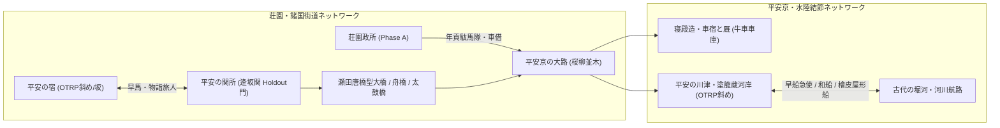

# 平安時代（794–1185年）交通・車両・橋梁・インフラ調査 ＆ Simutrans「Phase B」設計提案

> [!NOTE]
> 本資料は、すでに実装完了している **平安時代 Phase A（[建築様式調査](./heian_architecture_research.md)・政庁3階層/寝殿造/初期町家/武士の館/見世棚/酒蔵/工房 全16棟）** に続き、平安時代の陸上・水上交通および橋梁・街路・宿駅・関所・川津・車宿（計 **21種**）を実装するための歴史考証と Simutrans 設計計画書です。
>
> ※ 本資料用の新規 AI コンセプト図版4点は画像生成モデルのクォータ・サーバー容量上限（`429 RESOURCE_EXHAUSTED` / `503 MODEL_CAPACITY_EXHAUSTED`）到達のため保留とし、代わりにネットワーク構造図（Mermaid）と既存の平安 Phase A（[images/heian_03_shinden_mansion.png](./images/heian_03_shinden_mansion.png)・[images/heian_05_commerce_crafts.png](./images/heian_05_commerce_crafts.png)）および奈良 Phase B 図版（[images/nara_pB_01_oxcart.png](./images/nara_pB_01_oxcart.png)・[images/nara_pB_03_hiratabune.png](./images/nara_pB_03_hiratabune.png)）の造形基準を組み合わせて整理します。

---

## 1. 総論：律令官道・瓦舎から「牛車・車借・馬借・川津・舟橋」の国風交通網へ

794年の**平安京遷都**から9〜12世紀にかけて、日本の交通体系は律令国家直轄の「駅伝制＋丹塗瓦葺き都城施設」から、王朝貴族文化・**荘園公領制**・都市商業の成長に応じた **和様・実務主体の中世的物流網の萌芽** へと大きく変化しました。

1. **貴族乗用「牛車（ぎっしゃ）」文化の開花**
   - 奈良時代まで貨物運搬専業（「借車」）または行幸の鳳輦が中心だった陸上旅客に、**網代車（あじろぐるま）**・**檳榔毛車（びろうげのくるま）** などの豪華な屋根・御簾付き **乗用牛車** が定着し、朱雀大路や一条〜九条大路を行き交いました（『年中行事絵巻』『伴大納言絵詞』『枕草子』）。
2. **荘園年貢輸送を担う「車借（しゃしゃく）」「駄馬隊（馬借の祖）」と「物詣旅人」**
   - 9〜10世紀以降、淀津・鳥羽津・大津などの交通要衝では荷牛車を専業で請け負う輸送業者（後の**車借**）と、山道や荘園から年貢米・木材・陶磁器を運ぶ大量の**駄馬隊**（後の**馬借**）が発達しました。
   - 同時に、熊野詣・石山詣・鞍馬詣などに代表される**物詣（ものもうで）や荘園領主の往来**により、狩衣や市女笠・垂衣（むしのたれぎぬ）姿の**騎馬旅人一行**が幹線街道の主力旅客となります（既存 `Nara_Tenma` は `1250年` 引退予定）。
3. **「書状逓送」の用語方針（明治期の造語回避）**
   - Simutrans 内部のメール貨物スロット（`Post`）は明治以降の現代概念であるため、本パックの平安時代アセットでは**「郵便」の語を使わず**、歴史史料に沿った **「書状逓送」「急使」「早馬」「早船」「院宣急使」** として表現を統一します。
   - なお、既存の外洋高速書状船 `Asuka_Kentoushi_Ship_Post` は **950年で引退**するため、850年導入の **平安の早船・急使和船（`Heian_Wasen_Post`）** を投入し、平安期の水上書状輸送を途切れなく接続させます。
4. **「舟橋・太鼓橋・瀬田唐橋」と国風木造宿駅・川津**
   - 琵琶湖流出部の**瀬田の唐橋**や宇治川の**宇治橋**などの長大な木造擬宝珠大橋、都の堀川にかかる優美な**反り木橋（太鼓橋）**、渡河用の**舟橋（浮橋）**が整備され、街道には板葺・檜皮葺の**宿（しゅくば）**・**関所（逢坂関型）**・白壁塗籠蔵付きの**川津（河岸）**・寝殿造の**車宿と厩**が整いました。

### 奈良時代（Phase B・実装済） vs 平安時代（Phase B・設計案） 交通比較

| 交通区分 | 奈良時代（実装済み・`1250..1500`順次引退） | 平安時代（Phase B 設計対象：`794..1600`） | 将来の鎌倉期以降との接続 |
| :--- | :--- | :--- | :--- |
| **都市旅客** | 担ぎ輿（`Nara_Koshi` `6km/h`, 1250引退） | **網代牛車・檳榔毛車行列**（`9km/h`, 1350..1400引退） | 都市内乗合・徒歩/騎馬 |
| **街道旅客** | 律令の伝馬（`Nara_Tenma` `13km/h`, 1250引退） | **騎馬旅人・物詣一行 4/8騎**（`15km/h`, 1400引退） | 鎌倉街道の武士/旅人隊 |
| **書状逓送（陸）** | 律令の駅馬（`Nara_Ekiba` `20km/h`, 1250引退） | **平安の早馬・院宣急使 2/4騎**（`24km/h`, 1450引退） | 鎌倉飛脚・早馬制 |
| **陸上重貨物** | 荷牛車（借車 `12/24/36t`, `7km/h`） | **車借・大型荷牛車 1〜3輌**（`16/32/48t`, `8km/h`）＋ **年貢駄馬隊 4/8頭**（`12/24t`, `11km/h`） | 室町の大八車原型・馬借 |
| **水上交通** | 平田舟 3種（`710..1500`）＋ 遣唐使船6種（`..950`） | 既存和船・日宋貿易船に加え **早船・急使和船**（`18km/h`）＋ **檜皮屋形川船**（`13km/h`, 32人） | 初期廻船・弁才船の祖先 |
| **橋梁** | 官道木橋（最大長10, 25t） | **瀬田唐橋型擬宝珠大橋**（長16, 35t）・**反り太鼓橋**・**舟橋（浮橋）**（長20, 高1） | 永代木橋・石橋 |
| **街路・駅・港** | 朱雀大路（柳）・羅城門/坊門・瓦葺き駅家・堀河河岸・馬寮車宿 | **平安京の大路（木板溝・桜柳）**・**宿（板葺/檜皮）**・**関所（逢坂関）**・**川津（塗籠蔵河岸）**・**寝殿造車宿** | 鎌倉宿駅・和賀江嶋港 |

---

## 2. ① 乗用牛車（網代車・檳榔毛車）と騎馬旅人・院宣急使早馬

参考既存造形：車両構造ベースは [nara_pB_01_oxcart.png](./images/nara_pB_01_oxcart.png)・[nara_pB_02_koshi_tenma.png](./images/nara_pB_02_koshi_tenma.png)、寝殿造の色彩コード（檜皮茶・素木・黒漆・深緑御簾）は [heian_03_shinden_mansion.png](./images/heian_03_shinden_mansion.png) に準拠します。

### 歴史考証・造形コード
- **網代牛車 (`Heian_Ajiro_Gissha_Pax`)**: 四位〜五位の公卿・受領・女房などが日常の参内や方違えに用いた実用乗用牛車。竹・檜を薄く剥いで編んだ**網代張りのかまぼこ型屋根**と側面に**黒漆（または暗褐色）の縁枠**、開口部に**深緑の御簾（みす）**を垂らし、大径スポーク木車輪と長い轅（ながえ）を黒牛が曳き、牛飼童（うしかいわらわ）が先導します。
- **檳榔毛車・摂関家行列 (`Heian_Biroge_Gissha_Pax`)**: 摂政・関白・大臣・皇族のみが許された最高位の牛車。屋根・車箱を覆う白く晒した**象牙色（生成り）の檳榔の葉繊維**、黒漆枠と金の飾金具、内側の紅絹の下簾（したすだれ）をまとい、前後に供奉の網代車を伴う2輌編成の威容で表現します。
- **平安の騎馬旅人・物詣一行 (`Heian_Kiba_Traveler_4/8_Pax`)**: 律令官人（奈良伝馬）から和様化した平安中後期の街道旅人像。水干・狩衣姿の男性騎手や**市女笠（いちめがさ）に白い垂絹をまとった壺装束**の女性巡礼者を混ぜた4騎・8騎隊列とします。
- **平安の早馬・院宣急使 (`Heian_Hayama_2/4_Post`)**: 院政期〜源平争乱期にかけて全国へ院宣・官符・書状を届けた最速の騎馬急使。烏帽子・細身の旅装で駆ける和種馬に、朱漆・黒漆の文箱（ふばこ）・竹製書状筒を括り付けた2騎・4騎編成とします。

| アドオンID (`name`) | 日本語名称 / 英語名称 | 期間 | 貨物種別 | `payload` | `speed` | `power` | `weight` | `cost` | `running` | `length` |
| :--- | :--- | :---: | :---: | :---: | :---: | :---: | :---: | :---: | :---: | :---: |
| `Heian_Ajiro_Gissha_Pax` | 平安の網代牛車（中級貴族・常用） `Heian Ajiro Ox-Cart (Noble Carriage)` | `850..1400` | `Passagiere` | `10` | `9` | `8` | `1` | `42000` | `13` | `6` |
| `Heian_Biroge_Gissha_Pax` | 平安の檳榔毛車・摂関家牛車行列（2輌） `Heian Biroge Grand Ox-Cart Procession (2 Carts)` | `900..1350` | `Passagiere` | `24` | `9` | `16` | `2` | `96000` | `28` | `12` |
| `Heian_Kiba_Traveler_4_Pax` | 平安の騎馬旅人・物詣一行（4騎） `Heian Mounted Pilgrims & Retainers (4 Horses)` | `900..1400` | `Passagiere` | `16` | `15` | `14` | `1` | `74000` | `24` | `9` |
| `Heian_Kiba_Traveler_8_Pax` | 平安の騎馬旅人・物詣大行列（8騎） `Heian Mounted Pilgrims & Retainers (8 Horses)` | `900..1400` | `Passagiere` | `32` | `15` | `26` | `2` | `140000` | `44` | `15` |
| `Heian_Hayama_2_Post` | 平安の早馬・院宣急使（2騎・書状逓送） `Heian Imperial Express Riders (Hayama 2 Horses)` | `900..1450` | `Post` | `10` | `24` | `10` | `1` | `52000` | `17` | `5` |
| `Heian_Hayama_4_Post` | 平安の早馬・院宣急使（4騎・書状逓送） `Heian Imperial Express Riders (Hayama 4 Horses)` | `900..1450` | `Post` | `20` | `24` | `18` | `1` | `98000` | `31` | `9` |

---

## 3. ② 車借の大型荷牛車・年貢駄馬隊（馬借の祖）＆ 水上補完船2種

参考既存造形：貨物の荷牛車・俵/陶磁器積載パターンは [nara_pB_01_oxcart.png](./images/nara_pB_01_oxcart.png) および [nara_pB_03_hiratabune.png](./images/nara_pB_03_hiratabune.png) を発展させ、全18品目（`catg=1`）対応とします。

### 歴史考証・ゲームバランス位置づけ
- **車借の大型荷牛車 (`Heian_Shashaku_Oxcart_1/2/3_Cargo`)**: 鳥羽・淀・大津など都周辺の川津と京中の問丸（`Heian_10_Toimaru_Kura_2x1`）や酒蔵（`Heian_11_Sakagura_2x1`）を結ぶ民間専業の重量輸送車。奈良荷牛車より枠板を高く補強した大容量無蓋荷台（1輌 `16t` → 3輌 `48t`、`8 km/h`）とし、積荷グラフィックは米俵・薪炭・大甕・織物反物など多様な品目に応じて自動切替されます。
- **年貢駄馬隊・馬借の祖 (`Heian_Bashaku_Packhorse_4/8_Cargo`)**: 荘園（`Shoen_Mandokoro`）と街道宿・川津を結ぶ駄馬部隊。`Kofun_Packhorse`（`8 km/h`・1200年引退）の上位後継として速度 `11 km/h`・積載 `12t / 24t` を設定し、「大動脈の車借牛車（低速・超大容量）」と「機動力・山道向けの駄馬隊（中速・中容量）」が自然に棲み分けます。
- **水上書状補完船 (`Heian_Wasen_Post`)**: 既実装の `Asuka_Kentoushi_Ship_Post`（紅白/素木）が **950年に引退**すると、以降の時代に書状逓送（`Post`）専用の和船が不在となります。船型・速度 `18 km/h` の軽快な和船・急使早船（櫓漕＋四角網代帆＋黒/朱文箱積載）を追加し、瀬戸内・琵琶湖・河川連絡の書状網を維持します。
- **平安の檜皮屋形川船 (`Heian_Yakatabune_Pax`)**: 既実装の奈良平田舟（網代苫屋根・定員18・`12 km/h`）の上位世代として、宇治川・淀川の逍遥や貴族参詣を描いた絵巻物の**檜皮葺き＋素木高欄＋深緑御簾**を備えた遊覧屋形船（定員32・`13 km/h`）を追加します。

| アドオンID (`name`) | 日本語名称 / 英語名称 | 期間 | 水陸 / 貨物 | `payload` | `speed` | `power` | `weight` | `cost` | `running` | `length` |
| :--- | :--- | :---: | :---: | :---: | :---: | :---: | :---: | :---: | :---: | :---: |
| `Heian_Shashaku_Oxcart_1_Cargo` | 平安の車借・大型荷牛車（1輌） `Heian Shashaku Heavy Ox-Cart (1 Cart)` | `900..1500` | `road` / `rice` (`catg=1`) | `16` | `8` | `10` | `1` | `54000` | `15` | `6` |
| `Heian_Shashaku_Oxcart_2_Cargo` | 平安の車借・大型荷牛車（2輌編成） `Heian Shashaku Heavy Ox-Cart (2 Carts)` | `900..1500` | `road` / `rice` (`catg=1`) | `32` | `8` | `20` | `2` | `102000` | `28` | `11` |
| `Heian_Shashaku_Oxcart_3_Cargo` | 平安の車借・大型荷牛車（3輌大隊） `Heian Shashaku Heavy Ox-Cart (3 Carts)` | `900..1500` | `road` / `rice` (`catg=1`) | `48` | `8` | `30` | `3` | `148000` | `40` | `16` |
| `Heian_Bashaku_Packhorse_4_Cargo` | 平安の年貢駄馬隊・馬借の祖（4頭） `Heian Manor Packhorse Train (Bashaku 4 Horses)` | `950..1500` | `road` / `rice` (`catg=1`) | `12` | `11` | `12` | `1` | `58000` | `18` | `8` |
| `Heian_Bashaku_Packhorse_8_Cargo` | 平安の年貢駄馬隊・馬借の祖（8頭） `Heian Manor Packhorse Train (Bashaku 8 Horses)` | `950..1500` | `road` / `rice` (`catg=1`) | `24` | `11` | `22` | `2` | `110000` | `34` | `14` |
| `Heian_Wasen_Post` | 平安の早船・急使和船（書状逓送） `Heian Express Courier Ship (Hayabune Dispatch)` | `850..1450` | `water` / `Post` | `24` | `18` | `20` | `4` | `420000` | `62` | `10` |
| `Heian_Yakatabune_Pax` | 平安の檜皮屋形川船（遊覧・旅客） `Heian Hiwada River Yakatabune (Passenger)` | `900..1450` | `water` / `Passagiere` | `32` | `13` | `16` | `3` | `310000` | `52` | `12` |

---

## 4. ③ 平安の橋梁3様式（瀬田唐橋型擬宝珠大橋・反り太鼓橋・舟橋/浮橋）

1. **木造擬宝珠大橋・瀬田唐橋型 (`Heian_Seta_Karahashi_Bridge`)**: 東山道・東海道の咽喉を扼した瀬田の唐橋（長橋）および宇治橋をモデルとした幹線用木造大橋。堅牢な木材橋脚（`pillar_distance=2`）・無塗装素木橋桁に、銅製擬宝珠（ぎぼし）を冠した朱/素木高欄を備えます。従来の `Nara_Official_Road_Bridge`（`max_length=10, max_weight=25`）を大幅に上回る **`max_length=16`・`max_weight=35`・`topspeed=35`** で大河渡河を可能にします。
2. **反り木橋・太鼓橋 (`Heian_Taikobashi_Bridge`)**: 平安京の堀川・宇治・寺社門前などに架けられた優雅な円弧状の反り橋。橋脚を水路内に立てない無柱構造（`pillar_distance=0`）と美しい曲線高欄により、小運河・水路景観の主役になります。
3. **舟橋・浮橋 (`Heian_Funabashi_Bridge`)**: 『更級日記』（富士川）や『平家物語』にも登場する、急流や広幅河川に**多数の木造小舟を並べ、太綱で繋いで板を渡した仮設・長大橋**。水面高さ `max_height=1`（高架不可）・速度 `22 km/h` ながら、**低建設費（`cost=3800`）・長大スパン（`max_length=20`）** を持ち、序盤〜中盤の長大渡河に極めて有用な歴史的橋梁です。

| アドオンID (`name`) | 日本語名称 / 英語名称 | 期間 | `topspeed` | `max_weight` | `max_length` | `max_height` | `pillar_dist` | `cost` | `maint` | 用途・造形 |
| :--- | :--- | :---: | :---: | :---: | :---: | :---: | :---: | :---: | :---: | :--- |
| `Heian_Seta_Karahashi_Bridge` | 平安の木造擬宝珠大橋（瀬田唐橋型） `Heian Grand Giboshi Timber Bridge (Seta-Karahashi)` | `850..1600` | `35` | `35` | `16` | `4` | `2` | `9000` | `160` | 大河用の木造長大橋・擬宝珠高欄 |
| `Heian_Taikobashi_Bridge` | 平安の反り木橋・太鼓橋 `Heian Arched Wooden Bridge (Taikobashi)` | `850..1600` | `25` | `20` | `6` | `3` | `0` | `7500` | `110` | 京内堀川・景観向けの曲線反り木橋 |
| `Heian_Funabashi_Bridge` | 平安の舟橋・浮橋 `Heian Floating Pontoon Bridge (Funabashi)` | `850..1600` | `22` | `25` | `20` | `1` | `0` | `3800` | `85` | 低コスト・長距離渡河用の連舟木板橋 |

---

## 5. ④ 平安の街路・宿・関所・川津・寝殿造車宿（インフラ5種）

1. **平安京の大路 (`Heian_Kyo_Oji_Road`, `ways/road`)**: 朱雀大路（`Nara_Suzaku_Oji`, `max_weight=12`）を発展させた平安京の条坊大路。板張り木造側溝、整った礫・土舗装、路肩の**桜と柳の並木**（直線区間優先、曲線・交差点・急坂干渉ゼロ）を備え、`max_weight=25`・`topspeed=40` と重牛車にも対応します（16連 `ribi` + 8坂 + 4斜め × 積雪2季節）。
2. **平安の宿・馬継宿駅 (`Heian_Shukuba_Stop`, `stations/road`)**: 律令時代の瓦葺き官営駅家（`Nara_Kawara_Umaya_Stop`, `1400年引退`）の後継。和様の**檜皮葺き＋石置き板葺きの平屋本陣・宿屋**＋素木高欄＋馬繋ぎ杭で構成され、`OTRP 112レイアウト`（直交・斜め・単急坂フル対応・`lv=7, cap=80, all`）で街道と斜面を問わず配置できます。
3. **平安の関所・逢坂関型 (`Heian_Sekisho_Gate_Stop`, `stations/road`)**: 『百人一首』の逢坂の関に象徴される平安期の境界関門。縦板塀と頑丈な素木の**冠木門（Holdout Back/Front 16レイアウト）**、脇に石置き板葺きの番所小屋と立て並べた木盾（`tate`）を配置し、都市境界の通過型停留所として機能します（`lv=5, cap=56, all`）。
4. **平安の川津・塗籠蔵河岸 (`Heian_Tsu_Kashi_Stop`, `stations/water`)**: 大津・鳥羽津・淀津型の内陸水運拠点。木造桟橋・荷捌き上屋に加え、Phase A（`Heian_10_Toimaru_Kura`）と統一された**白壁初期塗籠蔵（塗籠耐火倉）**と積まれた年貢米俵・大甕を配した水運停留所です（`OTRP 48レイアウト` 斜め水路対応、`lv=6, cap=80, all`）。
5. **平安の寝殿造・車宿と厩 (`Heian_Kurumayado_Depot`, `depots/road`)**: [heian_03_shinden_mansion.png](./images/heian_03_shinden_mansion.png) に描かれた貴族邸宅・中門脇の「**車宿（くるまやど）**」と木造厩を一体化した車庫施設。築地塀・檜皮葺きの吹き放ち牛車格納棟（中に網代車を1輌格納）と木造馬房を備えます（`dims=1,1,4`, `lv=4, all`）。

---

## 6. ⑤ 全21種パラメータ総覧 ＆ Blender 実装方針・確認事項

### 全21種リスト（[作成リスト.md](../作成リスト.md) 準拠）
- **車両（13種）**: 道路 `11種`（網代車・檳榔毛車2輌・騎馬旅人4/8・早馬2/4・車借荷牛車1/2/3・年貢駄馬4/8）＋ 水上 `2種`（早船書状・檜皮屋形川船）
- **橋梁（3種）**: 瀬田唐橋型木造擬宝珠大橋・反り木橋 太鼓橋・舟橋（浮橋）
- **インフラ（5種）**: 平安京の大路（`way`）・平安の宿（`OTRP stop`）・平安の関所（`Holdout門 stop`）・平安の川津 塗籠蔵河岸（`OTRP water stop`）・寝殿造の車宿と厩（`depot`）

### 技術基準（Blender 5.2 制作方針）
1. **車両（8方向）**: `EmptyImage`＋`catg=1` 全18品目向け積荷切替（米俵・雑穀系 vs 木材・陶磁器/大甕・反物/和紙・炭鉄系）を全貨物車両に実装。すべて軽量自重設計（`weight=1..3`（陸）/ `3..4`（船））＋ **厳密予約色ゼロ（`reserved={}`）**。
2. **橋梁・街路・停留所・車庫**: 2季節（通常＋積雪）対応、交差点・タイル境界の非AA/ブリード基準（[simutrans_blender.md](../simutrans_blender.md)）遵守、`stations`/`ways`/`bridges`/`depots` 各 `32×32` 専用メニューアイコン完備。
3. **Excel / Make統合**: 各カテゴリの `parameters.xlsx`（`vehicles`・`bridges`・`ways`・`stations`・`depots`）および `.datt` / `.jatab` / `.entab` に登録し、`ruby scripts/make.rb makedat makeobj merge tab` と `makeobj LIST` 検証を完了させます。

### 着手前の最終確認
- 本設計書（**計21種**・明治期造語を排した**書状逓送・急使・早馬・早船**表記統一）で違和感や追加・修正要望はありますか？
- 問題なければ、次のステップで **Phase B の Blender モデリング・ビルド実装**（まず車両13種・橋梁3種、続けてインフラ5種を連続して制作し一括ビルド検証）へ進みます！

---

## 7. 実装結果（Phase B 完了メモ）

- **完了日**: 2026-11-25（Blender 5.2.2 LTS / `simutrans_blender_kit` / 全シート予約色ゼロ `reserved={}`・全プレビュー目視確認済）
- **生成アセット（計21種）**:
  - **道路車両 11種** (`vehicles/heian_vehicles/heian_vehicles_all.dat`):
    - **牛車・車借（牽引牛＋トレーラー連結分離式・`length=4` 統一・`constraint` 制御）**: 牽引飾牛 (`Heian_Gissha_Ox`, `Passagiere`, `pow=8`) ＋ 網代車 (`Heian_Ajiro_Gissha_Trailer`, `cap=10`) / 檳榔毛車 (`Heian_Biroge_Gissha_Trailer`, `cap=14`) による1〜2輌行列組替、および車借・力牛 (`Heian_Shashaku_Ox`, `pow=12`) ＋ 大型荷車 (`Heian_Shashaku_Cart_Trailer`, `cap=20`, `catg=1` 全18品目積荷切替、奈良荷牛・荷車とも相互連結可)
    - **騎馬・馬借**: 騎馬旅人（4/8騎）・早馬 院宣急使（2/4騎・書状逓送）・馬借年貢駄馬隊（4/8頭）
  - **水上船舶 2種** (`vehicles/heian_ships_pB/heian_ships_pB_all.dat`): 平安の早船 急使和船（書状逓送）・平安の檜皮屋形川船（旅客）
  - **橋梁 3種** (`bridges/heian_seta_karahashi_bridge/`, `bridges/heian_taikobashi_bridge/`, `bridges/heian_funabashi_bridge/`): 各 30枚×2季節 + `32×32` アイコン・カーソル完備
  - **街路 1種** (`ways/heian_kyo_oji_road/`): 平安京の大路（木板側溝＋桜柳並木、56スプライト＝通常/積雪×28種＋アイコン）
  - **駅・車庫 4種** (`stations/heian_sekisho_gate_stop/`, `stations/heian_shukuba_stop/`, `stations/heian_tsu_kashi_stop/`, `depots/heian_kurumayado_depot/`): Holdout関門（16向き）・OTRP宿場（112向き斜め/坂対応）・OTRP川津（48向き塗籠蔵河岸）・車宿と厩車庫（4向き・`needs_ground=1`）
- **Excel制約拡張＆統合ビルド検証**: `vehicles/parameters.xlsx` に `constraint_prev` / `constraint_next` 列を新設し `vehicles/vehicles.datt` で `constraint[prev/next][i]` 自動展開に対応。`ruby scripts/make.rb makedat makeobj merge tab` 正常終了 → [`build/JP_Historical_all.pak`](../build/JP_Historical_all.pak)（`97,878,396` bytes、奈良 `Nara_Oxcart_Ox/Trailer_Cargo` 含め連結再編済み・旧一体型8種完全撤去）、`ja.historical.tab` / `en.tab` 生成確認、平安名称への `郵便` 混入 **0件**。
