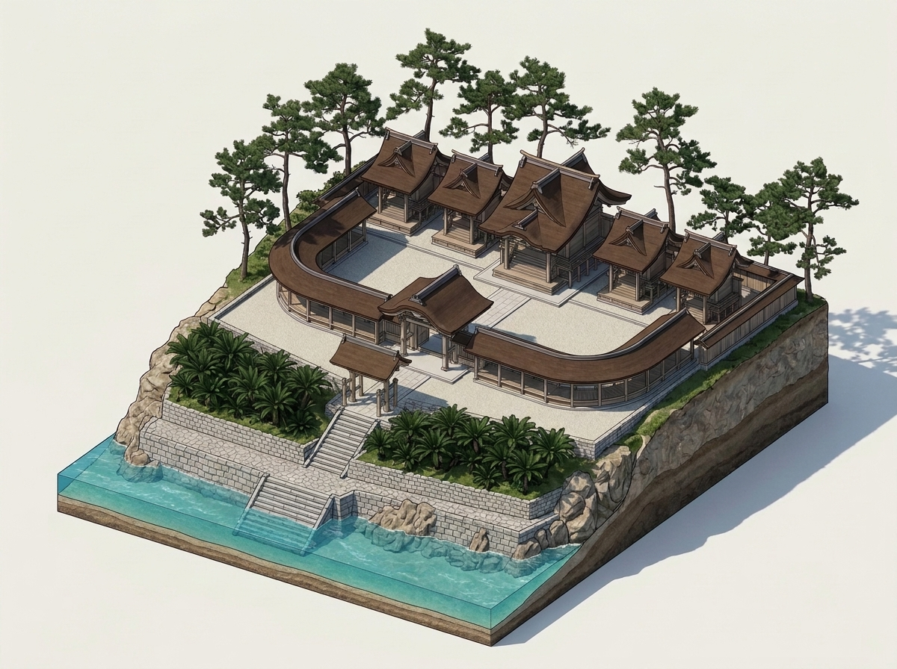

# 室津・賀茂神社（兵庫県たつの市御津町室津）調査レポート

> **ステータス**: **事前調査・設計提案のみ（未実装）**  
> 本ドキュメントは将来の文化遺産（`cur`）アドオン追加に向けた歴史・建築・Simutrans pak128 実装設計調査です。平安 Phase C では `.dat` / `.png` の制作・組み込みは行っていません。

---

## 1. 歴史的背景と海運上の位置づけ

- **鎮座地**: 兵庫県たつの市御津町室津（瀬戸内海東部の天然の良港「室泊」を望む岬の突端）
- **創建・京都賀茂社との結びつき**: 寛治4年（1090年）に当地が京都・賀茂別雷神社（上賀茂神社）の荘園「**室御厨**（むろのみくりや）」として寄進されたことに始まると伝わる。
- **平安末期の貴顕参拝**: 治承4年（1180年）には高倉上皇が厳島御幸の往路に室泊へ寄港し、賀茂神社へ参拝した記録が残る。風待ち・潮待ちの要港であった室津において、航海の安全を司る海上守護神として篤い信仰を集めた。
- **現存社殿（元禄再建）と文人来訪**: 現存する主要社殿群は元禄12年（1699年）の再建で、**8棟が国指定重要文化財**に指定されている。江戸後期（文政9年・1826年）の江戸参府時に室津に立ち寄ったシーボルトも、岬の高台から瀬戸内海を見渡す社頭の絶景を特筆している。

---

## 2. 建築様式・境内構成の特徴（国指定重要文化財 8棟）

室津・賀茂神社の建築最大の特徴は、岬の狭い石垣境内に複数の社殿を横一列に並べ、それを檜皮葺の回廊と唐門で連結する独特の配置と統一的な屋根意匠にある。

| 要素 | 構造・意匠上の特徴 |
| :--- | :--- |
| **重要文化財 8棟（すべて檜皮葺）** | **本殿**、**片岡社・太田社本殿**、**貴布祢社・若宮社本殿**、**榲尾社（すぎのおしゃ）本殿**、**権殿**、**唐門**、**東回廊**、**西回廊**の計8棟がいずれも優雅な**檜皮葺**（ひわだぶき）で統一されている。 |
| **並列社殿＋左右回廊の伽藍** | 本殿を中心に摂社群（片岡・太田、貴布祢・若宮、榲尾、権殿）を並列させ、唐門と東西回廊が前面の拝所を包み込む、上賀茂神社系の神域構成。 |
| **四脚門「馬足の龍」** | 参道途中の四脚門には、左甚五郎作とも伝わる名彫刻「**馬足の龍**」の伝承がある。 |
| **岬の石垣境内・野生ソテツ群** | 瀬戸内海へ突き出した岬の切石・野面積み石垣上に社殿が建ち、境内斜面には**日本最北端の自生（野生）ソテツ群**が茂る南国的な植生を持つ。 |

---

## 3. 将来の Simutrans pak128 アドオン設計案（未実装）

### A. 推奨サイズ・パラメータ比較案

| 案 | 推奨サイズ | `intro_year` 案 | 特徴と導入位置づけ |
| :--- | :---: | :--- | :--- |
| **案1: 江戸・近世海運期 3×2 岬境内版（推奨）** | `3×2` | `1699`（元禄再建〜現代） | 現存重文8棟（並列檜皮葺社殿＋唐門＋東西回廊＋四脚門）と石垣・野生ソテツ群をフルスケールで再現。瀬戸内海航路「室津」の寄港地ランドマークに最適。 |
| **案2: 平安後期〜通史 2×2 濃縮版** | `2×2` | `1090`（室御厨寄進〜`1868`／現代） | 1090年の創建・1180年高倉上皇御幸の海運信仰を重視し、平安水運ネットワーク（`Heian_Tsu_Kashi_Stop` や瀬戸内和船航路）と並べて配置できるコンパクトな2×2境内版。 |

### B. pak128 3D モデリング設計指針

1. **社殿群の檜皮葺統一感**: 主本殿と左右の摂社（片岡・太田・貴布祢・若宮・榲尾）および権殿を、流造・檜皮葺の濃茶曲線屋根で横並びに配し、前面を**唐門**（向唐門の反り屋根）と**東西回廊**で連続させることで、他の大型神社（春日大社型・厳島型）と明確に差別化する。
2. **石垣基壇＋海側参道石段**: 急峻な岬の立地感を出すため、外周の`stone_podium`／暗色割石積みの高い基壇段差と正面・側面の石段・朱塗鳥居・四脚門を前景に立てる（市街地や沿岸平地タイルでも破綻せず「高台の小山社」に見える段差設計）。
3. **野生ソテツ（蘇鉄）群と季節表現**: 既存の松・杉に加えて、幹から放射線状に広がる常緑のソテツ葉冠モデルを境内の石垣際・参道脇に配置し、温暖な瀬戸内・室津ならではの植生を付与する。積雪期（`s=4`）は檜皮屋根と石垣上に薄雪を乗せつつ、ソテツ・松の常緑を残す。
