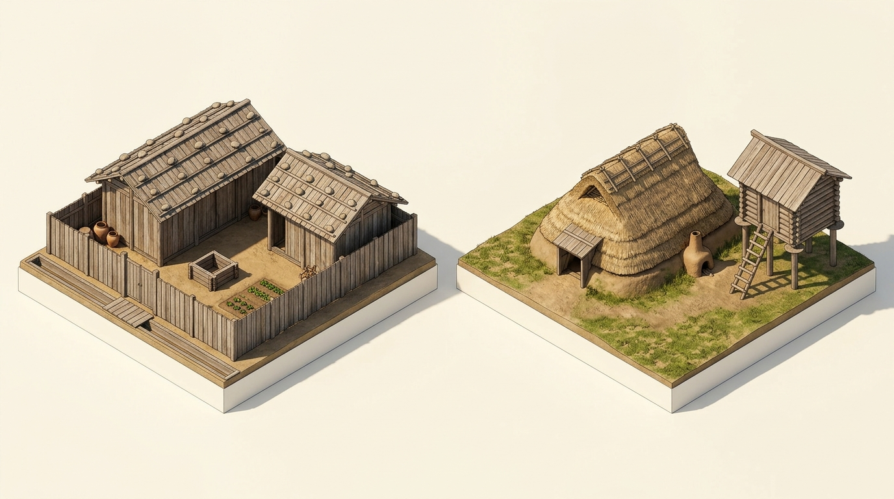
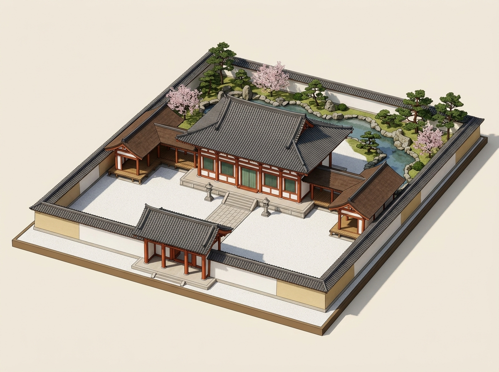
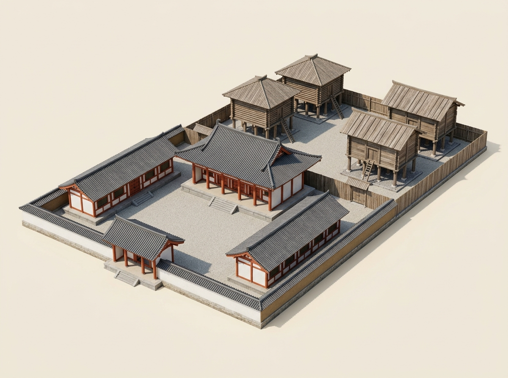
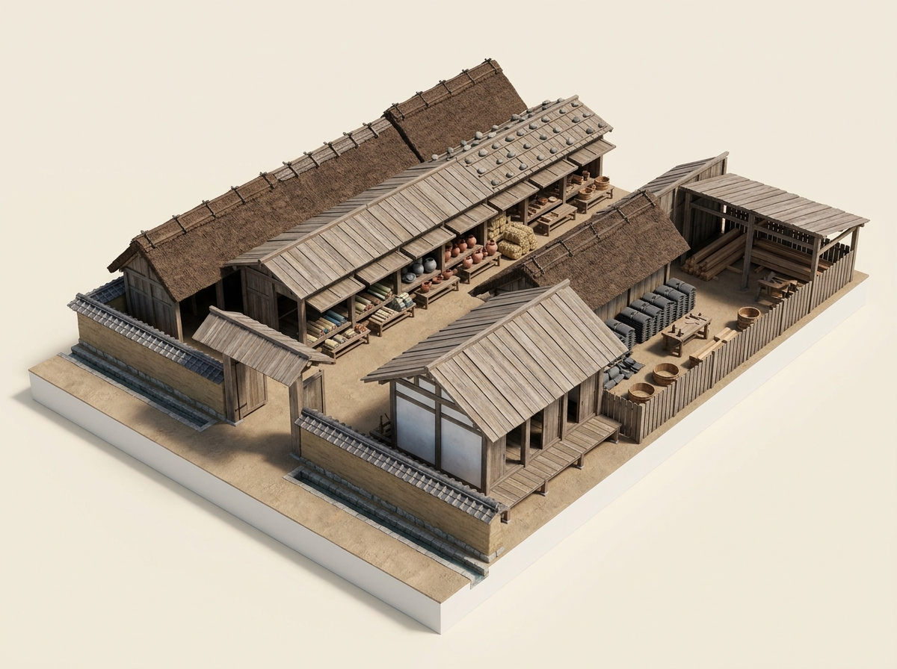
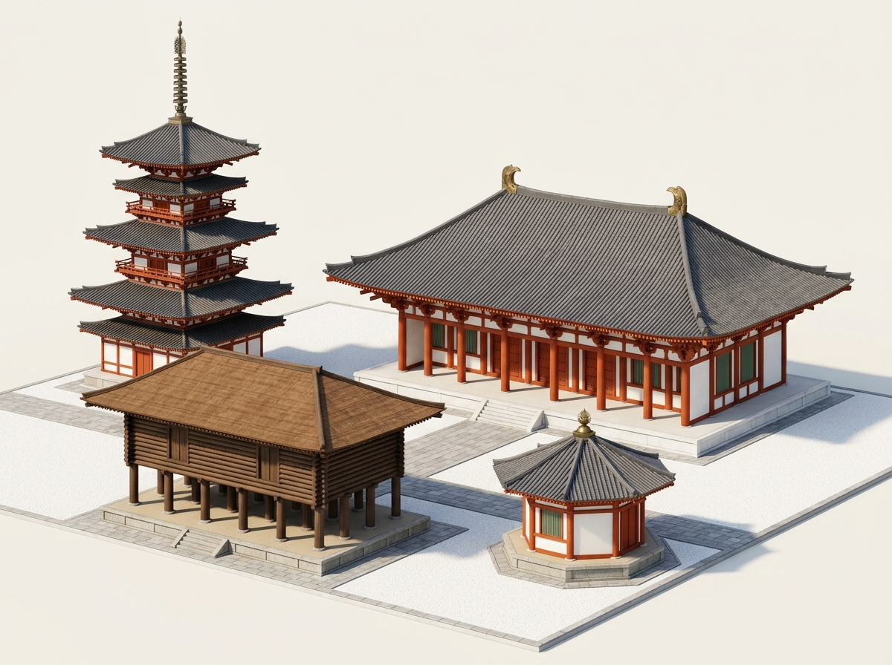
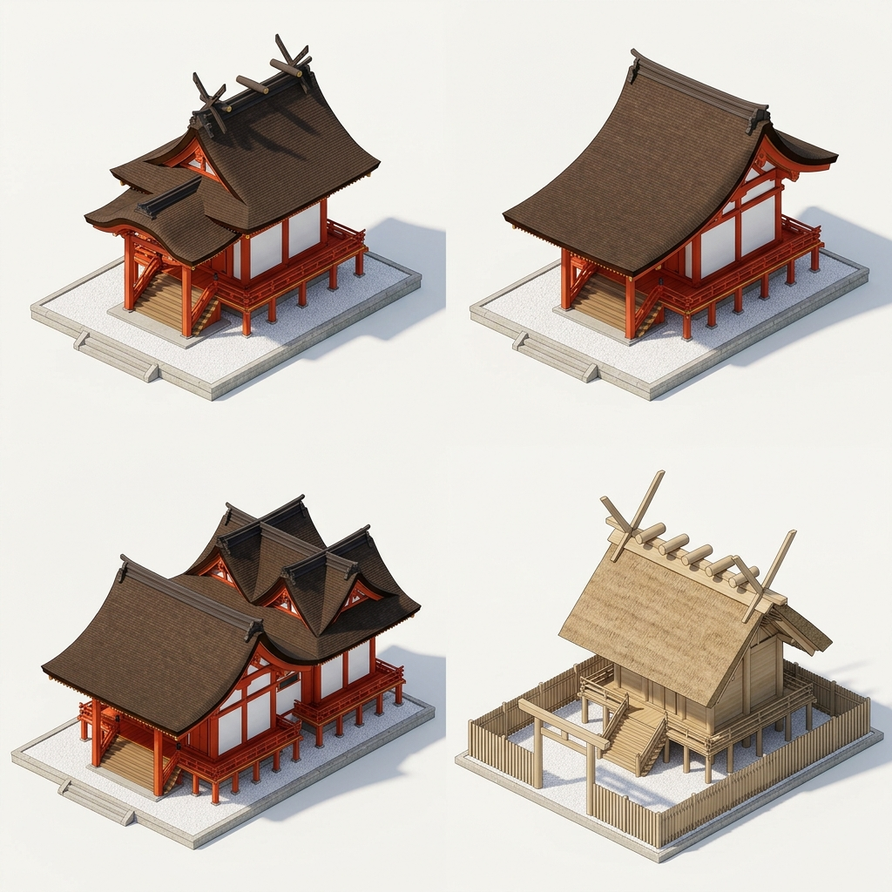

# 奈良時代（710–794年）建築様式調査 ＆ Simutrans「Phase A」設計提案

> [!NOTE]
> 本資料は、既存アドオン（古墳〜飛鳥時代：[asuka_koriga.png](../buildings/tow/asuka_koriga/asuka_koriga.png)・[asuka_palace_seiden.png](../buildings/cur/16_asuka_palace_seiden/asuka_palace_seiden.png)・[asuka_04.png](../buildings/city_buildings/30_asuka_fujiwara_teitaku/asuka_04.png) 等）との視覚的差別化と時代移行を明確にするため、大化改新〜天平期の建築変化を一次史料・発掘成果に基づき整理したものです。

---

## 1. 大化改新〜奈良時代で建築はどう変わったか（総論）

大化改新（645年）に始まる律令国家建設は、**694年の藤原京（初の条坊制都城＋瓦葺・礎石建築の宮殿導入）**、**701年の大宝律令（地方区分を「評」から「郡」へ統一）**、そして**710年の平城京遷都**を経て完成を迎えました。

特に奈良時代の都市景観を一変させた歴史的転換点が以下の2つです。
1. **神亀元年（724年）11月8日の太政官奏（『続日本紀』）**
   > 従来の「板屋・草舎（板葺き・草葺き）」は造りにくく壊れやすい「中古の遺制」であり、外交使節を迎える帝都の威容を示すため、五位以上の貴族から余裕ある庶民に至るまで **「瓦舎を構立し、塗りて赤白と為せ（瓦葺き＋丹塗と白漆喰）」** と聖武天皇が裁可しました。
   * 実際には技術・費用の制約から、京内の一般宅地に瓦が広まるのは奈良中〜後半にかけてでしたが、**「丹塗柱＋白漆喰＋緑の連子窓＋瓦／檜皮葺＋築地塀」** という **「青丹よし（あおによし）」** の視覚様式が都の上級〜中級建築の理想形となりました。
2. **地方行政・宗教建築の国家規格化**
   * 飛鳥時代の氏族的・私的な建築（評衙や氏寺）から、**平城宮朝堂院を縮小模倣した国庁・郡衙**、741年の詔による全国60余国の**国分寺**、そして**常設の神社社殿様式（春日造・流造・八幡造など）** へと一斉に体系化されました。

### 飛鳥時代 vs 奈良時代（天平） 建築の特徴比較

| 比較項目 | 飛鳥時代（〜710年）※既存アセット準拠 | 奈良時代（710–794年）※Phase A実装ターゲット |
| :--- | :--- | :--- |
| **宮殿・官衙** | 素木（しらき）・掘立柱・板葺き（板蓋宮系）、縦板塀の「評衙」 | 礎石建ち・**丹塗柱＋白壁**・**本瓦葺き（鴟尾付）**・**瓦載せ築地塀**、コの字型の「国庁」「郡衙」 |
| **貴族・官人邸宅** | 掘立柱または素木の瓦葺き邸宅、無彩色の板塀・簡素な築地 | **神亀元年の「瓦舎・赤白」様式**（丹塗柱・白壁・緑連子窓）および**檜皮葺き**主殿・脇殿、四脚門、曲水庭園 |
| **都市庶民住居** | 集落型・不規則配置の板葺き掘立柱小屋 | **平城京条坊制の1/16〜1/32町区画**：板塀＋前面側溝に沿う掘立柱板葺家屋2〜3棟＋井戸＋菜園 |
| **地方農村住居** | 全国的に竪穴建物中心＋掘立柱への萌芽 | **畿内**は掘立柱平地住居へ移行完了、**東国・辺境**はカマド付き竪穴建物がなお主流（強い地域差） |
| **寺院（伽藍・様式）** | 氏族仏教、単塔中心、エンタシス柱・雲斗雲肘木（法隆寺系） | 国家仏教（国分寺・東大寺）、**東西双塔**、**直線的な太い柱**、**三手先組物**、裳階付塔（薬師寺東塔）、広大な寄棟金堂、校倉（正倉院） |
| **神社建築** | 常設社殿の黎明（磐座・神籬、素木高床の神明造原型） | 仏教技術（**檜皮葺・丹塗・白壁・反り屋根・向拝**）を融合した **春日造・流造・八幡造** 等の常設本殿が確立 |

---

## 2. 庶民の住居（平城京 1/16町宅地 vs 地方農村の地域差）

### ① 平城京の1/16町・1/32町宅地（下級官人・雑色人・京内庶民）
* **区画と立地**: 平城京の基本区画である「1町（約120m四方）」を均等分割した **1/16町（約100〜200㎡前後）や1/32町** の零細な宅地が、平城宮から離れた左京・右京の南部周縁に整然と並びました。
* **建物構造**: 基礎石を使わない **掘立柱建物** で、屋根は **石置き板葺き（いたぶき）** や草葺きが主流です。狭小な敷地（縦板塀と排水用・境界用の側溝で区画）の中に、主屋・作業小屋など2〜3坪程度の小建築2〜3棟と、方形木枠の **井戸**・小規模な **菜園**・ごみ土坑が詰め込まれていました。

### ② 地方農村の住居（畿内と東国の明瞭な地域差）
* **畿内・近国**: 都の周辺（大和・河内など）では7世紀後半〜奈良時代初頭には一般農民層も地上の掘立柱建物へほぼ移行していました。
* **東国・地方農村**: 関東以東や遠国では、古墳時代以来の **カマド付き竪穴建物**（半地下式・藁や板を敷いた土間床・葺き下ろしの草葺屋根）が奈良〜平安時代を通じてもなお主流であり続け、敷地内の小規模な高床倉庫とセットで集落を構成しました。

---

## 3. 貴族邸宅と地方豪族の居宅（724年「瓦舎・赤白」と長屋王邸）

### ① 上級貴族邸宅（長屋王邸モデル・神亀元年太政官奏）
* **圧倒的な身分格差**: 最高位貴族・長屋王の邸宅（左京三条二坊等）は **4町（約6〜7万㎡）** にも及び、庶民（1/16町）の約600倍以上の敷地規模でした。
* **建築様式**: 周囲を **瓦葺き築地塀** と格式高い **四脚門（しきゃくもん）** で囲み、白砂・敷石の中庭の奥に基壇・礎石建ち・**本瓦葺き＋丹塗柱＋白漆喰壁＋緑の連子窓** を備えた主殿（しゅでん）を配置しました。周囲の脇殿・渡廊下には優美な **檜皮葺き（ひわだぶき）** も愛用され、さらに家政機関（家令所）や石組・池水を備えた **曲水庭園**（松・桜・州浜）が設けられました。
* **中級官人（五位〜六位相当）**: 1/4〜1町規模の宅地に、檜皮葺き・板葺きを主体としつつ一部に瓦や塗壁・板塀〜簡易築地を取り入れた屋敷が都の中核街区を形成しました。

### ② 地方豪族（郡司層）の居宅
* 郡司や地方の富豪農民は一般農民の竪穴住居とは一線を画し、**国庁・郡衙を模倣した L字型／コの字型の掘立柱建物群** を板塀・溝で区画しました。敷地内には私出挙（利殖用）の稲などを納める **高床式倉庫群** が伴い、硯や墨書土器・緑釉陶器などの高級遺物が出土します。

---

## 4. 地方官衙：評衙から郡衙へ・国庁と正倉群

### ① 「評衙」から「郡衙」への変遷（701年 大宝律令）
* **名称・性格の変化**: 大化の改新〜7世紀末の地方拠点「評衙」（既存の [Asuka_Koriga](../buildings/tow/asuka_koriga/asuka_koriga.png) のように板塀・板葺きで豪族居館と未分化な不整形配置が多い）が、701年大宝律令により **「郡衙（郡家）」** へ改められ、中央統制型の官庁へと転換しました。
* **空間定型化**: 奈良中期以降、郡衙の中枢「郡庁」も中央にならって **正面の門（八脚門／四脚門）＋奥の正殿＋左右の東西脇殿** を整然と並べる **コの字型配置** が普及しました。

### ② 国庁（国府政庁）と正倉群（しょうそうぐん）
* **国庁**: 諸国の最高行政機関であり、平城宮朝堂院を縮小した地方最上級の建築群です。**瓦載せ築地塀・石積み基壇・礎石建ち・丹塗瓦葺きの正殿・脇殿** を備えました。
* **正倉群（税の保管庫）**: 郡衙・国府で最大の敷地面積を占めたのが、租（稲・穀物）を収める高床倉庫群です。ネズミ返し付きの太い柱を礎石または掘立柱で立て、壁には三角形の材木を井桁に組む **校倉造（あぜくらづくり）**、厚い木板をはめ込む **板倉造（いたくらづくり）**、土壁の **土倉（つちくら）** などが採用されました。

---

## 5. 都市商業・官営工房（平城京 東西市・肆・市司）

* **東西市の構造**: 左京八条三坊の **東市**・右京八条二坊の **西市**（各4町・物資搬入用の堀河沿い）は、律令国家が直轄する計画的公設市場です。『関市令』により **正午に太鼓で開場・日没前に閉場** する厳格な時間統制が行われ、**東市司・西市司** が価格（估価簿）・度量衡・和同開珎の流通・不正取締りを監督しました。
* **「肆（し／いちくら）」と工房**: 市場の区画内には、掘立柱・板葺き／檜皮葺きの細長い平屋店舗長屋である **肆（し）** が並び、開放した板戸の前に置いた木製陳列台で **絹麻の反物・須恵器/土師器・稲俵・干物** 等が取引されました（※江戸風の土蔵や文字入りの暖簾はまだありません）。都や官衙の造営に伴う **瓦工房・木工工房・写経所** などの作業舎も都市経済を支えました。

---

## 6. 寺院建築（天平様式・国分寺・正倉院）

* **飛鳥から天平への飛躍**: 飛鳥建築（法隆寺系：百済・南北朝由来、エンタシス柱、雲斗雲肘木、五重塔＋金堂並列）から、遣唐使がもたらした **盛唐直輸入の天平建築** へ発展しました。
* **天平様式の造形コード**:
  * **柱・組物**: 中央の膨らみが抑えられた **直線的で太い円柱** と、軒を3段持ち出して深く壮大に見せる **三手先組物（みてさき）**。
  * **屋根・金堂**: 広大な **寄棟造（よせむねづくり）の本瓦葺き屋根** の大棟両端に金の **鴟尾（しび）** を戴き、正面吹き放しの列柱廊（唐招提寺金堂型）を持つ重厚なシルエット。
  * **塔・伽藍・特殊建築**: **裳階（もこし）** 付き三重塔（薬師寺東塔の「凍れる音楽」）、門の直進上に金堂・その前方に東西双塔を配する**東大寺・国分寺（741年詔）式伽藍**、**正倉院の巨大校倉造**、**夢殿・栄山寺の八角円堂** など多様な建築が開花しました。

---

## 7. 神社建築（常設社殿・朱塗りの誕生：4大様式）

仏教寺院建築の洗練された技術（**檜皮葺き**・**丹塗**・**白漆喰**・**屋根の緩やかな反り**・正面の庇である **向拝〔こうはい〕**）を取り入れつつ、高床の伝統と融合して **常設の神社本殿様式** が確立したのも奈良時代です（同時に神宮寺の造営など神仏習合も始まりました）。

| 様式名 | 入口位置（造り） | 特徴的シルエット・素材 | 代表例・奈良時代の成立背景 |
| :--- | :--- | :--- | :--- |
| **春日造** | 切妻・**妻入** | 正面妻側に独立した優美な **曲線向拝（庇）**・高欄付木階。**丹塗柱＋白壁＋檜皮葺**・千木と鰹木 | **春日大社**（神護景雲2年・**768年創建**、藤原氏氏神・平城京鎮護） |
| **流造** | 切妻・**平入** | 棟と平行な前面屋根が **長く優美に反り延びて向拝を兼ねる** 片流れ曲線（全国で最も普及） | 賀茂社など（神明造から仏寺屋根技術を取り入れ奈良〜平安初期に確立） |
| **八幡造** | 切妻・**平入**×2 | 前殿・後殿の二棟を **前後ぴったり連結** し、谷間に **陸樋（ろくひ）** を渡す複合殿舎＋丹塗檜皮葺 | **宇佐神宮**（神亀2年・**725年** 現社地鎮座・国家守護神として隆盛） |
| **神明造** | 切妻・**平入** | 古代高床倉直系の **素木白木造**・直線的な茅葺屋根・掘立柱・**外削ぎ千木・鰹木**・直線形の神明鳥居 | **伊勢神宮**（690年第一回式年遷宮で定型化、奈良期を通じ規範を維持） |

---

## 8. Simutrans「奈良時代 Phase A」当初設計案

[parameters.xlsx](../buildings/parameters.xlsx) を確認したところ、**710年**で弥生歩行者・飛鳥宮が引退し、**750年**で古墳一般建物、**800年**で評衙（`Asuka_Koriga`）と運搬人が引退します。これらを自然に引き継ぎ、街並みの色調を「素木・板葺き」から「築地塀・檜皮葺・青丹よしの瓦舎」へアップデートする **Phase A 構成案** を立案しました。

### ① 役場・ランドマーク系 (`tow` / 小規模 `cur`)
| ID / 名称案 | 種別・サイズ | 時代・`level` | 建築デザイン方針 |
| :--- | :--- | :--- | :--- |
| `Nara_Kokucho`（奈良の国庁） | `tow` / `2x2` | `710..1185` / `lv=24` | 瓦葺築地塀・八脚門・石積み基壇上の **丹塗＋白壁＋本瓦葺コの字型政庁**（`Asuka_Koriga` の正統上位後継） |
| `Nara_Gunga`（奈良の郡衙・正倉付） | `tow` / `2x2` | `701..1050` / `lv=16` | コの字型の小型郡庁（板〜檜皮葺）＋裏手に並ぶ **校倉・板倉の高床正倉群** |
| `Nara_Shrine_*`（小社3様式） | `cur` / `1x1`〜`2x1` | `690..1600` / `lv=4..7` | 玉砂利・鳥居・瑞垣の中に鎮座する **流造（1x1）**・**春日造（1x1）**・**神明造（2x1）** の社 |

### ② 一般市街建物 (`city_buildings`: `res` / `com` / `ind`)
| ID / 名称案 | 種別・サイズ | 時代・`level` | 建築デザイン方針 |
| :--- | :--- | :--- | :--- |
| `Nara_01_Heijo_Nagaya` | `res` / `1x1` | `710..1100` / `lv=2` | **平城京1/16町宅地**：板塀＋前面側溝＋石置き板葺小家屋2棟＋方形井戸枠・小菜園 |
| `Nara_02_Kanjin_Hiwadabuki` | `res` / `1x1` | `710..1150` / `lv=4` | **中級官人宅**：板塀/簡易土塀＋ **茶褐色の檜皮葺主殿**（素木縁側・板窓）＋小型板葺副屋 |
| `Nara_03_Gozoku_Shoso` | `res` / `1x1` | `710..1050` / `lv=5` | **地方豪族・郡司居宅**：板塀・溝＋L字型掘立柱主屋＋**高床板倉（正倉風）1棟** |
| `Nara_04_Kizoku_Kawara` | `res` / `1x1` | `724..1185` / `lv=6` | **神亀太政官奏「瓦舎赤白」邸**：瓦葺築地塀＋四脚門＋**丹塗柱・白漆喰・緑連子窓・本瓦葺** |
| `Nara_05_Kizoku_Teitaku_2x1` | `res` / `2x1` | `724..1185` / `lv=7` | **上級貴族邸宅（2×1）**：瓦葺築地塀・四脚門・本瓦葺主殿＋檜皮葺脇殿・小庭 |
| `Nara_06_Kizoku_Shuden_2x2` | `res` / `2x2` | `724..1185` / `lv=8` | **大貴族邸宅（2×2・長屋王邸風）**：瓦葺築地塀・四脚門・本瓦葺主殿＋檜皮葺脇殿・**曲水庭園**（松/桜・5季節） |
| `Nara_07_Tozai_Ichi` | `com` / `1x1` | `710..1100` / `lv=4` | **東西市の「肆（いちくら）」**：低い築地塀・市門＋開放型板庇長屋店舗（反物・須恵器・米俵陳列） |
| `Nara_08_Ichinotsukasa` | `com` / `1x1` | `710..1050` / `lv=6` | **市司・問屋蔵付店舗**：市場管理棟（白壁妻面＋縁側）＋荷役土間＋高床商品蔵 |
| `Nara_09_Zoei_Kobo` | `ind` / `1x1` | `710..1100` / `lv=4` | **官営の瓦・木工造営工房**：板葺作業小屋＋積まれた灰色の軒丸・平瓦ストック＋木材架台 |
| `Nara_10_Shakyo_Kobo` | `ind` / `1x1` | `720..1100` / `lv=5` | **写経・紙細工工房風**：白壁・瓦/檜皮葺の官営写経庁舎＋乾燥枠・文箱小庭 |

---

## 9. 実装結果（Phase A 完了メモ）

上記の確定仕様に基づき、以下 **全15棟** を Blender でモデリング（**5季節・4向き対応**、予約色ゼロ・マルチタイル住宅含む）し、[buildings/parameters.xlsx](../buildings/parameters.xlsx)（74〜88行目）および `build/JP_Historical_all.pak` へ統合・実機確認を完了しました（詳細は [作成リスト.md](../作成リスト.md) を参照）。

- **国庁・郡衙 (`tow`, `2x2`)**: `Nara_Gunga` (`701..1050`, `lv=16`), `Nara_Kokucho` (`710..1185`, `lv=24`, `build_time=1000`)
- **一般市街建物 (`res`, 1×1〜2×2)**: `Nara_01_Heijo_Nagaya` (`1x1 lv=2`), `Nara_02_Kanjin_Hiwadabuki` (`1x1 lv=4`), `Nara_03_Gozoku_Shoso` (`1x1 lv=5`), `Nara_04_Kizoku_Kawara` (`1x1 lv=6`), `Nara_05_Kizoku_Teitaku_2x1` (`2x1 lv=7`), `Nara_06_Kizoku_Shuden_2x2` (`2x2 lv=8`)
- **商業・工業 (`com` / `ind`, `1x1`)**: `Nara_07_Tozai_Ichi` (`lv=4`), `Nara_08_Ichinotsukasa` (`lv=6`), `Nara_09_Zoei_Kobo` (`lv=4`), `Nara_10_Shakyo_Kobo` (`lv=5`)
- **市内神社 (`cur`, 市内出現用)**: `Nara_Shrine_Nagare` (`1x1 lv=4`), `Nara_Shrine_Kasuga` (`1x1 lv=6`), `Nara_Shrine_Shinmei` (`2x1 lv=7`)
- **歩行者 (`pedestrians`)**: 必須ではないため後続フェーズへ延期
