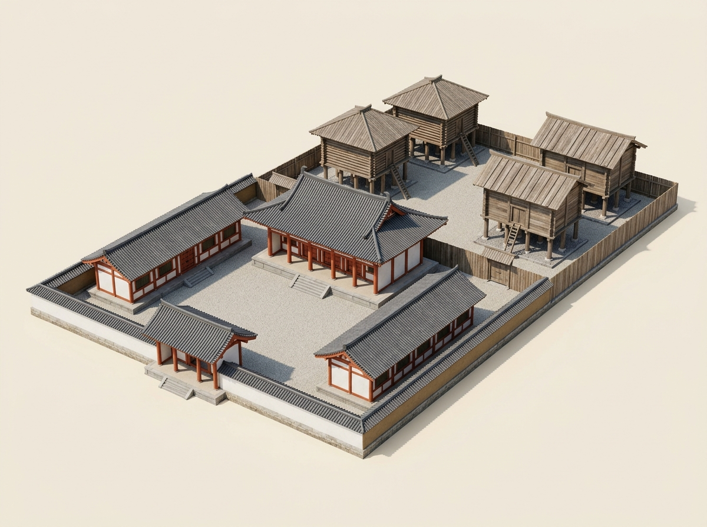
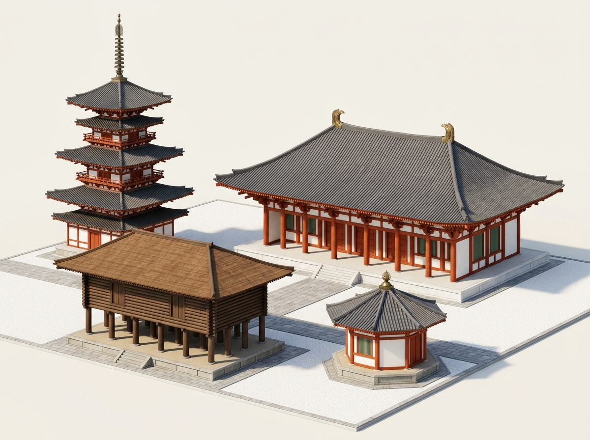
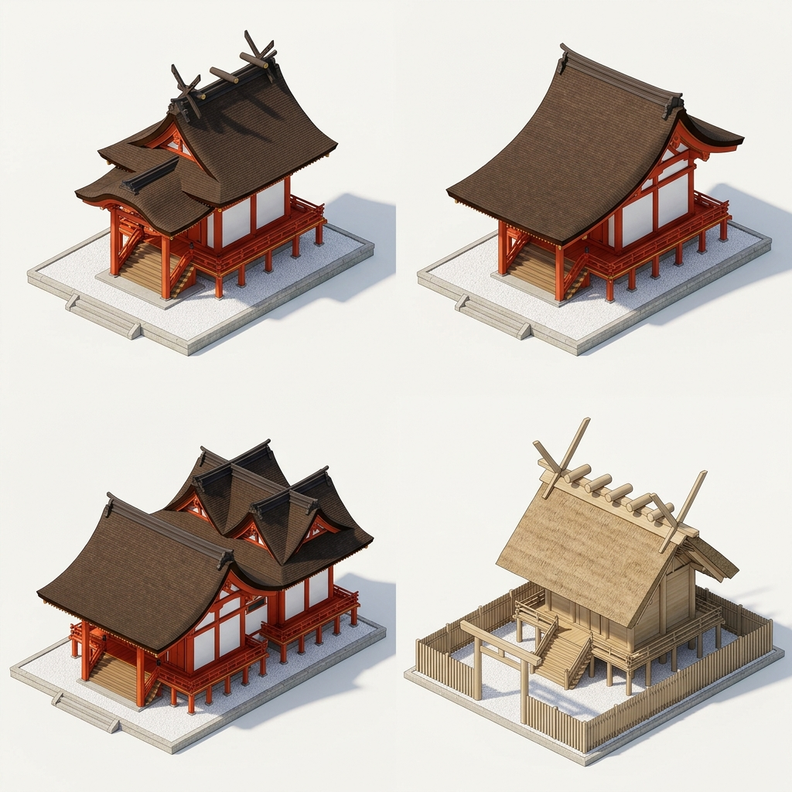

# 奈良時代（710–794年）宮都・大伽藍・大社ランドマーク調査 ＆ Simutrans「Phase C」設計計画

> [!NOTE]
> Phase C 専用イメージ図版（5点）の生成は画像生成サーバーの一時的なキャパシティ上限（`503 MODEL_CAPACITY_EXHAUSTED`）により今回見送り、既存の Phase A 建築考証図版（`nara_03` / `nara_05` / `nara_06`）を色彩・様式リファレンスとして掲載しています。専用図版を後追いで生成するか、このまま Blender 実寸モデリングへ進んで実レンダリングで確認するかをご判断いただけます。

---

## 1. 総論：奈良時代ランドマーク建築（「雲太・和二・京三」と国家規格化）

大化改新・律令体制の確立（701年大宝律令・710年平城京遷都）を背景に、日本の宮殿・寺院・神社のランドマーク建築は奈良時代に一斉に巨大化・体系化されました。

1. **宮都中枢の瓦葺・礎石建築化（710年〜）**:
   - 素木・掘立柱・板葺であった飛鳥板蓋宮（[buildings/cur/16..20_asuka_palace_*](../buildings/cur)）は `710年` で引退し、平城宮では**二重石積み基壇・礎石建ち・丹塗円柱・白漆喰壁・本瓦葺・金鴟尾（きんしび）**へと建築水準が劇的に刷新されました。
2. **鎮護国家仏教と天平様式（730〜759年）**:
   - 741年聖武天皇の「国分寺建立の詔」によって全国60余国に七重塔・金堂・築地塀を備えた**国分寺**が造営され、総本山として752年に**東大寺大仏殿**（天平創建様式・桁行11間）が開眼しました。飛鳥様式（エンタシス柱・雲斗）から盛唐直輸入の**直線的な太柱・三手先組物・広大な寄棟屋根・裳階**へと移行します。
3. **「雲太・和二・京三」と神社建築4大様式の確立**:
   - 後世の口遊にも「**雲太**（出雲大社）・**和二**（大和・東大寺大仏殿）・**京三**（大極殿）」と謳われた古代日本の三大巨建築が、いずれも奈良時代（8世紀）の実像・創建期に起源を持ちます。さらに725年の宇佐神宮（**八幡造**）、733年『出雲国風土記』（**古代高層大社造**）、768年の春日大社（**春日造**）により、伊勢（**神明造**）・**流造**を含む日本の主要神社様式が出揃います。

Phase C では、自由配置・都市内極稀出現向けの **平城宮3種・南都天平大寺院5種**、全国の大都市に自動出現する **国分寺1種**、および大社級神社 **4種（計13施設）** を一括設計し、あわせて既存の飛鳥寺社・宮殿・弥生ランドマークを含む全 `cur` 資産の `build_time` / `chance` を全面再調整します。

---

## 2. ① 平城宮（個別パーツ型 3種）

> 色彩・築地塀・瓦舎赤白の質感リファレンス（既存の [nara_architecture_research.md](./nara_architecture_research.md) 第4節図版より）：
>
> 

飛鳥宮と同様に個別パーツとして製作し、平城宮朝堂院・大極殿院をプレイヤーが自由に組み上げつつ単体でも都城の威容を放つ構成とします（`710..1185` により平安初期まで流用可能）。

| ID | 日本語名 / 英語名 | サイズ | 期間 | `lv` | `build_time` | `chance` | 建築的特徴 |
| :--- | :--- | :---: | :---: | :---: | :---: | :---: | :--- |
| `Nara_Heijo_Daigokuden` | 平城宮・第一次大極殿 `Heijo Palace First Daigokuden` | `4×2` | `710..1185` | `24` | `30000` | `5` | 桁行9間×梁間4間の重層入母屋・本瓦葺・金鴟尾。二重の石積み基壇「**龍尾壇**」と丹塗高欄・中央石階段・白砂前庭を備える都城最高峰。 |
| `Nara_Heijo_Suzakumon` | 平城宮・朱雀門 `Heijo Palace Suzakumon Gate` | `3×1` | `710..1185` | `16` | `30000` | `5` | 平城宮の正門。五間二戸の重層入母屋・丹塗柱・白壁・金鴟尾に、両翼の瓦葺築地塀を付属。 |
| `Nara_Heijo_Chodo` | 平城宮・朝堂院朝堂 `Heijo Palace Chodo Hall` | `3×1` | `710..1185` | `12` | `30000` | `5` | 朝堂院に東西対称に並ぶ長大な単層殿舎（丹塗柱・白壁・入母屋/切妻本瓦葺・石壇）。4向き対応により左右対称配置が可能。 |

> [!TIP]
> **朱雀門の扱い**: 実寸感のある五間二戸の威容を優先し `cur`（`3×1`）として設計します。道路を直接通したい用途には、既に実装済みの道路通過門 `Nara_Rajomon_Stop`（`1×1`）を併用・接続できます。

---

## 3. ② 南都・天平大寺院（個別パーツ型 5種）

既存の飛鳥式寺院 5種（`595..950`）は古刹として残しつつ、盛唐直輸入の天平建築 5種を追加します（いずれも `1600年` まで長期間維持）。

| ID | 日本語名 / 英語名 | サイズ | 期間 | `lv` | `build_time` | `chance` | 建築的特徴・既存飛鳥式との差異 |
| :--- | :--- | :---: | :---: | :---: | :---: | :---: | :--- |
| `Nara_Todaiji_Daibutsuden` | 東大寺・大仏殿（天平創建様式） `Todai-ji Great Buddha Hall (Tenpyo Style)` | `4×2` | `752..1600` | `28` | `30000` | `5` | 江戸再建（唐破風付・7間）ではなく、**752年創建の桁行11間×梁間7間**・広大な寄棟重層＋下層裳階（もこし）・巨大金鴟尾・正面 **唐破風なし** の水平大伽藍。前庭中央に八角銅燈籠を配置。既存 `Asuka_Daibutsuden`（`2×2`）を倍以上の横幅で圧倒。 |
| `Nara_Tenpyo_Kondo` | 天平式・金堂（唐招提寺型） `Tenpyo Golden Hall (Toshodai-ji Style)` | `3×2` | `759..1600` | `18` | `25000` | `10` | 広大な寄棟本瓦葺屋根と金鴟尾、正面1間吹き放しの**列柱廊（吹き抜け吹放し）**、直線的な太い円柱・三手先組物。 |
| `Nara_Yakushiji_Pagoda` | 天平式・裳階付三重塔（薬師寺東塔型） `Tenpyo Pagoda with Mokoshi (Yakushi-ji Style)` | `1×1` | `730..1600` | `12` | `20000` | `10` | 三重塔の各層に小屋根「**裳階（もこし）**」が付くリズミカルな六重シルエットと水煙相輪。単体塔 `Asuka_Sanjunoto` と明確に差別化。 |
| `Nara_Shosoin` | 正倉院・正倉（校倉宝庫） `Shoso-in Imperial Storehouse` | `2×1` | `756..1600` | `14` | `25000` | `10` | 奈良時代象徴建築。床下約2.7mの太い高床丸柱列に、三倉形式の三角断面ログを井桁に組んだ**校倉壁**と寄棟本瓦葺屋根。 |
| `Nara_Hakkakudo` | 天平・八角円堂（夢殿型） `Tenpyo Octagonal Hall (Hakkakudo)` | `1×1` | `739..1600` | `8` | `1500` | `45` | 八角石壇上の白壁・丹塗八角堂・八角瓦屋根・露盤宝珠。中都市で自然に建つ小規模天平寺院名所。 |

---

## 4. ③ 国分寺（全国大都市向け一体型伽藍 1種）

平城宮・東大寺・唐招提寺型が `build_time=20000..30000` / `chance=5..10` の超希少出現（事実上プレイヤー建設や極巨大都市限定）である一方、**741年の詔**に基づき諸国の国府付近・大都市に建てられた国分寺は、大都市へ自動出現する中核ランドマークとして **1区画完結型伽藍** とします。

| ID | 日本語名 / 英語名 | サイズ | 期間 | `lv` | `build_time` | `chance` | 建築的特徴 |
| :--- | :--- | :---: | :---: | :---: | :---: | :---: | :--- |
| `Nara_Kokubunji` | 奈良の国分寺（一体型伽藍） `Nara Kokubunji Provincial Temple` | `3×3` | `741..1450` | `18` | `3500` | `35` | 瓦葺築地塀と正面中門の内部に、**丹塗寄棟金堂・講堂・高い七重塔（または五重塔級高塔）・白砂境内・松桜**を国分寺式伽藍配置で凝縮した `3×3` 複合施設。 |

---

## 5. ④ 大社クラス神社（4種・全4様式＋古代高層出雲大社造コンプリート）

Phase A で実装した市内小社3種（`Nara_Shrine_Nagare`, `Kasuga`, `Shinmei`）に対し、未実装の第4様式「**八幡造**」と、総本社級 **大社3種（春日・伊勢・出雲）** を追加します。特にユーザー要望の **出雲大社** は、733年『出雲国風土記』および鎌倉期古図（金輪御造営差図）に基づく「**雲太**」の伝説的高層高床復元に挑みます。

| ID | 日本語名 / 英語名 | サイズ | 期間 | `lv` | `build_time` | `chance` | 建築的特徴 |
| :--- | :--- | :---: | :---: | :---: | :---: | :---: | :--- |
| `Nara_Shrine_Hachiman` | 八幡宮・八幡造（宇佐神宮型） `Hachiman Shrine (Hachiman-zukuri 2x2)` | `2×2` | `725..1600` | `10` | `2000` | `40` | **前殿と後殿の二棟を平入で前後連結**し軒を接する固有の「八幡造」本殿＋丹塗檜皮葺＋朱塗楼門・瑞垣・玉砂利。 |
| `Nara_Taisha_Kasuga` | 大社・春日大社型（3×2） `Kasuga Taisha Grand Shrine (3x2)` | `3×2` | `768..1600` | `16` | `4500` | `25` | 朱塗の回廊と中門の奥に並列する春日造檜皮葺本殿群・参道の石灯籠・背後の深い杉木立（鎮守の森）。 |
| `Nara_Taisha_Ise` | 大神宮・神明造大社（3×2） `Ise Grand Shrine (Shinmei-zukuri 3x2)` | `3×2` | `690..1600` | `18` | `6000` | `20` | 多重の素木板垣（瑞垣・玉垣）に囲まれた素木檜＋厚い茅葺の**神明造正殿**と東西宝殿・外削ぎ千木と鰹木・神明鳥居・深い檜杉林。 |
| `Nara_Taisha_Izumo` | 出雲大社・古代高層大社造（3×2） `Ancient Izumo Taisha High-Elevated Shrine (3x2)` | `3×2` | `710..1600` | `20` | `6000` | `20` | 「**雲太**」を体現する古代高層殿舎。束ねた巨大丸柱「**宇豆柱**」と斜材で支えた超高床本殿（反り檜皮葺・大千木鰹木・妻入）から、白砂の瑞垣前庭へ長い木階段「**木階（きざはし）**」が斜めに伸びる圧倒的シルエット＋松杉林。 |

---

## 6. ⑤ 既存寺社・宮殿 `cur` の `build_time` / `chance` 全面監査 ＆ 改修計画

全 `buildings/**/*.datt` および [buildings/parameters.xlsx](../buildings/parameters.xlsx) の `type=cur` エントリを監査した結果、**古墳・墳丘墓以外の飛鳥寺院 5種・飛鳥宮殿 5種・弥生物見櫓/主祭殿 2種がすべて `build_time=0`（または未指定）かつ `chance=100`** となっており、ゲーム内で郊外へ自動乱立する状態でした。

ユーザー指示どおり、これらに大きな `build_time`（または都市内出現閾値）と低い `chance` を設定して郊外自動生成を抑制し、奈良小社3種も階層感を整えます（※古墳・弥生墳丘墓 `buildings/cur/01..10`, `21..32` は野外観賞用のため従来の `build_time=0` を維持します）。

| 既存ID | サイズ | 期間 | 現 `lv` → 改 | 現 `bt` → 改（`.datt`） | 現 `ch` → 改（`xlsx`） | 方針 |
| :--- | :---: | :---: | :---: | :---: | :---: | :--- |
| `Asuka_Gojunoto` | `1×1` | `595..950` | `8` → `8` | `0` → **`20000`** | `100` → **`10`** | 郊外出現禁止・巨大都市限定（維持存続） |
| `Asuka_Sanjunoto` | `1×1` | `595..950` | `6` → `6` | `0` → **`20000`** | `100` → **`10`** | 同上 |
| `Asuka_Kondo` | `3×2` | `595..950` | `8` → `8` | `0` → **`25000`** | `100` → **`10`** | 同上 |
| `Asuka_Daikodo` | `3×2` | `595..950` | `8` → `8` | `0` → **`25000`** | `100` → **`10`** | 同上 |
| `Asuka_Daibutsuden` | `2×2` | `595..950` | `10` → `10` | `0` → **`30000`** | `100` → **`5`** | 同上 |
| `Asuka_Palace_Seiden` | `2×1` | `643..710` | `8` → `8` | 未指定 → **`30000`** | `100` → **`5`** | 飛鳥宮一式を大都市/手動向けへ是正 |
| `Asuka_Palace_Wakiden` | `1×1` | `643..710` | `4` → `4` | 未指定 → **`30000`** | `100` → **`5`** | 同上 |
| `Asuka_Palace_Chodo` | `2×1` | `643..710` | `6` → `6` | 未指定 → **`30000`** | `100` → **`5`** | 同上 |
| `Asuka_Palace_Okura` | `1×1` | `643..710` | `4` → `4` | 未指定 → **`30000`** | `100` → **`5`** | 同上 |
| `Asuka_Palace_Well_Rokoku` | `1×1` | `643..710` | `4` → `4` | 未指定 → **`30000`** | `100` → **`5`** | 同上 |
| `Monomi_Yagura` | `1×1` | `1..550` | `2` → `2` | 未指定 → **`150`** *(提案)* | `100` → **`70`** *(提案)* | 弥生集落内の出現制御（郊外乱立防止） |
| `Yayoi_Shusaiden` | `1×1` | `1..550` | `4` → `4` | 未指定 → **`300`** *(提案)* | `100` → **`60`** *(提案)* | 同上（集落中心建物として都市寄りに出現） |
| `Nara_Shrine_Nagare` | `1×1` | `710..1600` | `4` → `4` | `250` → `250` | `80` → `80` | 村・町の小社として現行維持 |
| `Nara_Shrine_Kasuga` | `1×1` | `768..1600` | `6` → **`5`** | `500` → `500` | `75` → `75` | 中小社の段階感を調整 |
| `Nara_Shrine_Shinmei` | `2×1` | `690..1600` | `7` → `7` | `800` → **`900`** | `65` → **`60`** | 八幡宮(`2000`)との中間層として微調整 |

---

## 7. ⑥ 技術仕様 ＆ 実装着手前の確認事項

- **共通レンダリング仕様**: 全13新規施設は [simutrans_blender.md](../simutrans_blender.md) 規約および `nara_arch_common.py` ＋ [tree_lib.py](../scripts/tree_lib.py) により **5季節（冬/春/夏/秋/雪）・4向き（`dims=X,Y,4`）・`needs_ground=1`・予約色ゼロ（`reserved={}`）** で生成します。
- **高層建築の高さ分割（縦積み `z` 層）**:
  - 既存五重塔 [asuka_gojunoto.datt](../buildings/cur/11_asuka_gojunoto/asuka_gojunoto.datt) の実装実績と同様に、1タイル高さ（128px）を大きく超える超高層建築（`Nara_Yakushiji_Pagoda`、`Nara_Kokubunji` 七重塔、`Nara_Taisha_Izumo` 古代高層本殿、`Nara_Todaiji_Daibutsuden`、`Nara_Heijo_Daigokuden`）では、`BackImage[rot][x][y][z]` の **複数 `z` 層分割（vertical stacking）** にも対応し、相輪や千木・大屋根頂部が途切れないよう設計します。
- **管理ファイル反映先**: `build_time` と画像配列は各アセットの `.datt`、`chance`・`level`・導入/引退年・翻訳名は [buildings/parameters.xlsx](../buildings/parameters.xlsx) に反映します。

### 実装（Blender モデリング）へ進む前のご確認ポイント
1. **サイズ感・フットプリント**: 上記13種（特に `4×2` の大極殿・東大寺大仏殿、`3×3` の国分寺、`3×2` の大社3種＋唐招提寺型金堂）のタイルサイズ感に違和感はありませんか？
2. **出現バランス（`build_time` / `chance`）**:
   - 大極殿・東大寺等の「事実上の希少配置枠（`build_time=20000..30000`, `chance=5..10`）」と、都市自動出現枠（国分寺 `3500`, 大社 `4500..6000`, 八幡宮 `2000`, 八角円堂 `1500`）の数値バランスで問題ないでしょうか？
   - 既存監査で見つかった `Monomi_Yagura` / `Yayoi_Shusaiden` の市内化（`build_time=150 / 300`）も同時に適用してよろしいでしょうか？
3. **次の進め方**: 専用イメージ図版の再試行（後でサーバー回復時に実施）を待ってから進めるか、それともこのまま **Blender での3D実装フェーズ（まず数棟ずつのモデリング＆レンダリング確認）** へ進んでよいかお聞かせください。

---

## 8. 実装結果（Phase C 完了メモ）

全13種の Phase C 新規ランドマークの Blender 5.2 モデリング・5季節4向きレンダリング・予約色検証・Excel/Tab統合、ならびに既存15種 `cur` 資産の `build_time` / `chance` / `level` 再調整および `JP_Historical_all.pak` コンパイルまで一括完了しました。

- **新規構築アセット (`buildings/cur/36..48_*`)**:
  - **平城宮 3種**: `Nara_Heijo_Daigokuden` (`4×2`, `3072×1280`, 220 sprites), `Nara_Heijo_Suzakumon` (`3×1`, `2048×896`, 100 sprites), `Nara_Heijo_Chodo` (`3×1`, `2048×512`, 60 sprites)
  - **南都・天平大寺院 5種**: `Nara_Todaiji_Daibutsuden` (`4×2`, `3072×1280`, 220 sprites), `Nara_Tenpyo_Kondo` (`3×2`, `3072×896`, 160 sprites), `Nara_Yakushiji_Pagoda` (`1×1`, `2048×384`, 40 sprites), `Nara_Shosoin` (`2×1`, `2048×384`, 40 sprites), `Nara_Hakkakudo` (`1×1`, `2048×256`, 20 sprites)
  - **国分寺 1種**: `Nara_Kokubunji` (`3×3`, `3072×1408`, 250 sprites)
  - **大社クラス神社 4種**: `Nara_Shrine_Hachiman` (`2×2`, `2048×896`, 100 sprites), `Nara_Taisha_Kasuga` (`3×2`, `3072×896`, 160 sprites), `Nara_Taisha_Ise` (`3×2`, `3072×896`, 160 sprites), `Nara_Taisha_Izumo` (`3×2`, `3072×896`, 160 sprites)
- **品質修正・外観検査**:
  - 初回再合成プレビュー確認にて検出した、`add_mokoshi_skirt` 上部隙間の閉鎖（大極殿・朱雀門・大仏殿）、大仏殿階段前の銅燈籠干渉解消、薬師寺東塔各層白壁の視認性向上、国分寺の七重塔と金堂の重なり解消（東側移設）と門高調整、春日大社4本殿の屋根間隔整理、古代出雲大社背面高欄の座標タイプミス修正、および全体的な `tree_lib` 樹木スケール拡大（0.95〜1.38）をすべて反映して再レンダリングし、全13種 `reserved={}` を確認しました。
- **既存資産更新 ＆ ビルド検証**:
  - 既存13本の `.datt` ファイル（`11..20_asuka_*`, `monomi_yagura`, `shusaiden`, `35_nara_shrine_shinmei`）の `build_time` 更新と [buildings/parameters.xlsx](../buildings/parameters.xlsx)（既存14件更新＋新規13件 `R89..R101` 追加）を反映。
  - `ruby scripts/make.rb makedat makeobj merge tab` が終了コード `0` で完了し、`build/JP_Historical_all.pak`（87,331,210 bytes）・`build/text/ja.historical.tab`（17,723 bytes）・`build/text/en.tab`（17,162 bytes）への統合、全13本のステージング `.pak` `makeobj LIST`（`building`）、および28本の `.dat` パラメータ一致検証を通過しました。
