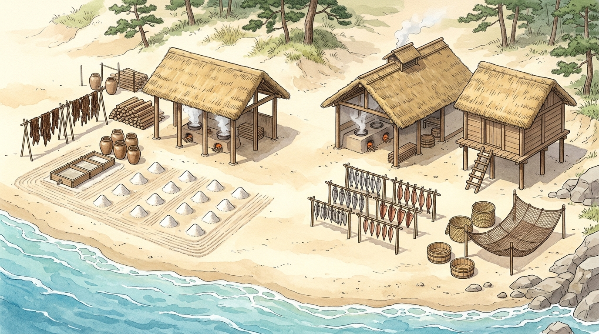
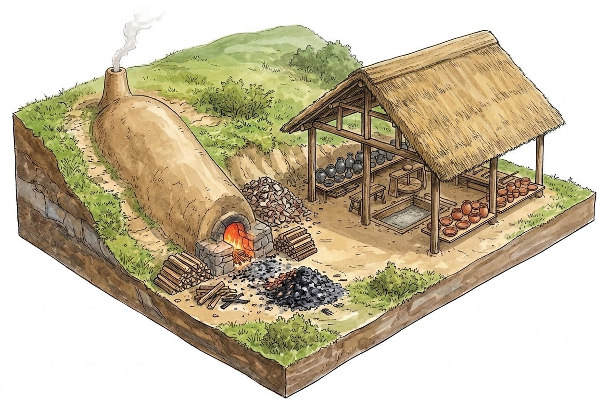
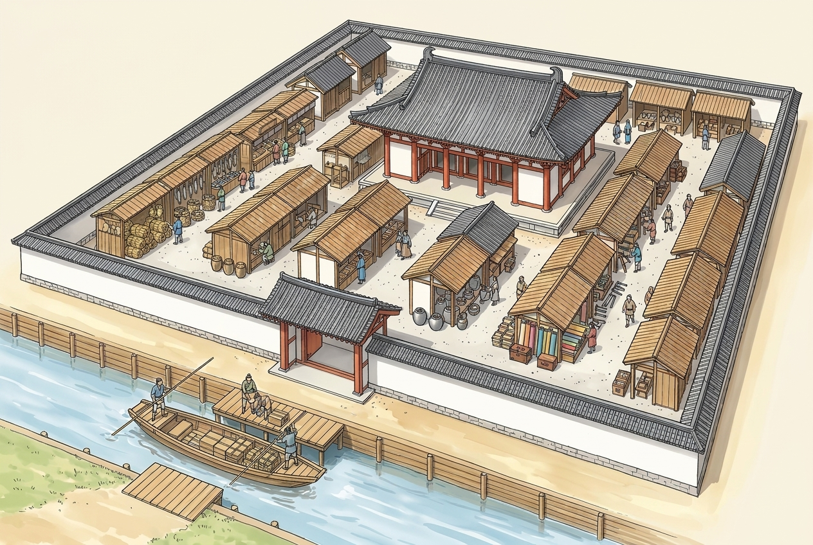
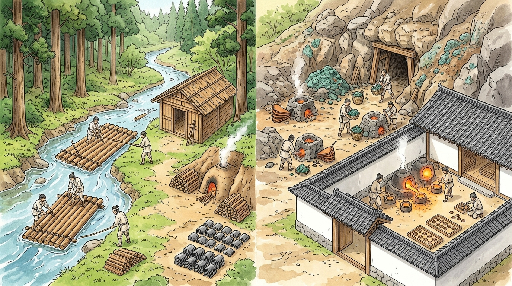
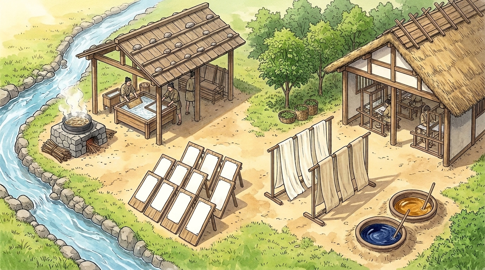
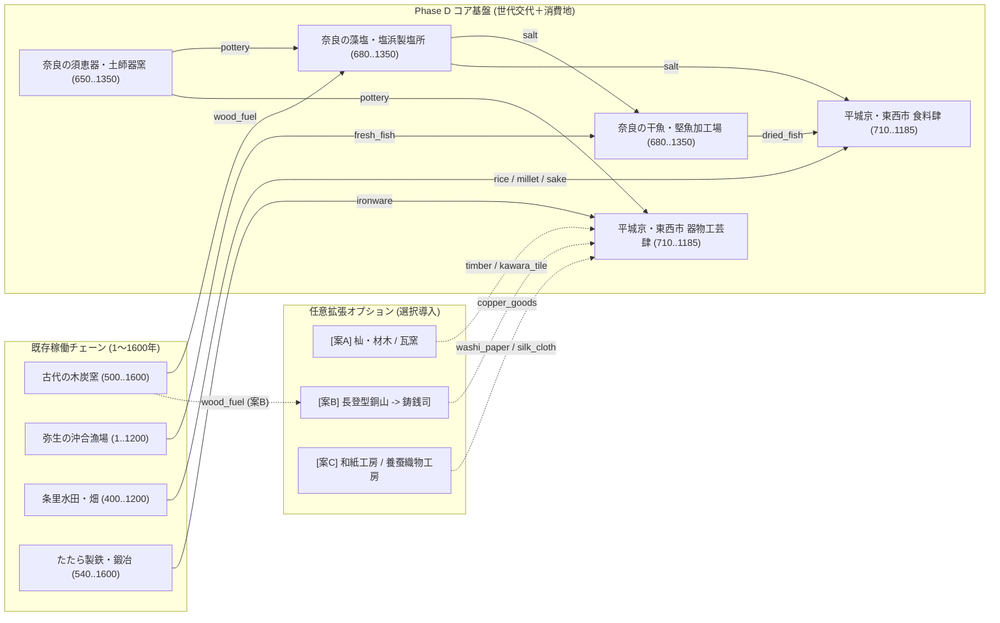

# 奈良時代（710–794年）産業・流通調査 ＆ Simutrans「Phase D」設計計画

> [!NOTE]
> 本資料は、すでに完了している **Phase A（[奈良時代建築様式調査](./nara_architecture_research.md)）** および **Phase B（[奈良時代交通・インフラ調査](./nara_transport_phaseB_research.md)）** に続き、奈良時代の生産・加工・消費チェーンを構築する **Phase D（産業・貨物）** の事前歴史調査および Simutrans 実装仕様案です。

---

## 1. 総論：奈良時代（710–794年）の産業構造と現行チェーンの課題

701年の大宝律令と710年の平城京遷都は、地方から都へ**調・庸・贄（塩・干魚・堅魚・和紙・絹布・木工品など）**や官営資源（**銅・瓦・材木・須恵器**）を集積し、都の官営市場（**東市・西市**）と全国を結ぶ一大物流網を生み出しました。

[Industries/parameters.xlsx](../Industries/parameters.xlsx)・[産業チェーンまとめ.md](../産業チェーンまとめ.md)・[goods/yayoi_goods.dat](../goods/yayoi_goods.dat)・[text/ja.tab](../text/ja.tab) を監査した結果、奈良〜平安初期の移行期における課題と方針は以下の4点に集約されます。

### 1-1. 現行産業チェーンの世代交代ギャップ（800年問題）

| 既存施設 (`name`) | 現行期間 | 出力 / 役割 | 現状の課題と Phase D 対応方針 |
| :--- | :---: | :--- | :--- |
| `Yayoi_Late_Saltworks`（弥生後期〜古墳の土器製塩所） | `150..800` | `salt`（塩） | **【必須】800年で後継なく消滅** → 奈良の藻塩・塩浜製塩所へ世代交代 |
| `Yayoi_Late_Dried_Fish_Factory`（弥生後期〜古墳の干物加工所） | `150..800` | `dried_fish`（魚加工品） | **【必須】800年で後継なく消滅**（漁場 `1..1200` の出荷先喪失）→ 奈良の干魚・堅魚加工場へ交代 |
| `Yayoi_Late_Wood_Fuel`（弥生後期〜古墳の薪炭工房） | `150..800` | `wood_fuel`（木質燃料） | `Ancient_Charcoal_Kiln`（`500..1600`）が後継として稼働中（維持可） |
| `Yayoi_Doki_Factory`（弥生の土器製作所） | `1..1200` | `pottery` | 奈良時代以後も弥生工房のまま残る → **奈良の須恵器・土師器登窯**へ世代交代（弥生工場の引退年を `800` 頃へ前倒し） |
| `Asuka_Market_Food` / `Asuka_Market_Craft` | `595..1200` | `city` 消費地（2系統） | 稼働中だが、奈良らしい**平城京・東西市（食料肆／器物・工芸肆）**を追加し消費拠点を拡充 |

### 1-2. 「土器 → 須恵器・陶磁器」貨物統合方針

- ユーザー方針に基づき、**須恵器も弥生土器と同じく「焼いた器」として貨物ID `pottery` に一本化**します。
- なお現在の翻訳ファイル（[text/ja.tab](../text/ja.tab) / [text/en.tab](../text/en.tab)）を確認したところ、`pottery` の訳語が **「弥生土器」/ `Yayoi Pottery`** となっていました。貨物ID `pottery` 自体は一切変えず、表示訳語のみ **「土器・陶磁器」/ `Pottery & Ceramics`**（または「土器・須恵器・陶磁器」）へ更新することで、弥生土器 → 古墳・奈良の須恵器/土師器 → 中世六古窯 → 近世陶磁器まで全時代の車両・工場設定を壊さず自然に接続できます。

### 1-3. 建築様式の明確な階級・地域コントラスト

Phase A（[奈良時代建築様式調査](./nara_architecture_research.md)）で確認した通り、奈良時代でも瓦葺き・丹塗建築は都城・官衙・大寺院に限られました。Phase D では以下の建築対比を徹底します。

- **地方・海辺の生産加工場（製塩所・干魚加工場・須恵器工房・和紙/織物工房）**:
  - 竪穴建物から移行した **掘立柱建物（ほったてばしら）＋茅葺き／石置き板葺き** を基本とし、湿気や獣害を防ぐ **高床板倉（たかゆかいたくら）** を伴う素朴な木造景観。
- **都の公設市場・官営工房（東西市・鋳銭司）**:
  - **築地塀（ついじべい）＋本瓦葺き市門／政庁（丹塗柱＋白漆喰）＋板葺/瓦葺の「肆（し）」長屋** による整然とした都城景観。

---

## 2. 海辺の生産拠点：藻塩・塩浜製塩所 ＆ 干魚・堅魚加工場

### 2-1. 奈良の藻塩・塩浜製塩所 (`Nara_Saltworks`) — 8世紀の製塩転換期モデル

- **歴史・考古学的背景**:
  - 弥生〜古墳時代の海浜では、海藻（ホンダワラ等）に海水をかけて干し、土器で煮詰める **藻塩焼き・土器製塩** が行われていました（能登・瀬戸内・紀伊・若狭などの海岸遺跡から大量の製塩土器が出土）。
  - **8世紀（奈良時代）**になると、人口約10万人の平城京や大寺院の塩需要（若狭・周防・紀伊・淡路・讃岐・備前等からの調塩木簡が平城京跡から大量出土）に応えるため、**砂浜の塩分を含んだ砂を集める（塩尻／塩砂山）→ 木枠のろ過槽「沼井（ぬい）」に砂を入れて海水を注ぎ濃い鹹水（かんすい）を採取 → 竈屋（かまや）の製塩土器／土釜で煮詰める** という、中世〜近世の揚浜式塩田の原型となる **初期「塩浜」技術** への過渡期に入りました。
- **3Dモデリング構成（掘立柱＋茅葺き＋砂浜過渡期）**:
  - **竈屋（煎熬小屋）**: 砂浜背後の掘立柱＋切妻茅葺き（吹き放ち・煙出し付）。土製カマドに製塩土器（尖底/丸底の煮沸土器）が並び、白煙が立ち上る。
  - **塩浜作業場**: 海側の砂浜面に **小さな円錐形の塩砂山（塩尻）** と **木枠の沼井（ろ過槽）・木桶** を配置し、さらに過渡期表現として **木架に干した濃褐色の海藻（藻塩用のホンダワラ）**、薪積み（`wood_fuel`）、搬入用の土器壺を置く。
- **Simutrans 仕様案**:
  - 立地 `shore`、`1x1`（4向き×夏・積雪2季節）、稼働期間 `680..1350`、レシピ `wood_fuel (100%) + pottery (50%) → salt (100%)`（既存チェーンと完全互換）。

### 2-2. 奈良の干魚・堅魚加工場 (`Nara_Dried_Fish_Factory`) — 調・庸・贄の水産加工村

- **歴史・考古学的背景**:
  - 平城京出土木簡の海産物貢納では、駿河・伊豆・安房・土佐・志摩などからの **堅魚（かつお：鰹節の原型で、煮熟後に乾燥・焙乾した保存食）・荒堅魚・煮堅魚・楚割（すわやり：魚肉の干物）・鯛・鰒（あわび）・海藻** が際立っています。
  - これらを製造した奈良時代の漁村・海辺作業場は瓦葺きではなく、**掘立柱・茅葺きの作業小屋**、煮沸・燻製用の土カマド、そして海産物を湿気や鼠害から守って長期保管・荷造りする **高床板倉** の組み合わせで構成されました。
- **3Dモデリング構成**:
  - **加工・燻製小屋**: 煙出し（越屋根小棟）付きの掘立柱茅葺き平屋。土カマド上の大釜で魚を煮熟する情景。
  - **高床板倉**: 木柱で高く持ち上げた板壁・茅葺きの倉庫＋梯子（完成した干魚・堅魚の保管庫）。
  - **浜辺の干場**: 木製干棚に並べて天日干しされる **開き魚（干物）と赤褐色の堅魚**、および籠・木桶・干し網。
- **Simutrans 仕様案**:
  - 立地 `shore`、`1x1`（4向き×2季節）、稼働期間 `680..1350`、レシピ `fresh_fish (100%) + salt (50%) → dried_fish (100%)`。

---

## 3. 窯業の世代交代：奈良の須恵器・土師器登窯

### 3-1. 奈良の須恵器・土師器窯 (`Nara_Sueki_Kiln`) — 陶邑窯・猿投窯モデル

- **歴史・考古学的背景**:
  - 弥生時代の「野焼き（地面での低温酸化炎焼成）」から、古墳中期以降に朝鮮半島伝来の窯業技術による **半地下式／地下式の窖窯・登窯（のぼりがま）** が導入され、奈良時代には **陶邑窯（大阪府南部）** や **猿投窯（愛知県）**、地方の国分寺・郡衙周辺の官窯群で大量生産体制が確立しました。
  - 奈良時代後期の窯には床面に段差を付けて焼成効率と均熱性を高めた **有段登窯** も普及し、還元炎焼成による硬質青灰色の **須恵器（長頸瓶・坏・甕など）** が全国に流通しました（同時に伝統的な赤褐色酸化炎焼成の **土師器** も平窯・覆い焼きで調理具や日常食器として並行生産されました）。
- **窯場・工房の遺構構造**:
  - **登窯本体**: 緩やかな丘陵斜面に半地下式で掘り抜き、粘土でアーチ天井（穹窿）を築いたトンネル窯。下端に石組みの **焚口（たきぐち）**、上端に排煙の **煙道口**、窯前に掻き出した炭・灰と失敗品の山 **灰原（はいばら）** と大量の薪束を配置。
  - **隣接工房（掘立柱＋茅葺き）**: 吹き放ちの掘立柱茅葺き作業小屋に、水簸・粘土調整用の **泥溜め坑**（土間掘り込み木枠）、木製ロクロ、そして板棚に並べた **灰色の須恵器群** と **赤褐色の土師器群** を表現。
- **貨物・バランス設計上の重要ポイント**:
  1. **貨物ID `pottery` の一貫維持**: レシピ出力は既存と同じ `pottery`（日英訳名を「土器・陶磁器 / Pottery & Ceramics」へ更新）。これにより、製塩所・酒造工房・肉加工所・市・全車両との連携が途切れません。
  2. **燃料入力（`wood_fuel`）の有無**: 現在800年以降の工場群を調べると、`wood_fuel` は既に **5系統**（製塩・酒造・たたら製鉄・鍛冶・器物市）で消費されており、供給元は `Ancient_Charcoal_Kiln`（`prod=30`）が主力です。須恵器窯まで `wood_fuel` 入力にすると燃料供給網が過負荷になりやすいため、**一次生産（入力なし・粘土と周囲薪山で自給、`output=pottery` のみ）** とするのがゲームバランス上最も安定します（※薪消費を厳密に入れたい場合は `input=wood_fuel (50%)` にし `Ancient_Charcoal_Kiln` の生産力または分布重みを少し上げる調整も選択可能です）。
  3. **世代交代**: 稼働期間 `650..1350`、既存の `Yayoi_Doki_Factory` の `retire_year` を `1200 → 800` に更新します。

---

## 4. 平城京の二大消費地：東市・西市（食料肆／器物・工芸肆）

### 4-1. 東市・西市の歴史構造と既存市街建物との棲み分け

- **歴史・考古学的背景**:
  - 平城京には左京八条三坊に **東市（ひがしのいち）**、右京八条二坊に **西市（にしのいち）** が設けられ、それぞれが堀河（人工運河）と接して水陸物資を集散しました。
  - 周囲を **瓦葺き築地塀** と **市門** で囲み、中央奥に相場・度量衡（和同開珎流通を含む）・治安を統制する **市司（いちのつかさ：丹塗柱・白漆喰・本瓦葺き）** が置かれ、区画内の砂利通り沿いに規則正しく並んだ店舗長屋 **肆（し／いちくら）** で各種物品が商われました。
- **Phase A 一般商業建物 (`com`) との差別化**:
  - Phase A では都市成長用 `com` 建物（`1x1`）として [Nara_07_Tozai_Ichi](../buildings/city_buildings/40_nara_tozai_ichi/nara_07_tozai_ichi.png) と [Nara_08_Ichinotsukasa](../buildings/city_buildings/41_nara_ichinotsukasa/nara_08_ichinotsukasa.png) を作成済みです。
  - 今回の Phase D で作るのは **貨物を受け入れる産業消費地（`obj=factory`, `location=city`）** であるため、一目で「貨物路線の終着拠点」と分かる **`2x1` サイズ**（または高密度 `1x1`）の重厚な市場複合区画として設計します。

### 4-2. 2系統消費地の設計

| アドオンID (`name`) | 日本語名称 | サイズ / 期間 | 受入品目（基本＋拡張） | 視覚的特徴・演出 |
| :--- | :--- | :---: | :--- | :--- |
| `Nara_Tozai_Market_Food` | 平城京・東西市（食料肆） | `city` / `2x1`（または `1x1`） `710..1185` | **基本**: `rice`, `millet`, `salt`, `dried_fish`, `cured_meat`, `sake` | 築地塀・瓦葺市門＋朱柱の市司庁＋板葺/檜皮の肆長屋群。店頭に**米俵・塩籠・干魚束・酒甕**を陳列 |
| `Nara_Tozai_Market_Craft` | 平城京・東西市（器物・工芸肆） | `city` / `2x1`（または `1x1`） `710..1185` | **基本**: `pottery`, `stone_goods`, `ironware`, `wood_fuel` *(オプションA/B/C採用時)* `kawara_tile` / `copper_goods` / `washi_paper` / `silk_cloth` を追加 | 同形式の公設市場区画。店頭・中庭に**青灰色の須恵器群・鉄製農工具・木材/瓦・巻物/反物・銭箱**を陳列 |

- なお既存消費地 `Asuka_Market_Food` / `Asuka_Market_Craft`（`595..1200`）はそのまま中世まで併存させることも、`900` 頃に引退させて地方飛鳥系から奈良・平安の東西市へ交代させることも可能です（併存がマップ上のバリエーションが豊富で扱いやすいです）。

---

## 5. 奈良時代を象徴する新規産業・新規貨物チェーン候補（任意拡張 A / B / C）

[作成リスト.md](../作成リスト.md#L192) に挙げられた「奈良時代ならではの代表産業」を、すべて既存と同じ **`catg=1`（混載貨物）** として追加できる **3つの拡張パッケージ案（A〜C）** に整理しました。

> [!TIP]
> **既存車両との互換性（技術検証済み）**
> 本パックの既存貨物15種はすべて `catg=1` です。[nara_vehicles_all.datt](../vehicles/nara_vehicles/nara_vehicles_all.datt) と [nara_ships_all.datt](../vehicles/nara_ships/nara_ships_all.datt) は全15貨物を荷姿別にマップしています（`kofun_packhorses_all.datt`・`heian_wasen_cargo.datt` は代表品目のみ定義）。Simutrans では `catg=1` の新貨物を追加しても既存車両でそのまま輸送可能であり、**`Nara_*` の荷牛車・力車・平田舟に `freightimagetype[15..]` を追記すれば積荷グラフィックの切替も完全に連動**できます。

### オプション A & B：造営建材（木材・瓦）＆ 国家鉱業・貨幣（銅山・鋳銭司）

#### オプション A：造営・建材チェーン（杣・材木 ＆ 瓦窯）
- **歴史背景**: 平城宮・東大寺・国分寺の空前の大造営では、近江（田上山）・伊賀・飛騨・吉野などの山林 **「杣（そま）」** から伐採したヒノキ・スギ巨木を川で **筏流し** して木津港へ運び、奈良山丘陵の **瓦窯**（中山瓦窯など）で大量の本瓦を焼成しました。Phase B で作った「瓦と材木を積んだ荷牛車・平田舟」がまさに本領を発揮するチェーンです。
- **施設・貨物案**:
  - **新規貨物（1〜2種）**: `timber`（材木・建築用材、`wood_fuel`＝薪炭と区別した丸太・角材） / `kawara_tile`（瓦・本瓦）
  - **工場**:
    1. `Nara_Soma_Timber_Camp`（奈良の杣・材木伐採場、`Land`, `680..1600`）→ `timber`（※中世〜近世の城郭・寺社建材にもそのまま延長利用可！）
    2. `Nara_Kawara_Kiln`（奈良山型の瓦窯、`Land`, `690..1200`）→ `kawara_tile`（入力なし、または `wood_fuel` 少量）
    3. **消費先**: `Nara_Tozai_Market_Craft`（器物・資材肆）または専用消費地 `Nara_Zoei_Yard`（都城・大寺の造営司／作所、`city` または `Land`）が `timber + kawara_tile + ironware + stone_goods` を受け入れる構成も可能。

#### オプション B：長登型銅山・鋳銭司チェーン（和同開珎 708年・大仏鋳造）
- **歴史背景**: 708年の「和同開珎」発行（武蔵国秩父からの和銅献上、実務の最大供給源は山口県 **長登銅山** 等の官営採銅・荒銅精錬遺跡）と東大寺盧舎那仏の鋳造は、律令国家の金属技術と経済の到達点です。長登銅山から荒銅が周防・長門・近江・河内等の **鋳銭司（ちゅうせんし）** へ送られ、木炭を使って銅銭（皇朝十二銭）や銅椀・仏具が鋳造されました。
- **施設・貨物案**:
  - **新規貨物（2種）**: `copper_ore`（銅鉱・荒銅、`698〜`）／ `copper_goods`（銅銭・銅器、`708〜`）
  - **工場**:
    1. `Nara_Copper_Mine`（長登型銅山・採銅精錬場、`Land`, `698..1600`）→ `copper_ore`（※石見・別子・足尾につながる鉱業の祖型）
    2. `Nara_Chusenshi_Mint`（律令の鋳銭司・鋳銅工房、`Land`, `708..1400`）：築地塀＋瓦葺作業舎＋鋳型・銅銭トレイ。`copper_ore + wood_fuel → copper_goods`
    3. **消費先**: `Nara_Tozai_Market_Craft`（東西市ではまさに和同開珎の流通統制が市司の重要職務でした）。

---

### オプション C：文芸・律令調庸チェーン（和紙工房 ＆ 養蚕・絹麻織物）

- **歴史背景**:
  - **和紙**: 大宝律令（701年）の戸籍・計帳・正倉院文書や国分寺写経（Phase A の [Nara_10_Shakyo_Kobo](../buildings/city_buildings/43_nara_shakyo_kobo/nara_10_shakyo_kobo.png)）は莫大な紙（麻紙・楮紙・穀紙）を必要とし、中央の図書寮および全国40余国で **和紙（紙漉き）** が発達しました。
  - **絹・麻布**: 律令税制 **「調」** の花形が全国各地で織られた **絁（あしぎぬ＝粗絹）・絹（きぬ）**、**「庸」** の代表が **庸布（麻布）** です。正倉院の墨書布や荷札木簡に産地・品質が刻まれ、駄馬や荷牛車で都へ運ばれて東西市に並びました。
- **施設・貨物案**:
  - **新規貨物（1〜2種）**: `washi_paper`（和紙）／ `silk_cloth`（絹・麻布 ※既存や将来の織物産業へそのまま直結）
  - **工場**:
    1. `Nara_Washi_Workshop`（奈良の紙屋・和紙漉き工房、`Land`, `701..1600`）→ `washi_paper`（掘立柱板葺き・楮蒸し釜・漉舟・日光干し板）
    2. `Nara_Silk_Weaving_Workshop`（養蚕・調庸織物工房、`Land`, `701..1600`）→ `silk_cloth`（桑樹・掘立柱織舎・織機・反物干し・藍甕）
  - **消費先**: `Nara_Tozai_Market_Craft`（市・肆）。さらに `silk_cloth` や `washi_paper` は平安・鎌倉・江戸時代まで途切れることなく受け継げる基盤貨物になります。

---

## 6. Simutrans Phase D 全体構成・パラメータ仕様案

### 6-1. Phase D 追加産業チェーン図（コア確定＋任意拡張オプション）

### 6-2. 施設パラメータ仕様案（一覧）

#### 【コア5施設】（800年問題解消・須恵器世代交代・東西市消費地）

| アドオンID (`name`) | 日本語名称案 | `dims` / `location` | `intro..retire` | `Lv` | `Prod / Range` | 入力原料 (`input`) | 出力 (`output`) | 建築表現（夏/積雪2季節・`needs_ground=1`） |
| :--- | :--- | :---: | :---: | :---: | :---: | :--- | :--- | :--- |
| `Nara_Saltworks` | 奈良の藻塩・塩浜製塩所 | `1,1,4` / `shore` | `680..1350` | `4` | `34 / 24` | `wood_fuel` (100,180) `pottery` (50,120) | `salt` (100,180) | 掘立柱茅葺竈屋＋沼井・塩尻砂山＋藻塩干し架け |
| `Nara_Dried_Fish_Factory` | 奈良の干魚・堅魚加工場 | `1,1,4` / `shore` | `680..1350` | `4` | `34 / 24` | `fresh_fish` (100,180) `salt` (50,120) | `dried_fish` (100,180) | 掘立柱茅葺煮熟小屋＋高床板倉＋干魚・堅魚干棚 |
| `Nara_Sueki_Kiln` | 奈良の須恵器・土師器窯 | `1,1,4` / `Land` | `650..1350` | `4` | `32 / 24` | *(なし推奨：注1)* | `pottery` (100,180) | 丘陵の粘土拱登窯＋灰原・薪束＋掘立柱茅葺成形小屋＋須恵器・土師器 |
| `Nara_Tozai_Market_Food` | 平城京・東西市（食料肆） | `2,1,4` / `city` | `710..1185` | `5` | `38 / 26` | `rice`(100), `millet`(100), `salt`(80), `dried_fish`(80), `cured_meat`(80), `sake`(70) | *(消費地)* | 築地塀・瓦葺市門＋朱柱市司＋肆長屋＋米俵・塩籠・干魚 |
| `Nara_Tozai_Market_Craft` | 平城京・東西市（器物・工芸肆） | `2,1,4` / `city` | `710..1185` | `5` | `38 / 26` | `pottery`(90), `stone_goods`(70), `ironware`(100), `wood_fuel`(60) *(＋選択導入貨物)* | *(消費地)* | 築地塀・瓦葺市門＋朱柱市司＋肆長屋＋須恵器・鉄器・工芸品 |

- 注1：`Nara_Sueki_Kiln` を一次生産とするのは、800年時点で `Ancient_Charcoal_Kiln` (`prod=30`) 1系統に対して既に5系統が `wood_fuel` を消費しているため、燃料ボトルネックを防ぐバランス設計です（薪束はビジュアル表現として配置）。

#### 【既存設定の更新項目（コア変更時）】

| 対象ファイル / ID | 変更前 | 変更案 | 理由 |
| :--- | :--- | :--- | :--- |
| [Industries/parameters.xlsx](../Industries/parameters.xlsx) (`Yayoi_Doki_Factory`) | `retire_year=1200` | `retire_year=800` | 奈良の須恵器・土師器窯（`650..1350`）へのスムーズな世代交代 |
| [text/ja.tab](../text/ja.tab) / [text/en.tab](../text/en.tab) (`pottery`) | `弥生土器` / `Yayoi Pottery` | `土器・陶磁器` / `Pottery & Ceramics` | `pottery` 貨物IDを維持したまま須恵器・将来時代へ一貫対応 |

#### 【任意拡張オプション候補（選択制・すべて `catg=1`・`seasons=2`）】

| 案 | 新規貨物 (`good`) | 新規施設案 (`dims` / `location` / `intro..retire`) | 原料 → 出力 | 備考 |
| :-: | :--- | :--- | :--- | :--- |
| **A** | `timber`（材木） `kawara_tile`（瓦） | `Nara_Soma_Timber_Camp`（`1,1,4`, `Land`, `680..1600`） `Nara_Kawara_Kiln`（`1,1,4`, `Land`, `690..1200`） *(任意)* `Nara_Zoei_Yard`（造営司, `city` or `Land`） | `→ timber` `→ kawara_tile` 消費先へ供給 | 中世・近世の建築資材（材木・瓦）まで長期間使える基本貨物 |
| **B** | `copper_ore`（銅鉱・荒銅） `copper_goods`（銅銭・銅器） | `Nara_Copper_Mine`（長登型銅山, `1,1,4`, `Land`, `698..1600`） `Nara_Chusenshi_Mint`（鋳銭司, `1,1,4`, `Land`, `708..1400`） | `→ copper_ore` `copper_ore + wood_fuel → copper_goods` | 和同開珎・大仏鋳造の象徴。銅山は近世まで延長可 |
| **C** | `washi_paper`（和紙） `silk_cloth`（絹・麻布） | `Nara_Washi_Workshop`（紙屋工房, `1,1,4`, `Land`, `701..1600`） `Nara_Silk_Weaving_Workshop`（調庸織物工房, `1,1,4`, `Land`, `701..1600`） | `→ washi_paper` `→ silk_cloth` | 写経・文書・調庸税を再現。平安〜江戸へそのまま継承可 |

---

## 7. 実装着手前の確認事項

本調査の内容および図版をご確認のうえ、以下の4点についてご意向をお聞かせください：

1. **コア5施設の構成・仕様**:
   - **製塩所 (`Nara_Saltworks`)・干魚加工場 (`Nara_Dried_Fish_Factory`)・須恵器窯 (`Nara_Sueki_Kiln`)・東西市 食料肆/器物工芸肆 (`Nara_Tozai_Market_Food` / `Craft`)** の5施設を基本セットとする方針でよろしいでしょうか？
   - `pottery` の翻訳名変更（`弥生土器` → `土器・陶磁器` 等）および `Yayoi_Doki_Factory` の引退年を `800` に前倒しして問題ないでしょうか？
2. **任意拡張（オプション A / B / C）の導入範囲**:
   - まずは **コア5施設のみ** 先行作成するか、**案A（材木・瓦）／案B（銅山・鋳銭司）／案C（和紙・絹麻布）** の中から今回 Phase D に加えたいチェーンはありますか？
3. **東西市消費地のサイズと既存飛鳥市場との扱い**:
   - Phase A の `1x1` 商業建物と差別化するため、東西市（食料肆／器物肆）は **`2x1` サイズ**（2タイル並列・築地塀＋市司＋肆）と **`1x1` サイズ** のどちらが都市内へ配置しやすいでしょうか？
   - 既存の `Asuka_Market_Food` / `Asuka_Market_Craft`（`595..1200`）はそのまま中世まで併存させるか、`900` 頃に引退させますか？
4. **須恵器窯の燃料入力（`wood_fuel`）有無**:
   - 木炭窯への負荷バランスを優先して **一次生産（入力なし）** にするか、あるいは歴史的リアリティを重視して **`wood_fuel` 少量入力（例: `50%`）** にしますか（その場合は木炭窯 `prod` 増強等とセットで調整します）？

---

## 8. 実装結果（Phase D 完了メモ）

ユーザー決定に基づき、コア5施設＋和紙・養蚕織物チェーン（計8工場＋3貨物＋2種・8クラスフィールド）を一括実装・レンダリング・Excel/Tab統合・コンパイルまで完了しました。

- **確定・実装した仕様**:
  1. **採用ラインナップ（オプション C を採択・拡張、案A/Bは見送り）**:
     - コア5施設: `Nara_Saltworks`（`shore`, `680..1350`）、`Nara_Dried_Fish_Factory`（`shore`, `680..1350`）、`Nara_Sueki_Kiln`（`Land`, `650..1350`）、`Nara_Tozai_Market_Food`（`city`, `2x2`, `710..1185`）、`Nara_Tozai_Market_Craft`（`city`, `2x2`, `710..1185`）。
     - 和紙・繊維・織物チェーン（近世・近代軽工業への継続貨物として `goods/nara_goods.dat` に `raw_fiber`, `textiles`, `paper` をすべて `catg=1` で追加）: `Nara_Washi_Workshop`（`710..1600`, `wood_fuel 35% → paper`）、`Nara_Fiber_Farm`（`710..1600`, `→ raw_fiber` ＋ 5季節対応フィールド `Nara_Mulberry_Field_1` / `Nara_Hemp_Field_2` 各4回転計8クラス）、`Nara_Textiles_Workshop`（`710..1600`, `raw_fiber → textiles`）。
  2. **2×2 東西市消費地と飛鳥市の併存**:
     - `Nara_Tozai_Market_Food` / `Craft` は築地塀＋四脚門＋市司＋肆長屋を備えた **`2x2`**（`level=6`, `Prod=38 / Range=26`）として実装。既存の `Asuka_Market_Food` / `Asuka_Market_Craft`（`595..1200`）も地方小規模市として併存運用。
  3. **燃料バランス調整・訳語統一・車両対応**:
     - `Nara_Sueki_Kiln` に `wood_fuel (40%)`、`Nara_Washi_Workshop` に `wood_fuel (35%)` を設定したため、`Ancient_Charcoal_Kiln` を `productivity: 30 → 42`, `range: 22 → 26`, `outputcapacity[0]: 200 → 260` へ増強。
     - `pottery` 貨物IDを維持したまま [text/ja.tab](../text/ja.tab) / [text/en.tab](../text/en.tab) を `土器・陶磁器` / `Pottery & Ceramics` に改称し、`Yayoi_Doki_Factory` の `retire_year` を `800` へ更新。
     - 既存の `Nara_Rikisha_Cargo`, `Nara_Oxcart_1/2/3_Cargo`, `Nara_Hiratabune_Cargo/Large` に `freightimagetype[15..17]`（`raw_fiber`, `textiles`, `paper`）を追加。
  4. **品質・ビルド検証**:
     - 全8工場＋2フィールドの生成スプライトで `reserved={}`（予約色ゼロ）を確認し、`ruby scripts/make.rb makedat makeobj merge tab` で `build/JP_Historical_all.pak`（73,423,489 bytes）・`build/text/ja.historical.tab`・`build/text/en.tab` への統合とオブジェクト収録を検証完了。
