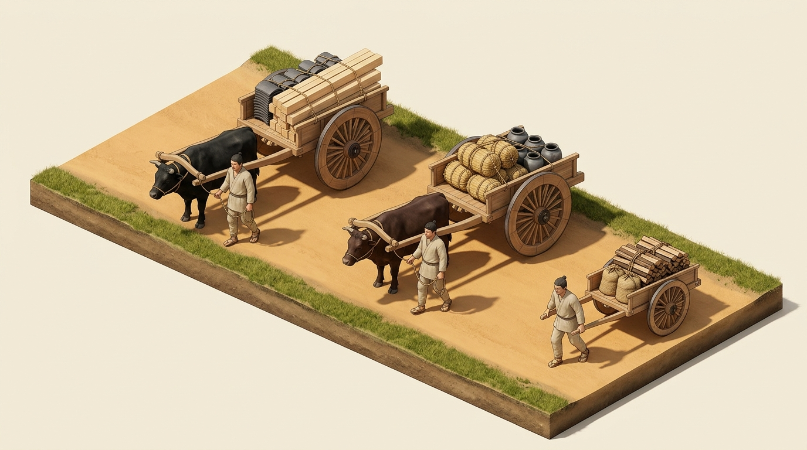
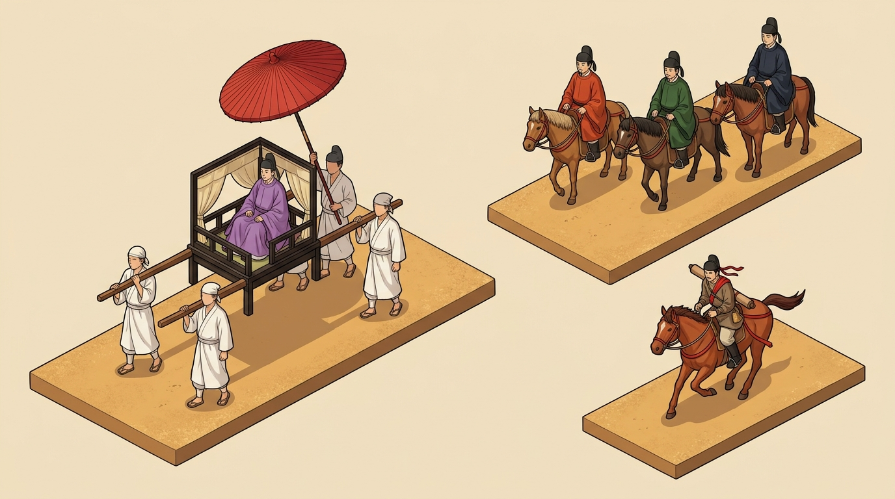
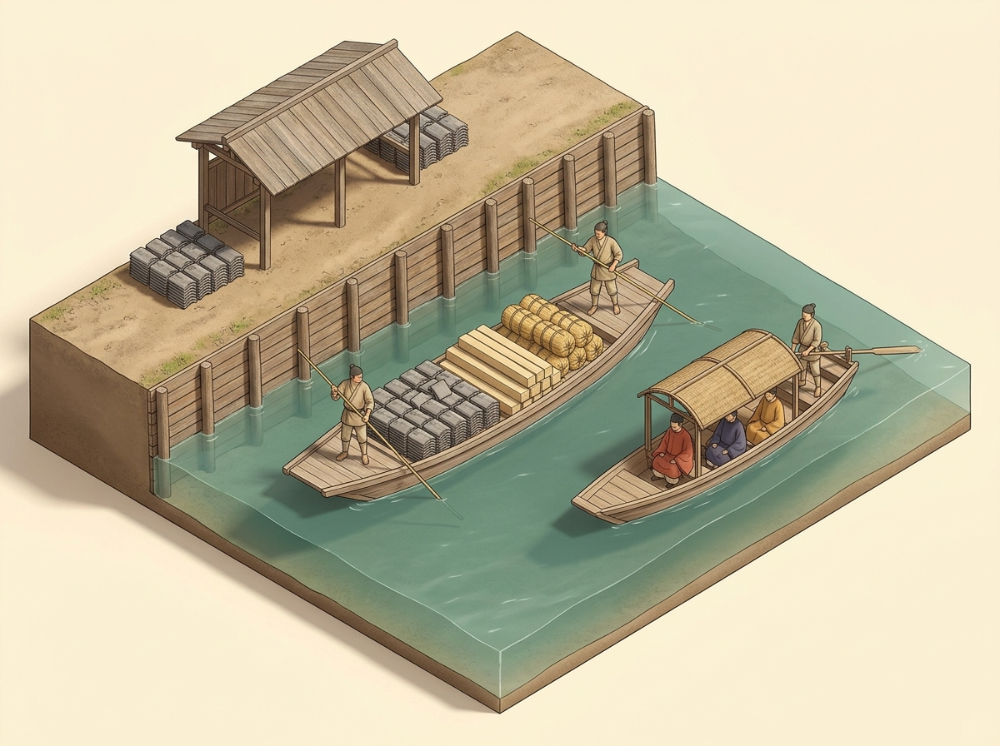
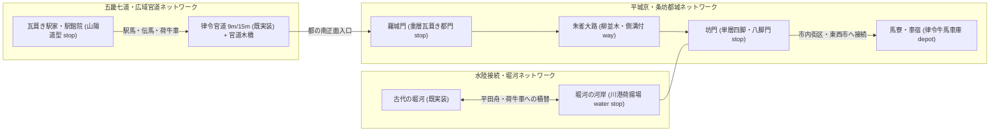

# 奈良時代（710–794年）交通・車両・インフラ調査 ＆ Simutrans「Phase B」実装計画

> [!NOTE]
> 本資料は、すでに完了している **Phase A（[奈良時代建築様式調査](./nara_architecture_research.md)・一般建物/国庁/郡衙/小社 15棟）** に続き、奈良時代の陸上・水上交通および関連インフラ（車両・街路・門型停留所・瓦葺き駅家・馬寮/車宿）を実装するための事前歴史調査と Simutrans 設計計画です。

---

## 1. 総論：奈良時代（710–794年）の交通・物流革命

701年の**大宝律令**と710年の**平城京遷都**は、約10万人を擁する巨大消費都市・平城京の出現と、全国60余国を結ぶ中央集権的ネットワーク **「五畿七道・駅伝制」** を生み出しました。これにより、古墳・飛鳥時代（駄馬・丸木舟・準構造船）から一段階進んだ重物流・公的旅客・都市交通インフラが成立しました。

特に本パックの時代区分（飛鳥 → 奈良 → 平安）において押さえるべき最重要ポイントは以下の4点です。

1. **「荷牛車（借車）」と「乗用牛車（ぎっしゃ）」の時代区分**
   - 貴族が屋根・網代付きの美しい牛車（ぎっしゃ）に乗って移動する文化は**平安時代以降**に定着します（本パックの[作成リスト](../作成リスト.md)でも平安時代担当）。
   - **奈良時代の牛車（荷牛車）は「重量貨物専用の運搬車」**であり、正倉院文書に頻出する造東大寺司等の**「借車（しゃしゃ／かりぐるま）」**契約によって、木津・泉津など川港から平城京内へ瓦・材木・米俵を運びました。
2. **奈良時代の陸上旅客輸送＝「伝馬」と「輿（腰輿・手輿）」**
   - 律令制下の公的旅行（国司・官人の赴任等）は郡衙などに常備された騎乗用の**伝馬（てんま）**が担い、急使・公文書逓送は駅家（約16km＝30里ごと）で馬を乗り継ぐ**駅馬（えきば／はゆま）**が担いました。
   - 高位貴族や皇族・高僧の都市内移動には、車ではなく人力で担ぐ**輿（腰輿・手輿・輦輿）**が用いられました。
3. **「堀河」と「平田舟（川船）」による水陸一貫輸送**
   - 重い瓦や材木・調庸米を10万人都市へ供給するため、難波津〜淀川〜木津川の水運と直結する人工運河 **東堀河・西堀河** が平城京（特に東市・西市脇）へ引き込まれ、喫水の浅い平底木造船（**平田舟・川船**）が大量物資を運びました。
4. **国家威信を示す「瓦葺き駅家」と「羅城門・朱雀大路・馬寮」**
   - 大陸・新羅からの外交使節（蕃客）を迎え入れるため、平城京の正門である**羅城門**・並木付きの**朱雀大路**、平城宮の**左右馬寮・車宿**、そして山陽道では『続日本紀』に記され発掘でも確認された**「瓦葺き・丹塗白壁」の駅家（駅館院）**が整備されました。

### 時代間の交通対比（飛鳥以前 vs 奈良時代 vs 平安時代以降）

| 輸送区分 | 飛鳥時代以前（既存アセット） | 奈良時代（Phase B 実装ターゲット） | 平安時代以降（後続フェーズ） |
| :--- | :--- | :--- | :--- |
| **陸上貨物** | 人力の運搬人（〜800）、古墳駄馬（4/8/16t・8km/h） | **荷牛車・借車**（重量物専用・スポーク車輪）＋ 手引き**力車** | 馬借・車借・大型荷車 |
| **陸上旅客** | 弥生運搬人案内（**800年で引退し以後ゼロ**） | **腰輿・手輿**（貴族・都市）＋ **律令伝馬**（騎馬官人隊・長距離） | 貴族乗用の**網代牛車（ぎっしゃ）** |
| **郵便連絡** | 古墳騎馬郵便（15km/h） | 律令 **駅馬（早馬・駅鈴）**（駅家乗り継ぎ・高速化） | 飛脚・早馬の分化 |
| **河川・運河** | 弥生丸木舟（〜800）、準構造船（〜1000） | **平田舟（荷船）／屋形平田舟（旅客）**（堀河・浅瀬対応平底船） | 和船（年貢輸送船 `850..`・既実装） |
| **外洋船舶** | 遣隋使・遣唐使船（紅白塗/素木造 `600..950`・既実装） | *既存の遣唐使船6種が全域カバー* | 日宋貿易船（`950..`・既実装） |
| **街路・施設** | 律令官道 9m/15m、飛鳥南大門・駅家・古墳馬車庫 | **朱雀大路（柳並木）**、**羅城門・坊門**、**瓦葺き駅家**、**馬寮・車宿** | 寝殿造車宿・町家街路・関所 |

---

## 2. 荷牛車（借車）と力車 — 重量物物流の主役

### 歴史・考古学的裏付け
- **正倉院文書の「借車（しゃしゃ）」**: 東大寺や法華寺などの造営にあたり、造東大寺司は木津（泉津）の川港に陸揚げされた大量の材木・瓦・銅・炭・米を都へ運ぶため、民間の牛車や人夫を賃借りしました。文書には輸送距離や積載品目に応じた **「車賃（くるまちん）」** の支払い記録が具体的に残っています。
- **出土車輪に見る高い木工技術**: 奈良県桜井市の**磐余（いわれ）遺跡**や平城京内の発掘調査から、奈良時代の荷車・牛車に用いられた実物の木製車輪・部材が出土しています。丸太をくり抜いた原始的な板車輪ではなく、**輪木（外周リム）をほぞ組で繋ぎ、複数の放射状の輻（や＝スポーク）と鉄製の軸受金具（釭／かりも）** を備えた本格的なスポーク車輪でした。
- **牽引構造と積荷**: 長い2本の梶棒（轅／ながえ）の先端に木製の湾曲した**軛（くびき）**を渡し、頑丈な黒牛・茶褐色の役牛の肩に掛けて牽引しました。荷台は平らな木製枠（無蓋平荷台）で、平城宮や大寺院向けの**本瓦・檜角材**、あるいは租庸調の**米俵・須恵器壺**が縄で縛られて積まれました。
- **力車（りきしゃ／手引き荷車）**: 『万葉集』（巻四「恋草を **力車** に七車 積みて恋ふらく わが心から」）にも詠まれており、人力で引く二輪の木製荷車も庶民〜造営現場の間で日常的に使われていました。

---

## 3. 旅客・郵便交通：腰輿・手輿、伝馬、駅馬

### ① 輿（腰輿・手輿）— 都城内の高位旅客輸送
- 平安時代のような「乗用牛車」がまだ一般化していなかった奈良時代において、天皇・皇族・上級貴族（長屋王や藤原氏など）・大寺の高僧が都内を移動する格式高い手段は**輿（こし）**でした。
- 特に日常〜儀礼用として用いられたのが、二本の長い木製担ぎ棒（轅）の上に簡素な木製椅子枠と絹の帷子・日除けあるいは**蓋（きぬがさ＝朱色の大日傘）**を伴う**手輿（たごし）／腰輿（ようよ）**で、白丁装束の担ぎ手（駕輿丁の先駆）が腰〜肩付近の高さで運搬しました。

### ② 伝馬（てんま）と騎馬官人 — 全国の公的旅客移動
- 大宝律令（701年）は急使用の「駅馬」とは別に、各郡の**郡衙（ぐんが）**などに原則各5疋の**伝馬（てんま）**を配備しました。
- **伝馬**は国司の赴任、中央からの巡察使、相撲人・衛士・貢上官人の往来など、急を要さないが正規の公務旅行（**官人旅客輸送**）に使われ、和種馬に木製鞍（大和鞍）・鉄鐙を装着し、黒頭巾／冠と朝服（朱・深緑・濃紺など位階色）を着た官人一行が隊列を組んで官道を行き来しました。

### ③ 駅馬（えきば／はゆま）と駅鈴 — 律令国家の高速郵便網
- 都と五畿七道を結ぶ駅路には30里（約16km）ごとに**駅家**が置かれ、大路20疋・中路10疋・小路5疋の**駅馬**が常備されました。
- 朝廷発給の銅製通行証兼鳴り物である**駅鈴（えきれい）**を腰に帯び、赤色系の官使襷・公文書巻物筒を携えた早馬騎手が駅家ごとに馬を乗り継ぐことで、東国や大宰府からの報告を驚異的な速度（1日百〜百数十km超）で平城京へ届けました。

---

## 4. 堀河・河川舟運：平田舟（ひらたぶね）・川船

### 平城京の「堀河」と水陸接点
- 平城京は内陸盆地にありましたが、瀬戸内海からの物資は**難波津**→**淀川**→**木津川**を遡り、そこから平城京へ伸びる人工運河（**東堀河**・**西堀河**など、幅約10m前後の矢板・木杭護岸水路）を経由して、直接 **東市・西市** や寺院造営地の目前まで運び込まれました。
- 平城京遺跡からは堀河の護岸材木・桟橋遺構とともに大量の木簡・瓦・材木片が出土しています。

### 平田舟（川船）の構造特性
- 浅瀬や人工運河の水深が限られる内水面では、外洋船（遣唐使船）のような深い喫水や高い帆柱は使えません。船底を広く平らにし（**平底・浅喫水**）、船首・船尾をなだらかに反り上げた無塗装杉板造りの**平田舟（後の高瀬舟・艀の源流）**が主力となりました。
- 2名の船頭が長い竹竿で水底を突いて進む貨物の平田舟は、陸上駄馬の数倍〜10倍の**重量貨物（瓦・木材・米俵）**を極めて低コストで運ぶことができました。また旅客・官人の移動には、網代や檜皮・蒲で編んだ弧状の小屋根（苫・屋形）を載せ、船尾の櫓（ろ）で漕ぐ**屋形平田舟**が活躍しました。

---

## 5. 奈良の交通インフラ：朱雀大路・羅城門・坊門・瓦葺き駅家・馬寮/車宿

> [!NOTE]
> 本節用のAIコンセプト図版（第4枚目）は画像生成モデルの一次クォータ上限（`429 RESOURCE_EXHAUSTED`）に到達したため省略し、代わりに以下のネットワーク構成図と既存実装アセットの視覚基準を提示します。

### 各施設の歴史・建築様式コード（Phase A とのデザイン統一基準）

Phase A で確立した**「丹塗柱＋白漆喰壁＋灰色本瓦葺き＋瓦載せ築地塀」**（参照：[nara_03_kokucho_gunga.png](./images/nara_03_kokucho_gunga.png) / [nara_kokucho.png](../buildings/tow/nara_kokucho/nara_kokucho.png)）を、そのまま道路門・駅家・車庫にも継承し、飛鳥アセット（[asuka_nandaimon.png](../stations/asuka_nandaimon/asuka_nandaimon.png)・[asuka_umaya_stop.png](../stations/asuka_umaya_stop/asuka_umaya_stop.png)・[kofun_umaya_depot.png](../depots/kofun_umaya_depot/kofun_umaya_depot.png)）からの視覚的時代更新を図ります。

1. **朱雀大路（柳並木・石縁側溝付き都城大路）**
   - 平城京の南北中軸線（幅約74m、羅城門〜朱雀門）は、唐・長安城の朱雀大街を模して砂利敷き路面・石組みまたは木板張りの両側溝・**柳並木（やなぎなみき）**・背後の築地塀で構成されました。既存の [ritsuryo_kando_15m.png](../ways/ritsuryo_official_road/ritsuryo_kando_15m.png) をベースにしつつ、両路肩に緑の**柳街路樹（冬期は落葉・積雪対応）**と整然とした縁石溝を持つ「都の象徴道路」として差別化します。
2. **羅城門（重層瓦葺き都門 `stop`）＆ 坊門（`stop`）**
   - **羅城門**: 平城京南端・朱雀大路の起点にそびえた二重閣（重層）・本瓦葺き入母屋造・丹塗柱・白壁・大棟両端に鴟尾を戴く巨大な都の正門（五間二戸〜七間五戸型）。道路上の停留所（`stop`）として、**荷牛車・騎馬が門をくぐって通り抜ける**表現を行います。
   - **坊門**: 各坊の出入口・条坊街路の結節点に立つ単層・切妻本瓦葺きの四脚門／八脚門。市内の景観パーツ兼、高頻度な路面停留所として使いやすくします。
3. **瓦葺き駅家・駅館院（山陽道型 `stop`）**
   - 7世紀末〜8世紀前半の掘立柱板葺き駅家（既実装の [Asuka_Umaya_Stop](../stations/asuka_umaya_stop/asuka_umaya_stop.png)）から、8世紀中葉には山陽道を中心に外国使節（蕃客）歓待のため**「瓦屋赭堊（瓦葺き＋赤塗り白壁）」**へ改修されました（兵庫県上郡町・**野磨駅家遺跡**、たつの市・**布勢駅家遺跡**で出土瓦・礎石建物群を実証）。門型の迎賓駅舎＋脇の荷捌き・馬繋ぎスペースを持つ上級道路駅として実装します。
4. **奈良の馬寮・車宿（牛馬車庫 `depot`）**
   - 平城宮西側の**左右馬寮（さうめりょう）**発掘成果では、築地塀で囲われた区画の北側に執務棟（政庁）、南側に等間隔に区切られた細長い木造の**厩舎（馬房）**、広場・水浴び場が整然と配置されていました。ここに貴族邸や官衙に置かれた吹き放ちの板壁車両庫 **「車宿（くるまやど）」**（荷牛車や予備車輪を格納する庇・屋根付き空間）を組み合わせ、古墳時代の素木厩舎（[Kofun_Umaya_Depot](../depots/kofun_umaya_depot/kofun_umaya_depot.png)）を置き換える律令車庫とします。

---

## 6. 現行パックセット交通バランス監査（1年〜1600年）

[vehicles/parameters.xlsx](../vehicles/parameters.xlsx)・[ways/parameters.xlsx](../ways/parameters.xlsx)・[stations/parameters.xlsx](../stations/parameters.xlsx)・[depots/parameters.xlsx](../depots/parameters.xlsx)・[bridges/parameters.xlsx](../bridges/parameters.xlsx) の実数値を調査した結果、奈良時代前後に**以下の3大ギャップ**が存在することが判明しました。

### 現行車両・インフラの世代推移サマリ

| カテゴリ | 現行アイテム | 期間 | 積載 (`payload`) | 速度 | コスト / 維持 | 現状の課題・空白 |
| :--- | :--- | :---: | :---: | :---: | :---: | :--- |
| **陸上貨物** | `Yayoi_Porter_Small/Med/Large_Cargo` | `1..800` | `2 / 3 / 4` (`rice` 等) | `4 km/h` | `12k..40k` / `5..14` | 800年引退 |
| | `Kofun_Packhorse_2/4/8_Cargo` | `390..1200` | `4 / 8 / 16` (`pottery` 等) | `8 km/h` | `25k..92k` / `8..28` | 1編成最大16t止まり・低積載密度 |
| **陸上旅客** | `Yayoi_Porter_Small/Med/Large_Pax` | `1..800` | `6 / 12 / 24` (`Pax`) | `4 km/h` | `12k..40k` / `5..14` | **【致命的】800年以後の陸上旅客車両がゼロ** |
| **陸上郵便** | `Kofun_Horse_2/4/8_Post` | `390..1200` | `6 / 12 / 24` (`Post`) | `15 km/h` | `30k..112k` / `10..34` | 駅伝制（駅馬乗り継ぎ）による高速化余地あり |
| **水上貨物** | `Yayoi_marukibune_cargo` / `junkou_1..4` / `Large` | `1..1000` | `1..12` (`rice`) | `8..10 km/h` | `15k..280k` | 中小船舶が900〜1000年で消滅 |
| | `Kofun_Large_Junkouzousen_Cargo` | `400..1000` | `24` (`rice`) | `12 km/h` | `420k` / `65` | 同上 |
| | `Asuka_Kentoushi_Ship_Cargo` (`_Natural`) | `600..950` | `50` (`rice`) | `13 km/h` | `840k..850k` / `118..120` | 高額・大型外洋船（堀河・小河川には過剰） |
| | `Heian_Wasen_Cargo` / `Nisso_Trade_Ship` | `850/950..1450` | `40 / 90` | `15 / 16` | `650k / 1600k` | 850年までの中間小型船、および堀河用低コスト船不足 |
| **水上旅客** | `Yayoi_marukibune`..`Large` / `Kofun_Large` | `1..1000` | `2..24` (`Pax`) | `8..15 km/h` | `15k..400k` | 1000年以後、小型川船の受け皿なし |
| | `Asuka_Kentoushi_Ship_Pax` / `Post` (各2色) | `600..950` | `60` / `30` | `15 / 16` | `770k..820k` | 奈良期の外洋旅客・郵便船は充足 |
| **道路・橋** | `Yayoi_Dirt_Road_10m/14m` | `1..1200` | 軸重上限 `5t` | `20 / 25` | `500..700` | 重量牛車が `5t` 超なら官道整備を促せる |
| | `Ritsuryo_Official_Road_9m/15m` | `646..1600` | 軸重 `50t / 60t` | `30 / 35` | `1000 / 1600` | 現状の車両が最大15km/hで道路性能を持て余し中 |
| | `Nara_Official_Road_Bridge` | `646..1600` | 軸重 `25t` / 長 `10` | `30` | `6000` / `120` | 1車両自重 ≤ 25t ならそのまま通行可 |

### 明確になった3つの優先補強ポイント
1. **800年「陸上旅客ゼロ」問題の完全解消**: `Yayoi_Porter_*_Pax` が800年で引退してもゲームが破綻しないよう、701〜710年導入で速度帯・価格帯の異なる2系統（都市向け大輸送・低速の **輿** と、長距離・高速官人輸送の **律令伝馬**）を投入する。
2. **「大量・安価な牛車物流」vs「中量・機敏な駄馬」の住み分け**: 既存の `Kofun_Packhorse` (`8 km/h`, `4..16t`) を完全に食うのではなく、**荷牛車**は `7 km/h` とわずかに遅い代わりに **積載量 `12 / 24 / 36t`**・運行効率に優れ、重量貨物（瓦・材木・米・塩・原石等）を一度に運ぶ「律令大量輸送」として位置づける。一方、**駅馬**は `20 km/h` で `Kofun_Horse_Post` (`15 km/h`) の純粋上位互換とする。
3. **水上は「平田舟（河川・堀河専用級）」に絞る**: 外洋の遣唐使船クラスはすでに紅白塗・素木造の計6種が奈良時代全域をカバーしているため重複作成せず、**堀河（`Ancient_Timber_Canal`, topspeed `25`）や小規模航路を低初期投資（17万〜34万）で回せる「平田舟」3種**を追加する。

---

## 7. Simutrans「奈良時代 Phase B」実装計画（詳細スペック案）

### A. 陸上車両 (`vehicles/nara_vehicles/` — 11種)

※全貨物車両の基準貨物 `freight=rice`（本パックセットは全15品目が `catg=1` 混載貨物のため、すべて互換輸送可能）。`EmptyImage`＋荷姿違い2系統（`f0`: 米俵・雑穀・塩など農産俵物 / `f1`: 本瓦・木材・土器・鉄器など重量資材）を持たせる方針です。

| アドオンID (`name`) | 日本語名称 | `intro..retire` | 貨物 | `payload` | `speed` | `power` | `weight` | `cost` | `running` | `length` | 備考 |
| :--- | :--- | :---: | :---: | :---: | :---: | :---: | :---: | :---: | :---: | :---: | :--- |
| `Nara_Rikisha_Cargo` | 奈良の力車（手引き荷車） | `710..1250` | `rice` (`catg=1`) | `6` | `5` | `3` | `1` | `18000` | `6` | `5` | 弥生運搬人(大型4t・4km/h)の上位後継、近距離・小口集荷用 |
| `Nara_Oxcart_1_Cargo` | 奈良の荷牛車（1輌） | `710..1350` | `rice` (`catg=1`) | `12` | `7` | `8` | `2` | `42000` | `12` | `6` | 単輌の黒牛牽引スポーク荷車（正倉院「借車」の基本単位） |
| `Nara_Oxcart_2_Cargo` | 奈良の荷牛車（2輌編成） | `710..1350` | `rice` (`catg=1`) | `24` | `7` | `16` | `4` | `80000` | `22` | `11` | 黒牛＋茶牛の2輌縦列。幹線貨物主力 |
| `Nara_Oxcart_3_Cargo` | 奈良の荷牛車（3輌大輸送隊） | `710..1350` | `rice` (`catg=1`) | `36` | `7` | `24` | `6` | `116000` | `31` | `16` | 造営資材・年貢米の大量輸送編成（`weight=6t`→官道以上推奨） |
| `Nara_Koshi_Small_Pax` | 奈良の腰輿・手輿（小隊） | `710..1250` | `Passagiere` | `8` | `6` | `4` | `1` | `24000` | `8` | `6` | 担ぎ手4名＋朱傘（蓋）の貴族用腰輿 |
| `Nara_Koshi_Large_Pax` | 奈良の輿行列（貴族行啓） | `710..1250` | `Passagiere` | `20` | `6` | `8` | `2` | `56000` | `17` | `12` | 輿2基＋従者列の市内高需要旅客対応 |
| `Nara_Tenma_2_Pax` | 律令の伝馬（騎馬官人・2騎） | `701..1250` | `Passagiere` | `6` | `13` | `6` | `1` | `34000` | `12` | `5` | 官道長距離・速達旅客の入門編（大宝律令701年） |
| `Nara_Tenma_4_Pax` | 律令の伝馬（騎馬官人・4騎） | `701..1250` | `Passagiere` | `14` | `13` | `12` | `2` | `66000` | `22` | `9` | 国司一行クラスの標準騎馬旅客隊 |
| `Nara_Tenma_8_Pax` | 律令の伝馬（騎馬官人隊・8騎） | `701..1250` | `Passagiere` | `28` | `13` | `22` | `4` | `125000` | `40` | `15` | 大容量官道旅客隊（弥生大型運搬人24人を上回る後継） |
| `Nara_Ekiba_2_Post` | 律令の駅馬（早馬・2騎） | `701..1250` | `Post` | `8` | `20` | `8` | `1` | `42000` | `14` | `5` | 駅鈴携行の高速飛脚騎馬（古墳15km/h→20km/hへ高速化） |
| `Nara_Ekiba_4_Post` | 律令の駅馬（早馬・4騎） | `701..1250` | `Post` | `16` | `20` | `16` | `2` | `80000` | `26` | `9` | 大都市・国庁間を結ぶ大容量早馬便 |

---

### B. 水上車両 (`vehicles/nara_ships/` — 3種)

| アドオンID (`name`) | 日本語名称 | `intro..retire` | 貨物 | `payload` | `speed` | `power` | `weight` | `cost` | `running` | `length` | 備考 |
| :--- | :--- | :---: | :---: | :---: | :---: | :---: | :---: | :---: | :---: | :---: | :--- |
| `Nara_Hiratabune_Cargo` | 奈良の平田舟（堀河川船・貨物） | `710..1500` | `rice` (`catg=1`) | `18` | `11` | `8` | `3` | `180000` | `35` | `10` | 平底無塗装杉造＋竹竿操船。堀河でのピストン輸送に最適 |
| `Nara_Hiratabune_Large_Cargo` | 奈良の大型平田舟（資材輸送船） | `710..1500` | `rice` (`catg=1`) | `32` | `11` | `14` | `5` | `340000` | `58` | `14` | 瓦・木材・米俵を満載する木津川〜堀河向け大型川船 |
| `Nara_Hiratabune_Pax` | 奈良の屋形平田舟（川船・旅客） | `710..1500` | `Passagiere` | `18` | `12` | `8` | `3` | `170000` | `34` | `10` | 網代・檜皮風アーチ苫屋根付きの官人・旅人用川船 |

---

### C. 道路・停留所・車庫インフラ (`ways` / `stations` / `depots` — 5〜6種)

| カテゴリ / ID (`name`) | 日本語名称 | 種別 | `intro..retire` | 主要パラメータ・仕様 | 建築・技術デザイン方針 |
| :--- | :--- | :---: | :---: | :--- | :--- |
| `Nara_Suzaku_Oji` | 平城京・朱雀大路（柳並木・側溝付） | `way` (`road`) | `710..1600` | `topspeed=40`, `max_weight=60`, `cost=2400`, `maint=35`, `wear=350000` | 律令大路ベース＋石縁側溝＋**両脇の柳並木**（直線道路優先・交差点/斜め非干渉、積雪2季節対応） |
| `Nara_Rajomon_Stop` | 平城京・羅城門（重層瓦葺き都門） | `station` (`stop`, `road`) | `710..1400` | `level=6`, `cap=64`, `enables=all`, `cost=14000`, `maint=45`, `dims=1,1,16` | 重層・丹塗白壁・本瓦入母屋＋金鴟尾。`BackImage`/`FrontImage` Holdout 2パスで車両が門下を通過 |
| `Nara_Bomon_Stop` | 平城京・坊門（瓦葺き条坊門） | `station` (`stop`, `road`) | `710..1400` | `level=4`, `cap=48`, `enables=all`, `cost=7500`, `maint=28`, `dims=1,1,16` | 単層切妻本瓦葺きの四脚/八脚門（市内条坊停留所向け）。Holdout 2パス＋2季節 |
| `Nara_Kawara_Umaya_Stop` | 奈良の瓦葺き駅家・駅館院 | `station` (`stop`, `road`) | `724..1400` | `level=6`, `cap=72`, `enables=all`, `cost=12000`, `maint=40`, `dims=1,1,16` | 布勢・野磨駅家モデル「瓦屋赭堊」。`Asuka_Umaya_Stop` の上位更新・道路沿い駅館門＋馬繋ぎ/荷扱庇 |
| `Nara_Maryo_Kurumayado_Depot` | 奈良の馬寮・車宿（牛馬車庫） | `depot` (`road`) | `710..1500` | `level=3`, `cost=85000`, `maint=35`, `dims=1,1,4` | 瓦載せ築地塀＋細長い板葺/瓦葺の馬房＋吹き放ちの**車宿**（内に荷牛車・車輪配置）。`Kofun_Umaya_Depot` の後継 |
| *(任意)* `Nara_Horikawa_Kashi_Stop` | 平城京・堀河の河岸（川港荷揚場） | `station` (`stop`, `water`) | `710..1500` | `level=5`, `cap=64`, `enables=all`, `cost=9000`, `maint=30`, `dims=1,1,16` | 木杭矢板護岸に接する切妻板葺き荷揚上屋＋積み瓦・米俵・踏板（水路直上配置・`needs_ground=0`） |

---

### D. 技術・レンダリング方針（[simutrans_blender.md](../simutrans_blender.md) 準拠）

1. **車両スプライト規約 (`vehicles`)**:
   - 全車両とも **8方向** (`s, w, sw, se, n, e, ne, nw`)、無蓋貨物車両は `EmptyImage`＋荷姿別 `FreightImage[0]`（米俵・雑穀・塩等の袋・俵群：代表して `rice`, `millet`, `salt`, `dried_fish`, `sake`, `cured_meat` 等に割り当て）・`FreightImage[1]`（本瓦・木材・土器・石材・鉄材等の硬質資材：代表して `pottery`, `wood_fuel`, `raw_stone`, `stone_goods`, `iron_sand`, `crude_iron`, `ironware`, `fresh_fish` 等に割り当て）を実装し、`catg=1` 全15品目で貨物ごとに適切な見た目が切り替わるようにします。
   - **共通パーツモジュール**: 役牛・和種馬・スポーク車輪・人物素体（麻衣人夫・白衣従者・朝服官人・船頭）・平田舟船体を共通ビルダー関数として切り出し、単輌・複数輌・各積荷で一貫した造形とスケールを維持します。
   - **船舶の喫水線省略**: `simutrans_blender.md` §4 に従い、水面下（`Z < 0`）をモデリングせず、水面より上の浅い乾舷・荷室・竹竿・苫屋根・船頭をくっきり表現します。
2. **門型停留所 (`Rajomon` / `Bomon` / `Kawara_Umaya`)**:
   - `simutrans_blender.md` §11 に従い、`ShaderNodeHoldout` マスクを用いた **Back / Front 2パス分割** を行い、車両・歩行者が門の屋根・前面柱の後ろを自然にくぐり抜けられるようにします。
   - 回転レイアウト反転（`layout 0` vs `layout 3`）を目視検証し、さらに非分割プレビューから **32×32 専用 `icon=>`**（下部 7px `#77429d` 道路色バー＋1px `#8a8a8a` 乗算枠）と **`cursor=`** を生成します（第6〜7節準拠）。
3. **街路 (`Suzaku_Oji`)**:
   - 既存の `Ritsuryo_Official_Road_9m/15m` と同じ **16接続 (`ribi`) + 8坂 (`imageup` / `imageup2`) + 4斜め (`diagonal`) × 2季節（通常 `[0]`＋積雪 `[1]`）** の出力フォーマットおよび境界シーム解消（接続端 `±1.04 BU` ブリード＋厳密ひし形・斜面クリップ、第13節準拠）を踏襲します。
   - 並木（柳）は**直線ピース (`ns`, `ew`) と終端**の外縁路肩（歩道縁外周）にのみ配置し、曲線・T字/十字交差点・斜め・急坂で車両や路面と衝突・重なりが起きない設計にします。
4. **品質・ビルド検証基準**:
   - すべての生成スプライトおよびアイコン画像で **`reserved={}`（予約色ゼロ）** を検証したうえで、[parameters.xlsx](../vehicles/parameters.xlsx) 等へ統合し、`ruby scripts/make.rb makedat makeobj merge tab` ならびに `./makeobj/makeobj.exe LIST` でビルド成功を確認します。

---

## 8. ご確認・ご決定いただきたい点（Phase B 実装着手前）

以下の3点についてご意見・方針をお聞かせいただければ、そのまま Blender 実装へ着手いたします。

1. **ラインナップとスコープの確認**:
   - 上記案（**陸上車両 11種＋平田舟 3種＋朱雀大路/羅城門/坊門/瓦葺き駅家/馬寮車宿 5種**）をベースに進めてよろしいでしょうか？
   - オプションとして挙げた **`Nara_Horikawa_Kashi_Stop`（平城京・堀河の河岸〔水路停留所〕）** や、**並木なしの都城条坊街路（石敷き小路/大路）** も今回同時に作成したいご希望はありますか？
2. **`Nara_Oxcart_3_Cargo` の自重設定（`weight=6t`）**:
   - 既存の未舗装道 `Yayoi_Dirt_Road_*` は `max_weight=5t`、丸木橋 `Yayoi_Log_Bridge` は `max_weight=8t`、律令官道 `Ritsuryo_Official_Road` は `50〜60t`・官道木橋は `25t` です。
   - 「大型3輌荷牛車（`weight=6t`）は未舗装農道を走れず、律令官道や朱雀大路への整備をゲーム的に促す」仕様（歴史・ゲーム性重視）にするか、あるいは「時代初期の路線置換が楽なように全車両を `weight ≤ 4t` に抑える」か、どちらが好みでしょうか？
3. **実装の進め方（ステップ分割）**:
   - 全20アイテム弱を一気に進めると確認量が増えるため、**Phase B-1（車両編：陸上11種＋平田舟3種）** を先に作成・ゲーム内確認し、続いて **Phase B-2（インフラ編：朱雀大路・羅城門/坊門・瓦葺き駅家・馬寮車宿・河岸）** を作成する **2段階分割** にするのが安全・見やすいと考えますが、一括と分割どちらをご希望でしょうか？

---

## 9. 実装結果（Phase B 完了メモ）

ユーザー決定に基づき、全22種を一括実装・レンダリング・Excel/Tab統合・コンパイルまで完了しました。

- **確定した調整事項**:
  1. **軽量な重量スケーリング**: 陸上車両は「2輌／2〜4騎あたり約1t」で統一し、`Nara_Oxcart_1/2_Cargo`, `Nara_Rikisha_Cargo`, `Nara_Koshi_*`, `Nara_Tenma_2/4`, `Nara_Ekiba_*` を `weight=1`、`Nara_Oxcart_3_Cargo` と `Nara_Tenma_8_Pax` を `weight=2`、平田舟を `weight=2..3` に設定。
  2. **`Nara_Suzaku_Oji` 諸元**: `max_weight=12`・`topspeed=40`（官道・都城幹線向け）として実装。
  3. **ターミナル型馬繋場・道標振分標識の追加採用**:
     - `Nara_Umatsunagi_Terminal_Stop` (`dims=1,1,4`, 袋小路型4向き Holdout 分割) を追加し、終点折返し駅庭として実装。
     - `Nara_Michishirube_Choose_Sign` (`obj=roadsign`, `free_route=1`) を `signals/` カテゴリとして新規パイプライン統合（`scripts/make.rb`・`scripts/sync_sheets.rb`・`signals/signals.datt`・`signals/parameters.xlsx`）し、実装・コンパイル完了。
     - `Nara_Kawara_Umaya_Stop` は `dims=1,1,112`（斜め・単坂・急坂フル対応）、`Nara_Horikawa_Kashi_Stop` は `dims=1,1,48`（堀河斜め水路対応）へ拡張して実装。
