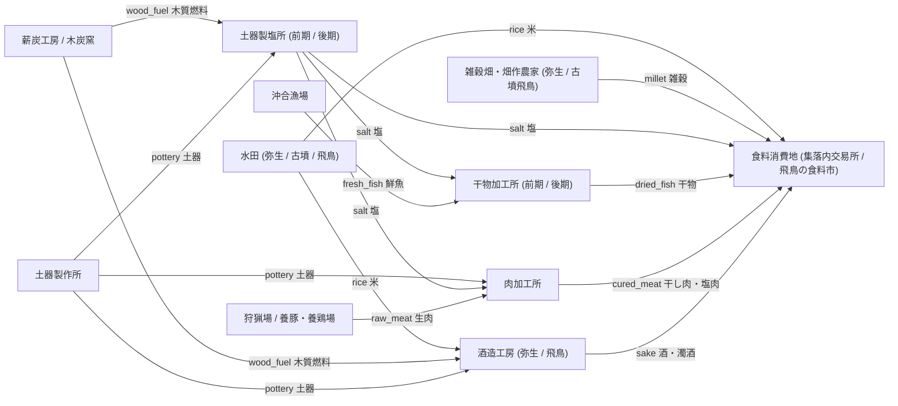
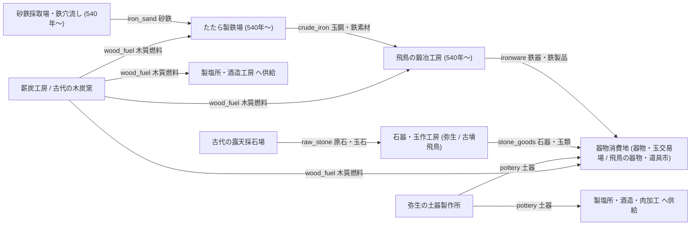

# Simutrans 日本歴史アドオンパック 古代産業・貨物チェーンまとめ

> **対象期間**: 弥生時代（1年〜）〜古墳時代〜飛鳥・奈良・平安（〜1600年まで段階的に移行）  
> **対象貨物**: 弥生6種（[yayoi_goods.dat](goods/yayoi_goods.dat)）＋ 古代追加9種（[ancient_goods.dat](goods/ancient_goods.dat)）＝ 計15種（すべて `catg=1` 混載貨物）  
> **登録総数**: 産業施設 30種 / 畑・水田フィールド 44クラス（[parameters.xlsx](Industries/parameters.xlsx)）

---

## 1. 全体構成と Phase 1〜4 改修・実装まとめ

1. **Phase 1（基盤貨物9種定義・既存弥生産業11種リメイク）**
   - [ancient_goods.dat](goods/ancient_goods.dat) に新規貨物9種（`millet`, `sake`, `raw_stone`, `stone_goods`, `raw_meat`, `cured_meat`, `iron_sand`, `crude_iron`, `ironware`）を追加し、[ja.tab](text/ja.tab)・[en.tab](text/en.tab) に日英翻訳を登録。
   - 既存弥生産業11種（`Yayoi_Saltworks` / `Yayoi_Late_Saltworks`, `Yayoi_Dried_Fish_Factory` / `Late`, `Yayoi_Wood_Fuel` / `Late`, `Yayoi_Doki_Factory`, `Yayoi_Trading_Post` / `Late`, `Yayoi_Suiden_Factory`, `Yayoi_Fishing_Ground`）の不要な木板ベースや全面タイル床を撤去し、`needs_ground=1`＋有機的地面パッチ・2季節積雪対応（`seasons=2`）へ全面リメイク。
   - 時代移行調整として `Yayoi_Suiden_*` の `retire_year=550`、`Yayoi_Late_Trading_Post` の `retire_year=650` へ更新。
2. **Phase 2（農業の時代移行・雑穀・酒造チェーン）**
   - 雑穀生産の `Yayoi_Millet_Farm`（`1..650`）と `Kofun_Asuka_Dryfield_Farm`（`400..1200`）を追加。
   - 水田を小区画（弥生）→ 2分割中区画（`Kofun_Suiden_Factory` `350..750`）→ 2分割条里水田（`Asuka_Suiden_Factory` `600..1200`）へ世代交代させ、5季節（春・夏・秋・冬枯れ・積雪）×4回転の新規フィールド32クラスを追加。
   - 醸造施設 `Yayoi_Sake_Brewery`（`1..650`）および `Asuka_Sake_Brewery`（`600..1200`）を追加。
3. **Phase 3（酒の3原料化・石器玉作・狩猟畜産肉加工・器物交易場分離）**
   - 酒造工房を3原料化（`rice + wood_fuel + pottery → sake`）し、`sake` 基本価格を `400` に調整。
   - 石器・玉作チェーン（`Ancient_Stone_Quarry` → `Yayoi_Stone_Jade_Workshop` / `Kofun_Jade_Workshop`）を追加。
   - 肉類チェーン（`Ancient_Hunting_Ground` / `Yayoi_Livestock_Farm` → `Ancient_Meat_Curing_Workshop`）を追加。
   - 市街地消費地（`city`）を**食料系**（`Yayoi_Trading_Post` / `Late`：米・雑穀・塩・干物・干し肉・酒）と**器物・道具系**（`Yayoi_Craft_Market` `1..650`：土器・石器玉類・木質燃料・鉄器）の2系統に分離。
4. **Phase 4（干し肉3原料化・たたら製鉄 `540年〜`・飛鳥2系統市）**
   - `Ancient_Meat_Curing_Workshop` に `pottery` を第3原料として追加（`raw_meat + salt + pottery → cured_meat`、`cured_meat` 基本価格 `290 → 340`）。
   - `Yayoi_Craft_Market` に `ironware` 消費枠を追加し、飛鳥の市登場（`595年`）前の `540..594年` の鉄器消費を確保。
   - たたら製鉄チェーン（`Ancient_Charcoal_Kiln` `500..1600`, `Ancient_Iron_Sand_Pit` `540..1600`, `Ancient_Tatara_Furnace` `540..1600`, `Asuka_Blacksmith_Factory` `540..1400`）と飛鳥2系統市場（`Asuka_Market_Food` / `Asuka_Market_Craft`, `595..1200`）を統合し、全4フェーズを完了。

---

## 2. 産業チェーン経路図

### 2-1. 食料・塩・醸造・水産・肉加工チェーン

### 2-2. 燃料・土器・石器玉作・たたら製鉄チェーン

---

## 3. 貨物一覧（全15種・すべて `catg=1`）

| ID | 日本語名 | 英語名 | 基本価格 (`value`) | 速度ボーナス | 重量 | マップ色 | 定義ファイル |
| :--- | :--- | :--- | :---: | :---: | :---: | :---: | :--- |
| `rice` | 米 | Rice | `180` | `5` | `100` | `215` | [yayoi_goods.dat](goods/yayoi_goods.dat) |
| `pottery` | 土器 | Pottery | `220` | `10` | `100` | `128` | [yayoi_goods.dat](goods/yayoi_goods.dat) |
| `wood_fuel` | 木質燃料 | Wood Fuel | `120` | `3` | `100` | `114` | [yayoi_goods.dat](goods/yayoi_goods.dat) |
| `salt` | 塩 | Salt | `260` | `8` | `100` | `213` | [yayoi_goods.dat](goods/yayoi_goods.dat) |
| `fresh_fish` | 鮮魚 | Fresh Fish | `200` | `15` | `100` | `148` | [yayoi_goods.dat](goods/yayoi_goods.dat) |
| `dried_fish` | 干物 | Dried Fish | `280` | `8` | `100` | `164` | [yayoi_goods.dat](goods/yayoi_goods.dat) |
| `millet` | 雑穀 | Millet | `150` | `5` | `100` | `199` | [ancient_goods.dat](goods/ancient_goods.dat) |
| `sake` | 酒・濁酒 | Ancient Sake | `400` | `10` | `100` | `210` | [ancient_goods.dat](goods/ancient_goods.dat) |
| `raw_stone` | 原石・玉石 | Raw Stone | `160` | `3` | `100` | `119` | [ancient_goods.dat](goods/ancient_goods.dat) |
| `stone_goods` | 石器・玉類 | Stone Tools & Jade | `300` | `8` | `100` | `94` | [ancient_goods.dat](goods/ancient_goods.dat) |
| `raw_meat` | 生肉・獣肉 | Raw Meat | `210` | `15` | `100` | `135` | [ancient_goods.dat](goods/ancient_goods.dat) |
| `cured_meat` | 干し肉・塩肉 | Cured Meat | `340` | `8` | `100` | `124` | [ancient_goods.dat](goods/ancient_goods.dat) |
| `iron_sand` | 砂鉄 | Iron Sand | `170` | `3` | `100` | `56` | [ancient_goods.dat](goods/ancient_goods.dat) |
| `crude_iron` | 玉鋼・鉄素材 | Crude Iron | `320` | `5` | `100` | `68` | [ancient_goods.dat](goods/ancient_goods.dat) |
| `ironware` | 鉄器・鉄製品 | Ironware | `420` | `8` | `100` | `76` | [ancient_goods.dat](goods/ancient_goods.dat) |

---

## 4. 産業施設一覧（全30工場）＆ フィールド一覧（全44クラス）

### 4-1. 一次生産（農林・採掘・水産・畜産：14施設）

| 内部名 (`name`) | 日本語名 | 出現〜引退 | 立地 | Lv | Prod / Range | 生産 (`output`) | 付属フィールド |
| :--- | :--- | :---: | :---: | :---: | :---: | :--- | :--- |
| `Yayoi_Suiden_Factory` | 水田 (弥生の集落水田) | `1..550` | `Land` | `2` | `30 / 20` | `rice` (cap `120`) | 3種×4回転 = 12 |
| `Kofun_Suiden_Factory` | 古墳時代の農家・中区画水田 | `350..750` | `Land` | `3` | `36 / 22` | `rice` (cap `160`) | 2種×4回転 = 8 |
| `Asuka_Suiden_Factory` | 飛鳥時代の農家・条里水田 | `600..1200` | `Land` | `4` | `45 / 25` | `rice` (cap `200`) | 2種×4回転 = 8 |
| `Yayoi_Millet_Farm` | 弥生の雑穀畑 | `1..650` | `Land` | `2` | `25 / 20` | `millet` (cap `120`) | 2種×4回転 = 8 |
| `Kofun_Asuka_Dryfield_Farm` | 古墳〜飛鳥の畑作農家 | `400..1200` | `Land` | `3` | `34 / 22` | `millet` (cap `160`) | 2種×4回転 = 8 |
| `Yayoi_Doki_Factory` | 弥生の土器製作所 | `1..1200` | `Land` | `2` | `20 / 20` | `pottery` (cap `120`) | — |
| `Yayoi_Wood_Fuel` | 弥生の薪炭工房 (木質燃料) | `1..400` | `Land` | `2` | `25 / 20` | `wood_fuel` (cap `150`) | — |
| `Yayoi_Late_Wood_Fuel` | 弥生後期〜古墳の薪炭工房 | `150..800` | `Land` | `3` | `30 / 22` | `wood_fuel` (cap `180`) | — |
| `Ancient_Charcoal_Kiln` | 古代の木炭窯 | `500..1600` | `Land` | `3` | `30 / 22` | `wood_fuel` (cap `200`) | — |
| `Yayoi_Fishing_Ground` | 弥生の沖合漁場 | `1..1200` | `water` | `2` | `25 / 20` | `fresh_fish` (cap `150`) | — |
| `Ancient_Hunting_Ground` | 古代の狩猟場 | `1..1400` | `Land` | `2` | `22 / 20` | `raw_meat` (cap `120`) | — |
| `Yayoi_Livestock_Farm` | 弥生〜古墳の養豚・養鶏場 | `1..680` | `Land` | `2` | `26 / 20` | `raw_meat` (cap `140`) | — |
| `Ancient_Stone_Quarry` | 古代の露天採石・原石採取場 | `1..900` | `Land` | `2` | `26 / 20` | `raw_stone` (cap `140`) | — |
| `Ancient_Iron_Sand_Pit` | 砂鉄採取場（鉄穴流し） | `540..1600` | `Land` | `2` | `28 / 20` | `iron_sand` (cap `140`) | — |

### 4-2. 加工・製造（2次/3次工場：11施設）

| 内部名 (`name`) | 日本語名 | 出現〜引退 | 立地 | Lv | Prod / Range | 入力原料 (`inputgood`: `factor%`, `cap`) | 出力 (`output`) |
| :--- | :--- | :---: | :---: | :---: | :---: | :--- | :--- |
| `Yayoi_Saltworks` | 弥生の土器製塩所 | `1..400` | `shore` | `2` | `22 / 20` | `wood_fuel` (`100`, `120`), `pottery` (`50`, `80`) | `salt` (`100`, `140`) |
| `Yayoi_Late_Saltworks` | 弥生後期〜古墳の土器製塩所 | `150..800` | `shore` | `3` | `28 / 22` | `wood_fuel` (`100`, `150`), `pottery` (`50`, `100`) | `salt` (`100`, `160`) |
| `Yayoi_Dried_Fish_Factory` | 弥生の干物加工所 | `1..400` | `shore` | `2` | `22 / 20` | `fresh_fish` (`100`, `120`), `salt` (`50`, `80`) | `dried_fish` (`100`, `120`) |
| `Yayoi_Late_Dried_Fish_Factory` | 弥生後期〜古墳の干物加工所 | `150..800` | `shore` | `3` | `28 / 22` | `fresh_fish` (`100`, `150`), `salt` (`50`, `100`) | `dried_fish` (`100`, `150`) |
| `Ancient_Meat_Curing_Workshop` | 古代の干し肉・塩肉加工所 | `1..1200` | `Land` | `2` | `24 / 20` | `raw_meat` (`100`, `120`), `salt` (`50`, `80`), `pottery` (`40`, `60`) | `cured_meat` (`100`, `120`) |
| `Yayoi_Sake_Brewery` | 弥生〜古墳の酒造工房 | `1..650` | `Land` | `2` | `20 / 20` | `rice` (`100`, `120`), `wood_fuel` (`50`, `80`), `pottery` (`40`, `60`) | `sake` (`100`, `100`) |
| `Asuka_Sake_Brewery` | 飛鳥・古代の造酒工房 | `600..1200` | `Land` | `3` | `28 / 22` | `rice` (`100`, `160`), `wood_fuel` (`50`, `100`), `pottery` (`40`, `80`) | `sake` (`100`, `140`) |
| `Yayoi_Stone_Jade_Workshop` | 弥生の石器・玉作工房 | `1..450` | `Land` | `2` | `22 / 20` | `raw_stone` (`100`, `100`) | `stone_goods` (`100`, `100`) |
| `Kofun_Jade_Workshop` | 古墳〜飛鳥の玉作・石細工工房 | `350..850` | `Land` | `3` | `30 / 22` | `raw_stone` (`100`, `140`) | `stone_goods` (`100`, `140`) |
| `Ancient_Tatara_Furnace` | たたら製鉄場 | `540..1600` | `Land` | `3` | `28 / 22` | `iron_sand` (`100`, `120`), `wood_fuel` (`120`, `140`) | `crude_iron` (`100`, `120`) |
| `Asuka_Blacksmith_Factory` | 飛鳥の鍛冶工房 | `540..1400` | `Land` | `3` | `28 / 22` | `crude_iron` (`100`, `120`), `wood_fuel` (`80`, `100`) | `ironware` (`100`, `120`) |

### 4-3. 市街地消費地（`city`：5施設）

| 系統 | 内部名 (`name`) | 日本語名 | 出現〜引退 | Lv | Prod / Range | 受入品目 (`factor%`, `cap`) |
| :--- | :--- | :--- | :---: | :---: | :---: | :--- |
| 食料 | `Yayoi_Trading_Post` | 弥生の集落内交易所 | `1..400` | `3` | `25 / 20` | `rice`(100,150), `millet`(100,120), `salt`(80,100), `dried_fish`(80,100), `cured_meat`(80,100), `sake`(60,80) |
| 食料 | `Yayoi_Late_Trading_Post` | 弥生後期〜古墳の集落内交易所 | `150..650` | `4` | `30 / 22` | `rice`(100,180), `millet`(100,150), `salt`(80,120), `dried_fish`(80,120), `cured_meat`(80,120), `sake`(60,100) |
| 食料 | `Asuka_Market_Food` | 飛鳥の食料市 | `595..1200` | `4` | `32 / 24` | `rice`(100,200), `millet`(100,160), `salt`(80,140), `dried_fish`(80,140), `cured_meat`(80,140), `sake`(60,120) |
| 器物 | `Yayoi_Craft_Market` | 弥生〜古墳の器物・玉交易場 | `1..650` | `3` | `26 / 20` | `pottery`(100,120), `stone_goods`(90,100), `wood_fuel`(60,100), `ironware`(70,80) |
| 器物 | `Asuka_Market_Craft` | 飛鳥の器物・道具市 | `595..1200` | `4` | `32 / 24` | `pottery`(90,140), `stone_goods`(80,120), `ironware`(100,140), `wood_fuel`(60,120) |

### 4-4. フィールド一覧（合計 44クラス：各4回転 `_R0.._R3`）

| ベース名 | 親工場 | 出現〜引退 | クラス数 | 特徴・季節（5季節・すべて積雪対応） | 定義ディレクトリ |
| :--- | :--- | :---: | :---: | :--- | :--- |
| `Yayoi_Suiden_1..3` | `Yayoi_Suiden_Factory` | `1..550` | `12` | 小区画水田3種 | [yayoi_suiden](Industries/yayoi_suiden/yayoi_suiden_all.datt) |
| `Yayoi_Millet_Field_1..2` | `Yayoi_Millet_Farm` | `1..650` | `8` | 弥生の雑穀畑2種 | [yayoi_millet_farm](Industries/yayoi_millet_farm/yayoi_millet_farm.datt) |
| `Kofun_Suiden_Field_1..2` | `Kofun_Suiden_Factory` | `350..750` | `8` | 2分割中区画水田2種 | [kofun_suiden](Industries/kofun_suiden/kofun_suiden.datt) |
| `Kofun_Dryfield_1..2` | `Kofun_Asuka_Dryfield_Farm` | `400..1200` | `8` | 畝整備畑2種 | [kofun_asuka_dryfield](Industries/kofun_asuka_dryfield/kofun_asuka_dryfield.datt) |
| `Asuka_Suiden_Field_1..2` | `Asuka_Suiden_Factory` | `600..1200` | `8` | 2分割条里水田2種 | [asuka_suiden](Industries/asuka_suiden/asuka_suiden.datt) |

---

## 5. 時代別タイムライン（世代交代・産業解放の流れ）

| 時代（年） | 主な解放・世代交代イベント |
| :--- | :--- |
| **1年〜**（弥生前期） | 水田・雑穀畑・土器・薪炭・製塩・漁場・干物・狩猟・養豚養鶏・肉加工・採石・石器玉作・酒造・集落内交易所・器物交易場 が稼働 |
| **150年〜**（弥生後期） | 後期の大型拠点（薪炭・製塩・干物・後期交易所 `150..650`）が追加 |
| **350〜400年〜**（古墳） | `350年`: `Kofun_Suiden_Factory`（中区画水田）・`Kofun_Jade_Workshop` 解放 / `400年`: `Kofun_Asuka_Dryfield_Farm` 解放・弥生前期工房群（薪炭/製塩/干物/交易所）引退 |
| **450〜550年〜**（古墳後期） | `450年`: `Yayoi_Stone_Jade_Workshop` 引退 / `500年`: `Ancient_Charcoal_Kiln` 解放 / `540年`: **たたら製鉄チェーン**（砂鉄採取場・たたら製鉄場・鍛冶工房）解放 / `550年`: 弥生水田引退 |
| **595〜680年〜**（飛鳥） | `595年`: `Asuka_Market_Food` / `Asuka_Market_Craft` 解放 / `600年`: `Asuka_Suiden_Factory`（条里水田）・`Asuka_Sake_Brewery` 解放 / `650..680年`: 弥生雑穀畑・弥生酒造・後期交易所・器物交易場・養豚養鶏場 引退 |
| **750〜1600年**（奈良〜近世接続） | 古墳中区画水田 (`750`)・古墳玉作 (`850`)・採石場 (`900`) 等が順次引退し、木炭窯・たたら製鉄 (`1600`) が近世まで継続 |
